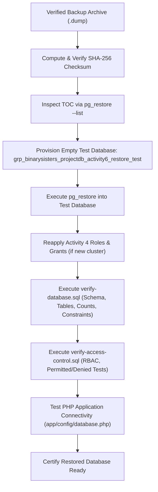

# Database Backup, Restoration, and Recovery Plan
## COMP 018 — Database Administration | Activity 6
### Assigned Project: Restaurant Online Ordering & Table Reservation System (Group: Binary Sisters)

---

## A. Database Information

| Specification Parameter | Detail / Value | Source / Evidence |
|---|---|---|
| **Project Name** | Restaurant Online Ordering & Table Reservation System | `README.md` |
| **Assigned Group** | Binary Sisters | `README.md`, `docs/progress/` |
| **Repository URL** | `https://github.com/kathlenmaecallos11-arch/Restaurant-Online-Ordering-Table-Reservation-System` | Assigned Project Specification |
| **Database Management System (DBMS)** | PostgreSQL 18 (Client / Server: PostgreSQL 18.6 x64 on Windows; scripts compatible with PostgreSQL 14+) | `psql --version`, `docs/database-documentation.md` |
| **Primary Database Name** | `grp_binarysisters_projectdb` | `database/migrations/000_create_database.sql`, `.env.example` |
| **Database Owner** | `postgres` | `database/migrations/000_create_database.sql` |
| **Target Schema** | `public` | Default PostgreSQL relational namespace |
| **Isolated Test Database Name** | `grp_binarysisters_projectdb_activity6_restore_test` | Phase 6 Restoration Specification |
| **Backend Technology Stack** | PHP 8.1+ (Native PDO with PostgreSQL driver, prepared statements, lightweight custom router) | `app/config/database.php`, `README.md` |
| **Frontend Technology Stack** | Responsive HTML5, Modern CSS (`app/public/assets/style.css`), Vanilla JavaScript | `preview/`, `app/public/` |

### Core Relational Schema and Objects Included
The primary database `grp_binarysisters_projectdb` consists of eight interrelated tables within the `public` schema, structured in strict Third Normal Form (3NF):

1. **`customer`** (51 baseline seed records):
   - Columns: `customer_id` (SERIAL, PK), `first_name` (VARCHAR(50), NN), `last_name` (VARCHAR(50), NN), `email` (VARCHAR(100), NN, UQ), `phone` (VARCHAR(20), NN), `password` (VARCHAR(255), NN — bcrypt hash), `created_at` (TIMESTAMP, NN, DEFAULT now()).
   - Constraints: Primary key `customer_pkey`, Unique `uq_customer_email`, Check `chk_customer_email` (regex pattern: `^[^@[:space:]]+@[^@[:space:]]+\.[^@[:space:]]+$`).

2. **`menu_item`** (50 baseline seed records):
   - Columns: `menu_item_id` (SERIAL, PK), `item_name` (VARCHAR(100), NN), `description` (TEXT, NULL), `category` (VARCHAR(50), NN), `price` (NUMERIC(10,2), NN), `availability` (BOOLEAN, NN, DEFAULT true).
   - Constraints: Primary key `menu_item_pkey`, Check `chk_menu_item_price` (`price >= 0`).

3. **`restaurant_table`** (20 baseline seed records):
   - Columns: `table_id` (SERIAL, PK), `table_number` (INTEGER, NN, UQ), `capacity` (INTEGER, NN), `status` (VARCHAR(20), NN, DEFAULT 'available').
   - Constraints: Primary key `restaurant_table_pkey`, Unique `uq_restaurant_table_number`, Check `chk_restaurant_table_capacity` (`capacity > 0`), Check `chk_restaurant_table_status` (`status IN ('available', 'occupied', 'reserved', 'out_of_service')`).

4. **`staff`** (10 baseline seed records):
   - Columns: `staff_id` (SERIAL, PK), `first_name` (VARCHAR(50), NN), `last_name` (VARCHAR(50), NN), `email` (VARCHAR(100), NN, UQ), `role` (VARCHAR(30), NN), `password` (VARCHAR(255), NN — bcrypt hash).
   - Constraints: Primary key `staff_pkey`, Unique `uq_staff_email`, Check `chk_staff_role` (`role IN ('admin', 'staff')`).

5. **`orders`** (60 baseline seed records):
   - Columns: `order_id` (SERIAL, PK), `customer_id` (INTEGER, NN, FK), `order_date` (TIMESTAMP, NN, DEFAULT now()), `order_status` (VARCHAR(20), NN, DEFAULT 'pending'), `total_amount` (NUMERIC(10,2), NN, DEFAULT 0).
   - Constraints: Primary key `orders_pkey`, Foreign key `fk_orders_customer` (references `customer(customer_id)` ON UPDATE CASCADE ON DELETE RESTRICT), Check `chk_orders_status` (`order_status IN ('pending', 'confirmed', 'preparing', 'ready', 'completed', 'cancelled')`), Check `chk_orders_total` (`total_amount >= 0`).

6. **`order_item`** (167 baseline seed records):
   - Columns: `order_id` (INTEGER, NN, FK), `menu_item_id` (INTEGER, NN, FK), `quantity` (INTEGER, NN), `unit_price` (NUMERIC(10,2), NN), `subtotal` (NUMERIC(10,2), NN).
   - Constraints: Composite Primary key `pk_order_item` (`(order_id, menu_item_id)`), Foreign key `fk_order_item_order` (references `orders(order_id)` ON UPDATE CASCADE ON DELETE CASCADE), Foreign key `fk_order_item_menu_item` (references `menu_item(menu_item_id)` ON UPDATE CASCADE ON DELETE RESTRICT), Check `chk_order_item_quantity` (`quantity > 0`), Check `chk_order_item_unit_price` (`unit_price >= 0`), Check `chk_order_item_subtotal` (`subtotal >= 0`), Check `chk_order_item_math` (`subtotal = quantity * unit_price`).

7. **`reservation`** (50 baseline seed records):
   - Columns: `reservation_id` (SERIAL, PK), `customer_id` (INTEGER, NN, FK), `table_id` (INTEGER, NN, FK), `reservation_date` (DATE, NN), `reservation_time` (TIME, NN), `number_of_guests` (INTEGER, NN), `reservation_status` (VARCHAR(20), NN, DEFAULT 'confirmed').
   - Constraints: Primary key `reservation_pkey`, Foreign key `fk_reservation_customer` (references `customer(customer_id)` ON UPDATE CASCADE ON DELETE RESTRICT), Foreign key `fk_reservation_table` (references `restaurant_table(table_id)` ON UPDATE CASCADE ON DELETE RESTRICT), Check `chk_reservation_guests` (`number_of_guests > 0`), Check `chk_reservation_status` (`reservation_status IN ('pending', 'confirmed', 'seated', 'completed', 'cancelled', 'no_show')`).
   - Exclusion Constraint: `ex_reservation_no_overlap` (`EXCLUDE USING gist (table_id WITH =, (tsrange(reservation_date + reservation_time, reservation_date + reservation_time + interval '2 hours')) WITH &&) WHERE (reservation_status IN ('pending', 'confirmed', 'seated'))`). Requires extension `btree_gist`.

8. **`payment`** (56 baseline seed records):
   - Columns: `payment_id` (SERIAL, PK), `order_id` (INTEGER, NN, FK, UQ), `payment_date` (TIMESTAMP, NN, DEFAULT now()), `payment_method` (VARCHAR(30), NN), `amount` (NUMERIC(10,2), NN), `payment_status` (VARCHAR(20), NN, DEFAULT 'pending').
   - Constraints: Primary key `payment_pkey`, Unique `uq_payment_order` (enforces 1:1 order-payment relationship), Foreign key `fk_payment_order` (references `orders(order_id)` ON UPDATE CASCADE ON DELETE RESTRICT), Check `chk_payment_amount` (`amount >= 0`), Check `chk_payment_method` (`payment_method IN ('cash', 'card', 'gcash', 'bank_transfer')`), Check `chk_payment_status` (`payment_status IN ('pending', 'paid', 'failed', 'refunded', 'cancelled')`).

### Secondary Indexes
From `database/migrations/004_indexes.sql`:
- `idx_orders_customer_date` on `orders (customer_id, order_date DESC)`
- `idx_orders_status` on `orders (order_status)`
- `idx_order_item_menu_item` on `order_item (menu_item_id)`
- `idx_reservation_customer` on `reservation (customer_id, reservation_date)`
- `idx_reservation_date` on `reservation (reservation_date)`
- `idx_menu_item_category` on `menu_item (category)`

### Views
From `database/migrations/003_views.sql`:
- `v_customer_directory` (sanitized customer contact listing without password hash)
- `v_staff_directory` (staff listing without password hash)
- `v_order_summary` (order header, customer name, total amount, item count, payment details)
- `v_reservation_schedule` (reservation schedule joined with table and customer details)

### Stored Procedures / Triggers
From `database/migrations/002_integrity_logic.sql`:
- `fn_refresh_order_total()` + Trigger `trg_order_item_total` on `order_item` (maintains `orders.total_amount` dynamically).
- `fn_require_order_items()` + Constraint Triggers `trg_orders_require_items` on `orders` and `trg_order_item_keep_one` on `order_item` (enforces BR9: every order must contain $\ge 1$ item, deferred to transaction `COMMIT`).
- `fn_check_reservation_capacity()` + Trigger `trg_reservation_capacity` on `reservation` (ensures `number_of_guests <= restaurant_table.capacity`).

### Activity 4 Access-Control Configuration
From `database/roles/01_create_roles.sql` and `02_grants.sql`:
- **Group Roles (NOLOGIN):**
  - `rors_runtime_grp`: Granted DML on customer, orders, payment, menu_item, restaurant_table, reservation, staff, order_item, sequences, and reporting views.
  - `rors_readonly_grp`: Granted SELECT on menu_item, restaurant_table, orders, order_item, reservation, payment, and sanitized views. Password hashes in base customer and staff tables are strictly withheld.
  - `rors_maint_grp`: Routine maintenance and performance monitoring (`pg_monitor`, `pg_maintain`). Zero access to customer or business data.
  - `rors_backup_grp`: Dedicated backup operator role; inherits built-in PostgreSQL role `pg_read_all_data` granting cluster-wide read-only access for `pg_dump`. Zero DML mutation rights.
  - `rors_admin_grp`: Day-to-day schema administration; `ALL ON ALL TABLES/SEQUENCES IN SCHEMA public`, `CREATE ON SCHEMA public`, `pg_monitor`.
- **Login Roles (LOGIN):**
  - `rors_app` (member of `rors_runtime_grp`, connection limit 20, statement timeout 30s)
  - `rors_report` (member of `rors_readonly_grp`, connection limit 5, statement timeout 60s)
  - `rors_maint` (member of `rors_maint_grp`, connection limit 3)
  - `rors_backup` (member of `rors_backup_grp`, connection limit 2)
  - `rors_dba` (member of `rors_admin_grp`, connection limit 3)

---

## B. Backup Method

### Selected Backup Methodology
- **Utility:** PostgreSQL native logical backup utility `pg_dump`
- **Format:** PostgreSQL Custom Archive Format (`-Fc` / `--format=custom`)
- **Command Template:**
  ```bash
  pg_dump -h localhost -p 5432 -U rors_backup -Fc -b -v -d grp_binarysisters_projectdb -f <destination_path>.dump
  ```

### Technical Rationale for Custom Archive Format (`-Fc`)
1. **Integrated zlib Compression:** The custom archive format applies block-level compression automatically, reducing archive file size by 70–85% compared to plain-text SQL files.
2. **Internal Table of Contents (TOC):** Embeds a serialized metadata catalog containing every archived object, its schema, type, dependencies, and byte offsets.
3. **Non-Destructive Metadata Inspection:** Allows immediate verification of archive contents using `pg_restore --list` without restoring or writing to any database.
4. **Flexible and Selective Restoration:** Enables restoring the entire database, selective schemas, individual tables, or data-only/schema-only slices using `pg_restore`.
5. **Topological Dependency Ordering:** `pg_restore` automatically evaluates the relational dependency graph, ensuring tables are created before indexes and foreign key constraints are applied only after data is loaded.

### What Database Objects and Data Are Included
- Database schema (`public`) and extensions (`btree_gist`, `pgcrypto`).
- All 8 tables and their column definitions.
- All table data rows (51 customers, 10 staff, 50 menu items, 20 tables, 60 orders, 167 order items, 56 payments, 50 reservations).
- Primary keys, foreign keys, unique constraints, and check constraints.
- Sequences and their current sequence generator values (`last_value`, `is_called`).
- Secondary performance indexes and GiST exclusion constraints.
- Views (`v_customer_directory`, `v_staff_directory`, `v_order_summary`, `v_reservation_schedule`).
- PL/pgSQL stored functions and database triggers.
- Object-level privileges (`GRANT` / `REVOKE` statements) within the database.

### What Is NOT Included Automatically (Cluster-Wide Scope)
In PostgreSQL architecture, the following objects are **cluster-wide (instance-level)** and reside in the shared system catalogs (`pg_authid`, `pg_database`, `pg_tablespace`):
- PostgreSQL login and group roles (`rors_app`, `rors_report`, `rors_maint`, `rors_backup`, `rors_dba`, `rors_runtime_grp`, etc.).
- Role passwords, connection limits, and role-level configuration parameters (`statement_timeout`, `idle_in_transaction_session_timeout`).
- Database-level `CONNECT` grants on `grp_binarysisters_projectdb`.

**Required Procedure for Fresh Server Re-creation:**
When restoring onto a completely new PostgreSQL instance, cluster roles must be pre-created prior to running `pg_restore`. This is accomplished by running the Activity 4 DDL script `database/roles/01_create_roles.sql` as superuser `postgres` or by exporting cluster globals using:
```bash
pg_dumpall -h localhost -p 5432 -U postgres --globals-only -f cluster_roles_globals.sql
```

### How the Backup Is Inspected
Before executing any restoration, the archive TOC is parsed:
```bash
pg_restore --list grp_binarysisters_projectdb_activity6.dump > logs/archive-toc.txt
```
This produces a complete listing of all items, verifying that tables, constraints, triggers, and data rows are present and uncorrupted.

### How the Backup Is Restored
Restoration is conducted exclusively into an isolated test database using `pg_restore`:
```bash
pg_restore -h localhost -p 5432 -U postgres -v -d grp_binarysisters_projectdb_activity6_restore_test grp_binarysisters_projectdb_activity6.dump
```

---

## C. Backup Security and Storage

### Protected Backup Storage Location
- **Local Directory:** `db-backup-recovery/restaurant-online-ordering/backups/` (or designated external mount `/var/backups/postgresql/` in Linux environments).
- **Physical Segregation:** Backup files must be stored on a dedicated physical or virtual drive separate from the PostgreSQL data directory (`PGDATA`) to prevent simultaneous loss in the event of drive hardware failure.
- **Git Repository Exclusion:** The root `.gitignore` strictly prohibits committing `*.dump`, `*.tar`, `*.sql.gz`, `*.bak`, or `backups/`. Actual customer emails, phone numbers, and bcrypt password hashes must NEVER be pushed to GitHub.

### Authorized Backup Account and Principle of Least Privilege
- **Authorized Backup Role:** `rors_backup` (member of `rors_backup_grp`).
- **Privilege Grants:** The role is granted `pg_read_all_data` in PostgreSQL 14+, allowing `pg_dump` to perform read-only queries across all application tables and sequences.
- **Administrative Restriction:** The runtime account `rors_app` and reporting account `rors_report` MUST NOT be used for administrative backups. `rors_backup` possesses zero DML mutation rights (`INSERT`, `UPDATE`, `DELETE`, `TRUNCATE`) and zero DDL rights (`DROP`, `ALTER`), preventing accidental data tampering during backup execution.

### Credential Protection
- **Zero Hardcoded Passwords:** Scripts must never contain plaintext passwords.
- **Interactive Secure Prompts:** Scripts prompt interactively using `Read-Host -AsSecureString` (PowerShell) or `read -s` (Bash).
- **Automated Environments:** In unattended server environments, authentication is managed via a protected `~/.pgpass` or `%APPDATA%\postgresql\pgpass.conf` file with strict file permissions (`0600` / read-only by the service owner).

### Backup Integrity Verification
- Immediately following archive creation, a cryptographic SHA-256 hash is computed and stored alongside the archive in a companion `.sha256` file:
  ```powershell
  Get-FileHash -Path $backupFilepath -Algorithm SHA256
  ```
- Before any restoration drill, the checksum is re-verified to guarantee zero binary bitrot or transmission corruption.

---

## D. Backup Schedule and Retention

> [!NOTE]
> The backup schedule, retention policy, RPO, and RTO described below represent the **proposed operational standard** designed for the Restaurant Online Ordering and Table Reservation System in an enterprise production setting.

### Proposed Backup Schedule
- **Daily Full Logical Backup:** Executed every night at **02:00 AM Philippine Standard Time (PST)**.
  - *Rationale:* 02:00 AM is the restaurant's operational maintenance window (kitchen is closed, table reservation bookings are minimal, web traffic is at lowest diurnal baseline).
- **Continuous Write-Ahead Log (WAL) Archiving (Recommended Production Extension):** PostgreSQL WAL segments archived continuously every 15 minutes to an off-site object storage repository.

### Proposed Retention Strategy (Grandfather-Father-Son)
- **Daily Backups:** Retain for **7 days** (rolling 1-week recovery window).
- **Weekly Backups:** Retain for **4 weeks** (Sunday 02:00 AM snapshots).
- **Monthly Backups:** Retain for **12 months** (end-of-month snapshot for financial and sales audit compliance).
- **Annual Backups:** Retain for **3 years** for regulatory tax and business record compliance.

### Recovery Objectives: RPO and RTO

#### 1. Recovery Point Objective (RPO) = 24 Hours (Daily Logical Snapshot) / 15 Minutes (with WAL Archiving)
- **Definition:** RPO represents the maximum acceptable age of files or transactions that must be recovered from backup storage for normal operations to resume after a disaster. It defines the maximum data loss window tolerable by the business.
- **Reasonableness for this System:** Under the primary daily logical backup model, if a total storage crash occurs at 11:00 PM, the system can be restored to 02:00 AM of that day, resulting in a maximum data loss of 21 hours. For a dining establishment, lost orders placed earlier that day can be partially reconciled via physical receipt printer chits, GCash transaction IDs, and credit card gateway settlement batches. However, implementing WAL archiving reduces RPO to 15 minutes, preventing loss of active kitchen orders and online table bookings.
- **Impact of Data Loss Between Backups:** Unsaved reservations could result in double-booked tables, walk-in customer disputes, and kitchen order discrepancies.

#### 2. Recovery Time Objective (RTO) = 2 Hours
- **Definition:** RTO represents the maximum acceptable amount of elapsed clock time that a computer, system, network, or application can be down after a disaster, failure, or disruption before significant economic or reputational damage occurs.
- **Reasonableness for this System:** Technical restoration of `grp_binarysisters_projectdb` from a custom archive (`-Fc`) requires **under 3 minutes** on modern SSD hardware. The remaining 1 hour and 57 minutes of the 2-hour budget provide ample buffer for:
  1. Incident assessment, root cause isolation, and stakeholder notification (20 minutes).
  2. Operating system and PostgreSQL engine provisioning if physical hardware failed (45 minutes).
  3. Restoration execution and log verification (10 minutes).
  4. Execution of the `verify-restore.sql` and `verify-access-control.sql` audit suites (15 minutes).
  5. Application smoke testing and web server DNS cutover (25 minutes).

---

## E. Restoration Plan

### Step-by-Step Restoration Protocol



#### Step 1: Provision Separate Empty Test Database
Never restore over the live production database. Provision an isolated test instance:
```bash
createdb -h localhost -p 5432 -U postgres -O postgres grp_binarysisters_projectdb_activity6_restore_test
```

#### Step 2: Restore the Backup Archive
Execute `pg_restore` targeting the isolated database:
```bash
pg_restore -h localhost -p 5432 -U postgres -v -d grp_binarysisters_projectdb_activity6_restore_test grp_binarysisters_projectdb_activity6.dump
```
*Note on Flags:* Avoid `--no-owner` or `--no-acl` during standard restoration so that authentic table ownership (`postgres`) and Activity 4 permissions are reproduced faithfully.

#### Step 3: Reapply Activity 4 Roles (Cluster-Wide Provisioning)
If restoring on a new database server where roles do not exist, execute `database/roles/01_create_roles.sql` and `02_grants.sql` before or immediately after restoration.

#### Step 4: Verify Database Objects and Records
Run the SQL verification suite `scripts/verify-database.sql` to confirm:
- Presence of all 8 tables.
- Verification of baseline row counts: 51 customers, 10 staff, 50 menu items, 20 tables, 60 orders, 167 order items, 56 payments, 50 reservations.
- Validation that primary keys, foreign keys, unique constraints, and check constraints are active and enforced.
- Verification of secondary indexes, views, and exclusion constraints.

#### Step 5: Verify Access Control and Least Privilege
Run `scripts/verify-access-control.sql`:
- Confirm role memberships.
- Confirm table-level grants.
- Test 1 permitted operation (`rors_app` reading menu items and creating orders).
- Test denied operations (`rors_report` attempting INSERT or selecting password hashes; `rors_app` attempting DROP TABLE).

#### Step 6: Test Application Connectivity
Point a test configuration of the PHP application to the restored database:
```ini
DB_HOST=localhost
DB_PORT=5432
DB_NAME=grp_binarysisters_projectdb_activity6_restore_test
DB_USER=rors_app
DB_PASSWORD=<chosen_password>
```
Execute `php tools/test-connection.php` and open `http://localhost:8000/health` to verify that the application communicates cleanly without SQL errors.

#### Step 7: Restoration Error Handling Protocol
- **Missing Extensions Error:** If `btree_gist` or `pgcrypto` is missing, install the PostgreSQL contrib package and execute `CREATE EXTENSION btree_gist;` as superuser before restoring.
- **Role Ownership Mismatch Warnings:** If the executing user is not `postgres`, `pg_restore` will emit warnings when assigning table ownership. Ensure the database owner matches the archive owner.
- **Constraint Violation on Seed:** If restoring data over an existing populated database, foreign key violations will occur. Always restore into an entirely empty database.

