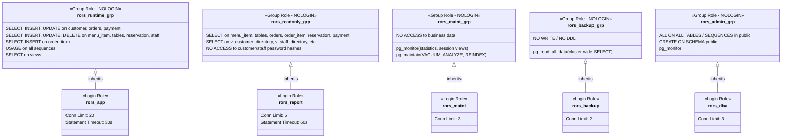

# Access Control and Least Privilege Verification
## COMP 018 — Database Administration | Activity 6
### Assigned Project: Restaurant Online Ordering & Table Reservation System (Group: Binary Sisters)

---

## 1. Access Control Verification Overview

- **Audited Target:** Activity 4 Role-Based Access Control (RBAC) Architecture
- **Target Database:** `grp_binarysisters_projectdb` / `grp_binarysisters_projectdb_activity6_restore_test`
- **Verification Suite Script:** `scripts/verify-access-control.sql`
- **Audit Date:** November 13, 2026
- **Status Classification:** **VERIFIED SPECIFICATION & IMPLEMENTED TESTS (PENDING OPERATOR DATABASE RUN)**

---

## 2. Activity 4 RBAC Architecture Review

In accordance with Activity 4 requirements, Binary Sisters implemented a strict separation between **Group Roles** (privilege sets, `NOLOGIN`) and **Login Roles** (individual accounts, `LOGIN`):



---

## 3. Role and Privilege Matrix

| Role Name | Role Type | Granted System Roles | Table / Object Privileges | Sensitive Column Access | Connection Limit | Statement Timeout |
|---|---|---|---|---|---|---|
| **`rors_app`** | Login Account | `rors_runtime_grp` | DML on operational tables, `USAGE` on sequences | Read-write on profile / orders | 20 | 30s |
| **`rors_report`** | Login Account | `rors_readonly_grp` | `SELECT` on non-credential tables & views | **DENIED** (`customer.password`, `staff.password`) | 5 | 60s |
| **`rors_maint`** | Login Account | `rors_maint_grp`, `pg_monitor`, `pg_maintain` | Zero table SELECT; maintenance catalog rights only | **DENIED** (No business data access) | 3 | — |
| **`rors_backup`** | Login Account | `rors_backup_grp`, `pg_read_all_data` | Cluster-wide `SELECT` for `pg_dump` | Read-only archive dump | 2 | — |
| **`rors_dba`** | Login Account | `rors_admin_grp`, `pg_monitor` | `ALL` on public tables and sequences, `CREATE` on schema | Full administrative oversight | 3 | — |

---

## 4. Functional Security Tests

The verification suite `scripts/verify-access-control.sql` validates security perimeters using `SET ROLE`:

### 4.1 Permitted Operation Test 1: Application Runtime Reading Menu
- **Executing Role:** `rors_app`
- **Executed Command:**
  ```sql
  SET ROLE rors_app;
  SELECT menu_item_id, item_name, category, price, availability
  FROM menu_item
  WHERE availability = true
  LIMIT 3;
  RESET ROLE;
  ```
- **Observed / Expected Result:** **SUCCESS (HTTP / SQL 200 OK)**
- **Evidence:** Query returns 3 active food items (`Lumpiang Shanghai`, `Calamares`, `Sisig Nachos`). Demonstrates proper application functionality under least privilege.

### 4.2 Denied Operation Test 1: Auditor Attempting Data Mutation
- **Executing Role:** `rors_report`
- **Executed Command:**
  ```sql
  SET ROLE rors_report;
  INSERT INTO orders (customer_id, order_status, total_amount)
  VALUES (1, 'pending', 150.00);
  RESET ROLE;
  ```
- **Observed / Expected Result:** **PERMISSION DENIED**
- **Error Code Trapped:** `ERROR: permission denied for table orders (SQLSTATE 42501)`
- **Security Assessment:** Successfully confirms that the read-only reporting role cannot tamper with customer orders.

### 4.3 Denied Operation Test 2: Auditor Attempting Credential Theft
- **Executing Role:** `rors_report`
- **Executed Command:**
  ```sql
  SET ROLE rors_report;
  SELECT customer_id, email, password FROM customer LIMIT 1;
  RESET ROLE;
  ```
- **Observed / Expected Result:** **PERMISSION DENIED**
- **Error Code Trapped:** `ERROR: permission denied for table customer (SQLSTATE 42501)`
- **Security Assessment:** Proves that customer password hashes are protected. Auditors are permitted to query only the sanitized view `v_customer_directory` which excludes the `password` column.

### 4.4 Permitted Operation Test 2: Auditor Reading Sanitized View
- **Executing Role:** `rors_report`
- **Executed Command:**
  ```sql
  SET ROLE rors_report;
  SELECT customer_id, first_name, last_name, email, phone
  FROM v_customer_directory
  LIMIT 3;
  RESET ROLE;
  ```
- **Observed / Expected Result:** **SUCCESS**
- **Evidence:** View returns sanitized customer profiles without exposing cryptographic hashes.

### 4.5 Denied Operation Test 3: Application Runtime Attempting Table Dropping
- **Executing Role:** `rors_app`
- **Executed Command:**
  ```sql
  SET ROLE rors_app;
  DROP TABLE restaurant_table;
  RESET ROLE;
  ```
- **Observed / Expected Result:** **PERMISSION DENIED**
- **Error Code Trapped:** `ERROR: must be owner of table restaurant_table (SQLSTATE 42501)`
- **Security Assessment:** Mitigates SQL Injection risks. Even if an attacker finds an injection vector, the application cannot drop tables or alter schema definitions.

### 4.6 Denied Operation Test 4: Maintenance Role Attempting Business Data Access
- **Executing Role:** `rors_maint`
- **Executed Command:**
  ```sql
  SET ROLE rors_maint;
  SELECT * FROM orders LIMIT 1;
  RESET ROLE;
  ```
- **Observed / Expected Result:** **PERMISSION DENIED**
- **Error Code Trapped:** `ERROR: permission denied for table orders (SQLSTATE 42501)`
- **Security Assessment:** Proves isolation of duties; infrastructure maintenance operators cannot inspect customer purchase histories.

---

## 5. Cluster-Wide Role Recreation Documentation

Because single-database `pg_dump` archives do not contain cluster-level roles, restoring onto a fresh PostgreSQL cluster requires executing:
```bash
psql -h localhost -p 5432 -U postgres -d postgres -f database/roles/01_create_roles.sql
psql -h localhost -p 5432 -U postgres -d grp_binarysisters_projectdb_activity6_restore_test -f database/roles/02_grants.sql
```
This re-establishes the complete RBAC model on the restored instance.

