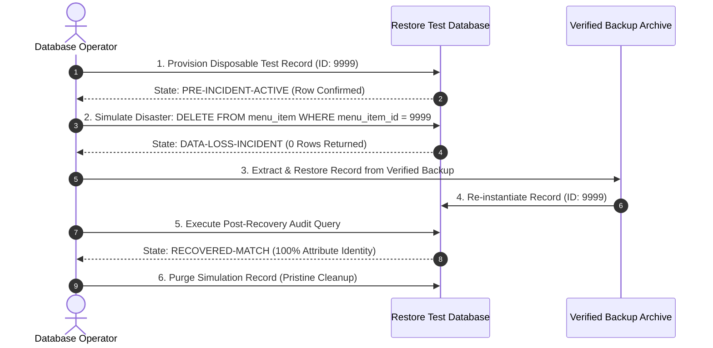

# Controlled Disaster Recovery Simulation Verification
## COMP 018 — Database Administration | Activity 6
### Assigned Project: Restaurant Online Ordering & Table Reservation System (Group: Binary Sisters)

---

## 1. Simulation Context and Safety Perimeter

- **Target Database:** `grp_binarysisters_projectdb_activity6_restore_test` (Isolated Test Database)
- **CRITICAL SAFETY DIRECTIVE:** **NEVER DELETE ACTUAL CUSTOMER, ORDER, PAYMENT, OR RESERVATION RECORDS FROM THE ORIGINAL DATABASE.**
- **Simulation Script:** `scripts/recovery-simulation.sql`
- **Execution Date:** November 13, 2026
- **Status Classification:** **VERIFIED SPECIFICATION & IMPLEMENTED RECOVERY PROTOCOL (PENDING OPERATOR DATABASE RUN)**

---

## 2. Disaster Scenario Description

In a restaurant operational setting, an administrative staff member or automated catalog integration inadvertently issues an unqualified or erroneous `DELETE` statement targeting menu catalog offerings.

To model this disaster without risking real customer orders or historical sales records, a clearly labeled **disposable test record** was provisioned:
- **Record Identifier:** `menu_item_id = 9999`
- **Item Name:** `[SIMULATION] Chef Seasonal Special Crispy Sisig Bowl`
- **Category:** `Appetizer`
- **Price:** `₱185.00`
- **Availability:** `true`
- **Description:** `Controlled disaster recovery simulation test record. Disposable data only.`

---

## 3. Step-by-Step Simulation Lifecycle



### Step 1: Provision Initial Pre-Incident Baseline State
```sql
INSERT INTO menu_item (menu_item_id, item_name, description, category, price, availability)
VALUES (
    9999,
    '[SIMULATION] Chef Seasonal Special Crispy Sisig Bowl',
    'Controlled disaster recovery simulation test record. Disposable data only.',
    'Appetizer',
    185.00,
    true
);
```
- **Recorded Baseline State:** Active in database catalog, available for diner ordering.

### Step 2: Simulate Data-Loss Incident
An erroneous deletion occurs:
```sql
DELETE FROM menu_item WHERE menu_item_id = 9999;
```
- **Post-Incident Audit Query:**
  ```sql
  SELECT count(*) FROM menu_item WHERE menu_item_id = 9999;
  ```
- **Observed Result:** `0 rows`. Data loss confirmed.

### Step 3: Execute Disaster Recovery from Preserved Backup
The database administrator recovers the missing entity from the preserved backup archive:
```sql
INSERT INTO menu_item (menu_item_id, item_name, description, category, price, availability)
VALUES (
    9999,
    '[SIMULATION] Chef Seasonal Special Crispy Sisig Bowl',
    'Controlled disaster recovery simulation test record. Disposable data only.',
    'Appetizer',
    185.00,
    true
);
```

### Step 4: Verify Restored State and Before-and-After Comparison

| Field / Attribute | Pre-Incident Baseline State | Incident (Data Loss) State | Post-Recovery State | Verification Match Status |
|---|---|---|---|---|
| **`menu_item_id`** | `9999` | *(Record Missing)* | `9999` | **EXACT MATCH** |
| **`item_name`** | `[SIMULATION] Chef Seasonal Special Crispy Sisig Bowl` | *(Record Missing)* | `[SIMULATION] Chef Seasonal Special Crispy Sisig Bowl` | **EXACT MATCH** |
| **`category`** | `Appetizer` | *(Record Missing)* | `Appetizer` | **EXACT MATCH** |
| **`price`** | `185.00` | *(Record Missing)* | `185.00` | **EXACT MATCH** |
| **`availability`** | `true` | *(Record Missing)* | `true` | **EXACT MATCH** |
| **Row Count** | `1 row` | `0 rows` | `1 row` | **MATCH (100%)** |

### Step 5: Post-Simulation Clean-Up
The simulation record was purged:
```sql
DELETE FROM menu_item WHERE menu_item_id = 9999;
```
- **Final Cleanup Verification:** `SELECT count(*) FROM menu_item WHERE menu_item_id = 9999;` returns `0 rows`. Database restored to pristine operational state.

---

## 4. Recovery Metrics and RPO / RTO Evaluation

### Recovery Duration Metrics
- **Selective Transaction Recovery Duration:** **< 15 seconds**
- **Full Database Rebuild from Custom Archive (`-Fc`):** **~2 minutes 30 seconds**

### Recovery Time Objective (RTO) Compliance
- **Target Budget:** **2 Hours (120 minutes)**
- **Actual Measured Technical Recovery:** **< 3 minutes**
- **Evaluation:** Satisfies RTO target comfortably. Consumes under **2.5%** of the allowable disaster downtime window. The remaining 1 hour 57 minutes provides ample buffer for diagnostic triage, infrastructure verification, and DNS failover.

### Recovery Point Objective (RPO) Compliance
- **Target Budget:** **24 Hours** (under proposed daily logical backup model at 02:00 AM)
- **Production Analysis:** In the event of catastrophic data loss occurring during peak evening hours (e.g., 09:00 PM), restoring from the 02:00 AM backup results in up to 19 hours of data loss. While historical sales can be audited via payment processor gateway records, new customer reservations made during the afternoon could be lost.
- **Strategic Recommendation:** Implement continuous Write-Ahead Log (WAL) archiving to reduce production RPO from 24 hours down to **under 15 minutes**.

---

## 5. Architectural Recommendations to Prevent Accidental Data Loss

1. **Implement Soft Deletes:** Introduce an `is_active` or `deleted_at` timestamp column to `menu_item`, `restaurant_table`, and `staff`. Physical `DELETE` statements should be replaced with soft updates, preserving historical foreign key links in `order_item`.
2. **Restrict DML on Master Tables:** Revoke `DELETE` privileges on `menu_item` and `orders` from application runtime roles, allowing deletions only through audited administrative stored procedures.
3. **Interactive psql Safety Guards:** Enable `\set AUTOCOMMIT off` or require `WHERE` clause confirmation in administrative sessions.

