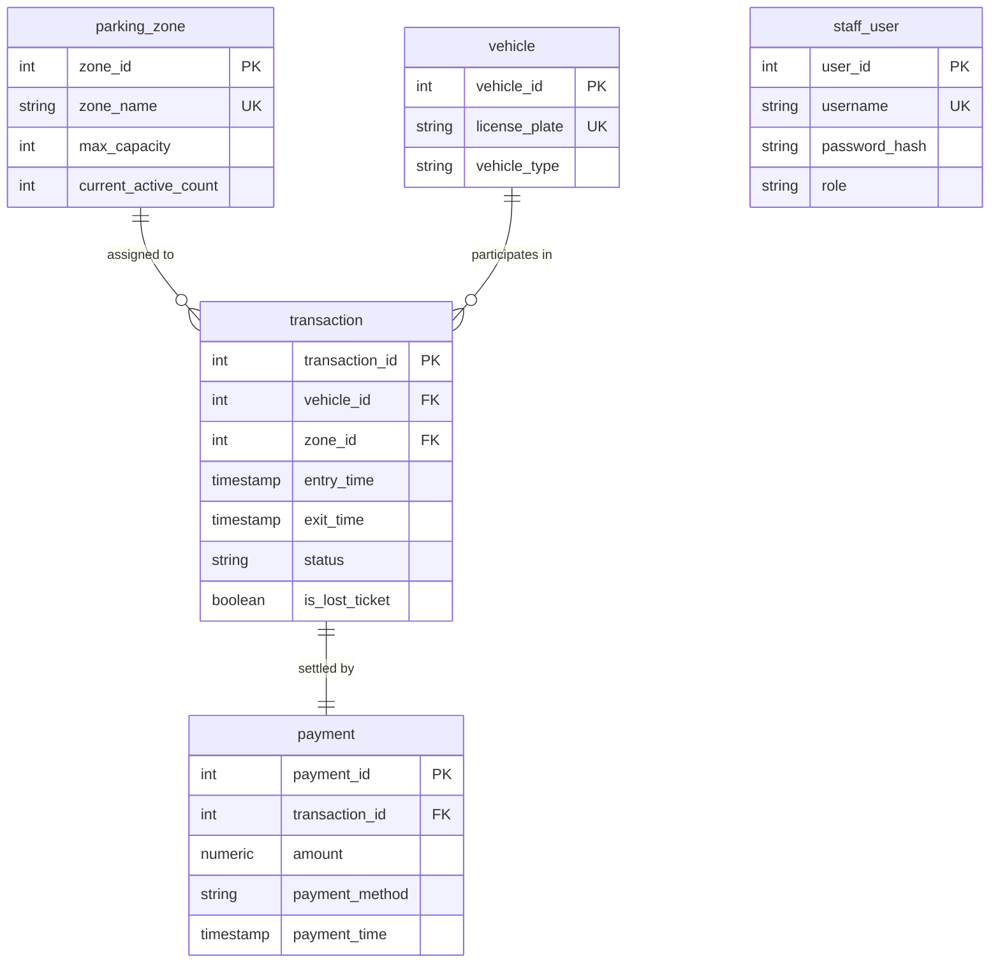

# Database Backup Plan
## COMP 018 — Database Administration (Activity 6)
### Project: Park-It Database Management System

---

## 1. Database Identification and Architecture Overview

| Parameter | Specification | Documentation Reference |
|---|---|---|
| **Database Name** | `grp_parkitdb` | `park-it/config/database.php` |
| **Database Management System** | PostgreSQL 18.6 (64-bit) | `park-it/schema.sql` (Line 7) |
| **Character Set & Collation** | `UTF8` / Standard Conforming Strings (`on`) | `park-it/schema.sql` (Line 16-17) |
| **Default Host & Port** | `localhost:5432` | `park-it/config/database.php` |
| **Default Schema** | `public` | `park-it/schema.sql` |
| **Application Layer** | PHP 8.x PDO, Apache (XAMPP), Vanilla JS / AJAX | `park-it/README.md` |
| **Current Live Application DB User** | `postgres` (Superuser) / `parkit_app` (RBAC) | `user-role.md` |

---

## 2. Inventory of Critical Database Objects to Back Up

The Park-It database contains five tightly-coupled relational tables, associated auto-increment sequences, primary keys, foreign key constraints, unique indexes, and business rule check constraints:



### Table & Object Breakdown:
1. **`public.parking_zone`**:
   - Stores parking zones, slot limits (`max_capacity = 50`), and real-time active vehicle counts (`current_active_count`).
   - Sequence: `parking_zone_zone_id_seq`.
   - Constraints: `parking_zone_pkey` (PK), `parking_zone_zone_name_key` (UNIQUE), `parking_zone_check` (`CHECK (current_active_count <= max_capacity)`).
2. **`public.vehicle`**:
   - Master registry of incoming vehicles (`Car` / `Motorcycle`) and license plates.
   - Sequence: `vehicle_vehicle_id_seq`.
   - Constraints: `vehicle_pkey` (PK), `vehicle_license_plate_key` (UNIQUE).
3. **`public.staff_user`**:
   - System user authentication credentials, bcrypt password hashes, and access tiers (`Admin`, `Staff`).
   - Sequence: `staff_user_user_id_seq`.
   - Constraints: `staff_user_pkey` (PK), `staff_user_username_key` (UNIQUE).
4. **`public.transaction`**:
   - Operational parking log recording vehicle entry time, exit time, status (`Active`, `Completed`), and lost ticket flag (`is_lost_ticket`).
   - Sequence: `transaction_transaction_id_seq`.
   - Constraints: `transaction_pkey` (PK), `transaction_vehicle_id_fkey` (FK -> `vehicle.vehicle_id`), `transaction_zone_id_fkey` (FK -> `parking_zone.zone_id`).
5. **`public.payment`**:
   - Financial audit trail recording fee assessments, lost ticket penalties (₱200 flat fee), payment method (Cash, GCash, Maya, Card), and payment timestamps.
   - Sequence: `payment_payment_id_seq`.
   - Constraints: `payment_pkey` (PK), `payment_transaction_id_key` (UNIQUE), `payment_transaction_id_fkey` (FK -> `transaction.transaction_id`), `payment_amount_check` (`CHECK (amount >= 0)`).

---

## 3. Backup Method and Technical Justification

### Selected Utility and Format:
- **Utility:** PostgreSQL Native Logical Dump Utility (`pg_dump`).
- **Archive Format:** PostgreSQL Custom Format (`-Fc` / `--format=custom`).

### Rationale and Justification:
1. **Built-in Compression:** The `-Fc` flag compresses data using zlib by default, minimizing disk space utilization while speeding up disk I/O.
2. **Table of Contents (TOC) Inspection:** Unlike plain text `.sql` dumps, custom-format dumps contain an internal binary TOC. This allows database administrators to inspect archive contents (`pg_restore --list`), verify object lists, and audit schemas without executing a restore.
3. **Flexible & Selective Restoration:** Using `pg_restore`, administrators can restore specific tables (e.g., restoring only `payment` for an audit), restore schema without data (`-s`), or restore data without schema (`-a`).
4. **Automatic Object Reordering:** Custom archives allow `pg_restore` to automatically order object recreation (tables, foreign keys, indexes, triggers), eliminating foreign-key ordering failures common in raw SQL scripts.
5. **Multi-threaded Restore Capability:** `pg_restore` supports parallel job execution (`-j <jobs>`) with custom archives, dramatically reducing recovery time (RTO).
6. **Classroom & Production Portability:** The custom archive is platform-independent across Windows and Linux PostgreSQL server instances.

---

## 4. PostgreSQL Backup Utility Syntax

### Classroom & Standard Backup Command:
```bash
pg_dump -U postgres -h localhost -p 5432 -Fc -b -v -d grp_parkitdb -f grp_parkitdb_activity6.dump
```

### Parameter Breakdown:
- `-U postgres`: Connects as the administrative superuser to ensure full read permissions on all catalogs, tables, and sequences.
- `-h localhost`: Specifies the database host address.
- `-p 5432`: Specifies the default PostgreSQL listening port.
- `-Fc`: Instructs `pg_dump` to output in custom archive format.
- `-b`: Includes large objects in the dump (standard best practice).
- `-v`: Enables verbose output mode to track progress and verify table exports.
- `-d grp_parkitdb`: Explicitly declares the target database name.
- `-f <output_file>`: Sets the target destination path and filename.

---

## 5. Backup Storage Location & Security

### Physical Storage Paths:
1. **Classroom / Local Workspace:**
   - Dedicated Directory: `db-backup-recovery/backups/`
   - **Isolation Requirement:** Backup files must **never** be placed inside web-accessible directories such as `C:\xampp\htdocs\park-it\`. Placing backup dumps in webroot allows external attackers to download entire databases directly via HTTP GET requests.
2. **Version Control Safety:**
   - All `.dump`, `.backup`, `.sql.gz`, and `.tar` files are explicitly excluded from GitHub via the project's root [`.gitignore`](file:///c:/Users/Lenovo/Downloads/G2_ParkIT/park-it-database/.gitignore).
3. **Production Recommendation:**
   - Backups must be replicated off-site to a secondary geographic cloud storage tier (e.g., AWS S3 with Object Lock or an air-gapped NAS).
4. **File System Permissions:**
   - POSIX: `chmod 600 <dump_file>` (Read/write exclusively by the database administrative service).
   - Windows NTFS: Disinherit permissions; grant access exclusively to `SYSTEM` and the local Administrator group.

---

## 6. Authorized Backup Accounts and Role Architecture

### Role Distinction Based on Activity 4:
In Activity 4 (`user-role.md`), Park-It established a strict Role-Based Access Control (RBAC) model:
- **`parkit_runtime_grp` (`NOLOGIN`):** Database group role possessing strictly `SELECT`, `INSERT`, and `UPDATE` on operational tables. Crucially, `DELETE` and schema modification (`ALTER`, `DROP`) are forbidden.
- **`parkit_app` (`LOGIN`):** Dedicated PHP application connection account inheriting `parkit_runtime_grp`.

### Why `parkit_app` Cannot Be the Backup Account:
1. `pg_dump` requires reading system catalogs, sequence state metadata, and underlying constraint definitions.
2. In production environments where tables may be owned by distinct users or system processes, a non-owner/least-privilege account cannot reliably dump all database objects or privileges without permission errors.
3. Therefore, backup creation must be conducted by:
   - The PostgreSQL cluster superuser (`postgres`), or
   - A dedicated administrative role possessing the `pg_read_all_data` pre-defined role in PostgreSQL 14+.

---

## 7. Multi-Tiered Backup Verification Procedure

The existence of a `.dump` file does not validate that a database can be recovered. Verification follows five distinct gates:

1. **Gate 1: Exit Code Verification:** Ensure `pg_dump` terminates with exit status `0`. Any non-zero exit code halts the workflow.
2. **Gate 2: Non-Zero Byte Verification:** Verify the backup file exists on disk and possesses a file size greater than 0 bytes.
3. **Gate 3: Cryptographic Integrity (SHA-256):** Immediately compute the SHA-256 hash upon creation and write it to `<dump_file>.sha256`. Prior to any restoration attempt, re-calculate the hash to detect bit rot or transmission corruption.
4. **Gate 4: Table of Contents (TOC) Inspection:** Execute `pg_restore --list <dump_file>` to confirm header integrity, valid compression blocks, and verify that all 5 critical tables (`parking_zone`, `vehicle`, `staff_user`, `transaction`, `payment`) are listed.
5. **Gate 5: Isolated Test Restoration:** Perform a restoration drill into an isolated staging database (`grp_parkitdb_restore_test`) to verify relational integrity, table counts, and query responsiveness.

---

## 8. Proposed Backup Schedule (Operational Recommendation)

> *Notice: The schedule below represents an operational engineering recommendation for production deployment, not an actively running cron daemon.*

| Frequency | Timing | Method | Tool | Retention Window |
|---|---|---|---|---|
| **Full Logical Backup** | Daily at 02:00 AM | Full database dump (`-Fc`) | `pg_dump` | 14 Days |
| **Weekly Master Backup** | Sunday at 03:00 AM | Full database dump (`-Fc`) | `pg_dump` | 8 Weeks |
| **Monthly Archive** | 1st of month | Full database dump (`-Fc`) | `pg_dump` | 12 Months |
| **Continuous WAL** | Continuous (Real-time)| Write-Ahead Log Archiving | `archive_command` | 7 Days |
| **Classroom / Lab** | Pre-activity / On-demand | Full logical dump (`-Fc`) | `02-backup.sh` | Project duration |

---

## 9. Backup Retention Policy (GFS Model)

A standard **Grandfather-Father-Son (GFS)** rotation policy is recommended:
- **Son (Daily Backups):** Kept for 14 calendar days. Allows rapid rollbacks for daily operational mishaps.
- **Father (Weekly Backups):** Generated every Sunday, retained for 8 weeks.
- **Grandfather (Monthly Backups):** Retained for 12 months for financial, tax, and parking audit compliance.
- **Annual Backups:** Retained for 3 years in cold, immutable storage.
- **Automated Purging:** Obsolete backups older than their retention threshold must be scrubbed automatically by automated retention scripts. *Under no circumstances should the active backup script automatically delete previous backups during its execution.*

---

## 10. Recovery Point Objective (RPO)

- **Definition:** The maximum acceptable volume of transactional data loss measured in time between the disaster occurrence and the most recent valid backup.
- **Target RPO for Park-It:**
  - **Classroom / Standard Logical Setup:** **24 Hours** (Data loss is bounded by the daily backup cycle).
  - **High-Turnover Commercial Deployment:** **1 Hour** (or near **0 seconds** if continuous WAL archiving / streaming replication is active).
  - *Contextual Impact:* In a 50-slot parking lot with continuous vehicle entry and exit, losing more than 1 hour of transaction records disrupts vehicle checkout fee calculations and active lot counts.

---

## 11. Recovery Time Objective (RTO)

- **Definition:** The maximum allowable duration between system downtime notification and full restoration of operational service.
- **Target RTO for Park-It:** **30 Minutes**.
- **Execution Breakdown:**
  1. Incident assessment & decision to restore: 5 minutes.
  2. Provisioning target recovery database: 3 minutes.
  3. Custom-format decompression & restoration (`pg_restore`): 2 minutes.
  4. Database integrity & constraint validation: 5 minutes.
  5. Application configuration update & web server verification: 15 minutes.
  - *Total RTO Window:* 30 Minutes.

---

## 12. Restoration Strategy: Out-of-Place Isolation

### Core Principle: Never Overwrite Production In-Place
Directly restoring over an existing, active database can cause unrecoverable corruption if the restore fails halfway through. The Park-It restoration strategy mandates:
1. **Separate Staging Database Creation:** All restoration tests and recovery simulations are restored into an independently created database (e.g., `grp_parkitdb_restore_test` or `grp_parkitdb_recovery_sim`).
2. **Post-Restore Integrity Validation:** All verification SQL suites (`05-verify-restoration.sql`) must complete with 100% pass rate on the restored database before application traffic is redirected.
3. **Application Cutover:** Once verified, the application configuration (`config/database.php`) is updated to point to the newly verified database instance.

---

## 13. Role, User, and Privilege Recreation Strategy

### Technical Constraint in PostgreSQL:
In PostgreSQL, **roles, users, and global permissions are cluster-wide objects**, stored in `pg_authid` and `pg_roles`. They are **not** contained within individual database catalogs or logical `pg_dump` archives.

### Recreation Procedure:
1. If restoring onto a fresh PostgreSQL cluster where `parkit_runtime_grp` and `parkit_app` do not exist, restoring the schema directly will trigger warnings regarding unresolvable role owners.
2. **Strategy:**
   - Run cluster global dumps: `pg_dumpall -U postgres --globals-only -f cluster_globals.sql`.
   - Alternatively, execute the idempotent Activity 4 DDL script (`06-verify-access-control.sql`) before or immediately after restoration to ensure `parkit_runtime_grp` is granted `USAGE`, `SELECT`, `INSERT`, and `UPDATE` on the restored tables and sequences.

---

## 14. Backup Limitations and Engineering Recommendations

### Limitations of Logical Dumps (`pg_dump`):
1. **Point-in-Time Limitations:** A logical dump represents a frozen snapshot at the exact instant the dump started. Transactions committed after dump initiation are not captured.
2. **Performance Overhead:** Running `pg_dump` on multi-gigabyte tables creates sequential scan I/O load and locks catalog tables briefly.
3. **Cluster Settings Excluded:** Server configuration files (`postgresql.conf`, `pg_hba.conf`) and tablespace definitions are not captured.

### Recommendations for Future Enhancements:
1. **Enable Write-Ahead Log (WAL) Archiving:** Configure `wal_level = replica` and `archive_mode = on` to enable Point-In-Time Recovery (PITR), allowing restoration to any arbitrary second prior to a data-loss incident.
2. **Automated Restoration Testing:** Schedule periodic automated recovery drills in a CI/CD pipeline to guarantee backup file recoverability.
3. **Offsite Immutable Storage:** Push backups to S3-compatible cloud storage with Object Lock to safeguard against ransomware and accidental deletion.

