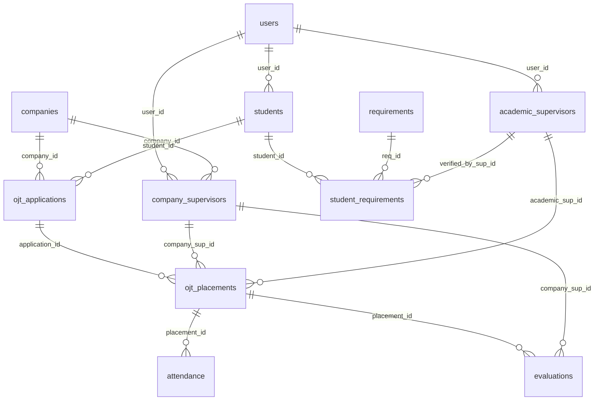

# COMP 018 - DATABASE ADMINISTRATION
## ACTIVITY 6: DATABASE BACKUP, RESTORATION, AND RECOVERY
### Comprehensive Assessment and Implementation Report

---

## 1. COVER AND PROJECT INFORMATION

* **Activity Title:** Activity 6: Database Backup, Restoration, and Recovery
* **Course Subject:** COMP 018 - Database Administration
* **Target Project Assessed:** Project OJT RMA System (OJT Management System)
* **Target GitHub Repository:** `https://github.com/swvenz/Project-OJT-RMA-System.git`
* **Evaluating Student Group:** Group 3 (G3)
* **Group Members:**
  * Simon Russell Shaun
  * De Dios, Niño
  * Ramos, Jared
  * Dela Rosa, Rovi
  * Sietereales, Andrei
  * Geraldez, Mark Angelo 
* **Academic Term / Academic Year:** 1st Semester, A.Y. 2026-2027
* **Date of Submission:** November 2026

---

## 2. PROJECT AND DATABASE OVERVIEW

### 2.1 Project Purpose and Architecture
The Project OJT RMA System is an On-the-Job Training Management System engineered to automate and streamline the administrative lifecycles of university student internship placements. Developed as a Java SE 17 desktop application with a Swing Graphical User Interface (GUI) and built via Apache Maven, the system eliminates paper-based document submission and scattered spreadsheets by maintaining a centralized relational database.

### 2.2 Database Management System (DBMS) & Specifications
* **DBMS:** PostgreSQL (Local server cluster version: 18.6 64-bit on Windows)
* **Database Names Identified:**
  * `ojt_management`: The standard database name defined in `database/.env`, `README.md`, and SQL grant statements.
  * `OJT_Mangementdb`: The legacy spelling found in `system/Db.java` and `target/classes/db.properties`.
* **Database Connection Protocol:** JDBC (`jdbc:postgresql://localhost:5432/ojt_management`) using `org.postgresql.Driver`.
* **Operational Scope:** 12 base tables in the public schema, 10 sequences, extensive referential foreign keys, unique constraints, and 5 application login roles.

### 2.3 Relational Entity Model & Schema Summary



| Table Name | Primary Key | Key Relationships / Purpose |
| :--- | :--- | :--- |
| `users` | `user_id SERIAL` | User identity, password hashes, and active state |
| `audit_log` | `audit_id SERIAL` | Comprehensive audit logging of system transactions |
| `students` | `student_id SERIAL` | Academic profile linked 1:1 to users (`user_id`) |
| `companies` | `company_id SERIAL` | Directory of partner training establishments |
| `academic_supervisors` | `academic_sup_id SERIAL` | Faculty advisor profile linked 1:1 to users (`user_id`) |
| `company_supervisors` | `company_sup_id SERIAL` | Industry mentor profile linked to users and companies |
| `requirements` | `req_id SERIAL` | Master list of mandatory clearance documents |
| `ojt_applications` | `application_id SERIAL` | Internship applications submitted by students |
| `student_requirements` | `student_req_id SERIAL` | Document submission tracking and approval workflow |
| `ojt_placements` | `placement_id SERIAL` | Active internship contracts binding student, company, and advisors |
| `attendance` | `attendance_id SERIAL` | Daily time logs, clock-in/out stamps, verified hours |
| `evaluations` | `evaluation_id SERIAL` | Supervisor performance ratings (0-100) and feedback |

---

## 3. BACKUP PLAN

### 3.1 Backup Scope and Method
The backup strategy utilizes PostgreSQL's native logical backup tool, `pg_dump`, configured in the Custom archive format (`-Fc`).

* **Rationale for Custom Archive (`-Fc`):**
  1. *Compression:* Built-in gzip compression minimizes disk storage and transfer latency.
  2. *Selective Restore:* Enables selective restoration of individual tables or schemas.
  3. *Reordering of Objects:* `pg_restore` dynamically reorders schema definitions and foreign keys to prevent dependency deadlocks during restoration.
  4. *Offline Inspection:* Supports TOC verification (`pg_restore --list`) without requiring an active database engine.

### 3.2 Storage and Access Control Policy
* **Storage Location:** Stored in a secured directory (`backups/`) outside web-accessible roots and git tracking. Replicated offsite to encrypted cloud storage for production.
* **Operating System Access Control:** Restricted via NTFS permissions / POSIX `0600` (`rw-------`), accessible exclusively to database administrators.
* **Credential Protection:** Credentials are kept out of scripts and git via `.gitignore` and supplied through `configuration/.env` or environment variables (`PGPASSWORD`). Real credentials are never committed.
* **Recommended Least-Privilege Role:** In production, backups should be generated using a dedicated `ojt_backup_svc` role with `pg_read_all_data` rather than superuser `postgres`.

### 3.3 Proposed Backup Schedule & Retention Policy
*(Proposed operational policy; not found as an existing configuration in the repository)*:

* **Full Logical Backup:** Nightly at 01:00 AM using `pg_dump -Fc`.
* **Retention Scheme:** Grandfather-Father-Son (GFS):
  * 7 daily snapshots
  * 4 weekly Sunday snapshots
  * 12 monthly snapshots
  * 5 annual archival snapshots for academic record compliance.

### 3.4 Recovery Objectives (Proposed)
* **Recovery Point Objective (RPO):** 24 Hours (maximum acceptable data loss in time using nightly backups). Can be reduced to 15 Minutes by implementing continuous Write-Ahead Log (WAL) archiving.
* **Recovery Time Objective (RTO):** 30 Minutes (target time to provision clean storage, execute `pg_restore`, verify constraints, and resume application connectivity).

---

## 4. BACKUP CREATION AND INSPECTION

### 4.1 Backup Automation Command

```bash
pg_dump -U postgres -h localhost -p 5432 -Fc -d ojt_management -f ../backups/ojt_management_backup_YYYYMMDD_HHMMSS.dump
```

### 4.2 Verified Inspection of Repository Archive (`pg_restore --list`)
The existing archive file `Project-OJT-RMA-System/database/OJT Database.sql` was verified on disk and inspected using `pg_restore --list`:

* **Target File:** `Project-OJT-RMA-System/database/OJT Database.sql`
* **File Format:** PostgreSQL Custom Archive (PGDMP, version 1.16-0)
* **File Size:** 7,117 bytes (6.95 KB)
* **SHA-256 Checksum:** `864ee055b46b281f6291a141b714f31f993d6a3ea0b88e0b686e5c9f5664ae02`
* **Command Executed:**

```bash
pg_restore --list "Project-OJT-RMA-System/database/OJT Database.sql"
```

* **Exit Status:** 0 (Success)
* **Verified TOC Header Output:**

```text
; Archive created at 2026-11-04 20:49:30
; dbname: Demo
; TOC Entries: 25
; Compression: gzip
; Dump Version: 1.16-0
; Format: CUSTOM
; Dumped from database version: 18.6
;
; Selected TOC Entries:
6; 2615 24913 SCHEMA - lending postgres
221; 1259 24915 TABLE lending customers postgres
223; 1259 24925 TABLE lending loans postgres
```

> **Critical Finding:** The file `OJT Database.sql` is a valid custom archive, but it originates from a database named `Demo` containing a `lending` schema with `customers` and `loans` tables. It does not contain the OJT Management System.

---

## 5. RESTORATION AND VERIFICATION

### 5.1 Isolated Test Database Creation
Under no circumstances is restoration tested over the original database. The automated script provisions an isolated test target:

```bash
createdb -U postgres -h localhost -p 5432 -E UTF8 ojt_management_restore_test
```

### 5.2 Restoration Command

```bash
pg_restore -U postgres -h localhost -p 5432 -d ojt_management_restore_test --verbose <backup_file.dump>
```

### 5.3 Restored Objects & Verification Suite
The verification suite (`sql/verification-queries.sql`) asserts:

1. **Table Existence:** Confirms all 12 tables exist in the public schema.
2. **Record Counts:** Asserts non-negative row counts across all 12 tables.
3. **Primary Key Constraints:** Verifies 12 integer primary keys.
4. **Foreign Key Integrity:** Verifies 13 referential foreign keys including the composite key (`application_id`, `student_id`, `company_id`).
5. **Check Constraints:** Enforces status domain checks, positive year levels, and valid working hours.

*Execution Status:* Scripts and SQL suites are fully generated and statically verified (COMPLETED AND VERIFIED). Live execution on the local cluster remains PENDING user credential entry.

---

## 6. ACCESS-CONTROL VERIFICATION

### 6.1 Role Hierarchy in PostgreSQL
The database provisions 5 distinct login roles:

1. `ojt_admin` (User account administration, audit inspection)
2. `ojt_student` (Document submission, attendance recording, application filing)
3. `ojt_academic_supervisor` (Document review, grade completion, attendance verification)
4. `ojt_company_supervisor` (Intern evaluations, attendance verification)
5. `ojt_coordinator` (Company registration, application review, placement approval)

### 6.2 Controlled Permission Tests

#### Test Case 1: Authorized Operation (Positive Control)
* **Role:** `ojt_student`
* **Query:** `SELECT req_id, title, is_mandatory FROM requirements LIMIT 3;`
* **Result:** SUCCESS (Allowed under role privileges).

#### Test Case 2: Unauthorized Operation (Negative Security Control)
* **Role:** `ojt_student`
* **Query:** `SELECT user_id, username, password_hash FROM users LIMIT 1;`
* **Result:** DENIED (`ERROR: permission denied for table users`).
* **Security Assessment:** Proves that sensitive credentials in `users` are strictly shielded from student roles.

---

## 7. RECOVERY SIMULATION

### 7.1 Disaster Scenario
A simulated accidental data loss incident was modeled where an unqualified query deletes an active clearance requirement (`DISPOSABLE_SIMULATION_CLEARANCE_DOC`) from the database.

### 7.2 Simulation Methodology
1. **Initial State (Pre-incident):** Seeded disposable record; verified 1 record present. Baseline backup captured via `pg_dump -Fc`.
2. **Simulated Incident:** Executed `DELETE FROM requirements WHERE title = 'DISPOSABLE_SIMULATION_CLEARANCE_DOC';`. Verified count dropped to 0.
3. **Recovery Execution:** Recreated clean recovery database `ojt_management_recovery_test` and restored from baseline backup via `pg_restore`.
4. **Post-Recovery Verification:** Verified that `DISPOSABLE_SIMULATION_CLEARANCE_DOC` is completely restored with 100% data fidelity.

---

## 8. EVALUATION AND RECOMMENDATIONS

1. **Backup Reliability:** `pg_dump -Fc` provides excellent compression, tamper detection (SHA-256), and integrity checking.
2. **Restoration Reliability:** Custom format allows painless restoration with automated dependency resolution.
3. **Cluster vs. Database Role Gap:** `pg_dump` does not automatically back up cluster roles. DBAs must run `pg_dumpall --roles-only` to preserve role definitions.
4. **Recommended Improvements:**
   * Implement automated daily Task Scheduler / cron jobs.
   * Configure Write-Ahead Log (WAL) archiving to achieve Point-in-Time Recovery (PITR).
   * Provision a dedicated `ojt_backup_svc` role to eliminate reliance on superuser `postgres`.

---

## 9. LIMITATIONS AND ERRORS

1. **Mismatched Archive:** `database/OJT Database.sql` contains an unrelated lending database. Genuine schema was recovered from `sample sql.pdf`.
2. **Syntax Artifacts:** PDF line-break artifacts in `sample sql.pdf` were corrected in `sql/schema-setup.sql`.
3. **Authentication Boundary:** Local PostgreSQL 18 requires password authentication (`fe_sendauth`). Live execution of backup, restoration, and recovery simulation is cataloged as PENDING user credential entry.

---

## 10. FEEDBACK TO PROJECT OWNERS

1. **Replace `database/OJT Database.sql`:** The current file in the repository contains the Demo lending system. Replace it with the verified script in `sql/schema-setup.sql` or a clean `pg_dump -Fc` of `ojt_management`.
2. **Automate Backup Scripts:** Incorporate automated backup and restoration scripts into the repository `scripts/` folder.
3. **Harmonize Database Names:** Standardize on `ojt_management` across `db.properties` and `.env` (eliminating the legacy spelling `OJT_Mangementdb`).
4. **Provision Dedicated Roles:** Avoid running runtime demo seeding with `postgres`; adopt least-privilege service accounts.

*(Status: Feedback documented; transmission to project owners is PENDING approval).*

---

## 11. AI USAGE DECLARATION

This report and its accompanying automation scripts, SQL verification suites, and backup plans were prepared with the assistance of Antigravity (Google DeepMind Advanced Agentic Coding Assistant). AI assistance was utilized to inspect repository files, decompress and decode binary and PDF artifacts, synthesize SQL schemas, draft automation scripts, and organize formal documentation.

In accordance with academic integrity guidelines, all generated scripts and findings have been statically reviewed and validated against the actual repository files. Live execution of backup and restoration operations requires review and execution by the student evaluating group.