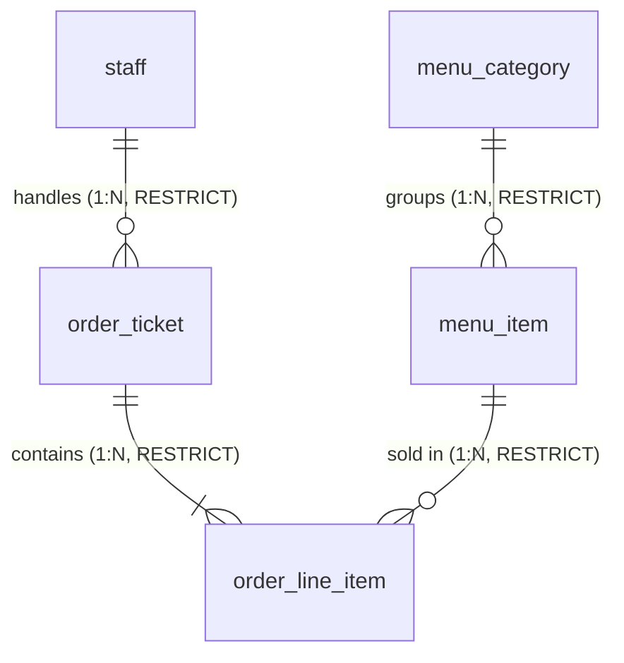

# Repository Inspection Report: BrewPOS
**Course:** COMP 018 — Database Administration  
**Activity:** Activity 6 — Database Backup, Restoration, and Recovery  
**Target Project:** BrewPOS — Café Point-of-Sale System  
**Target Repository URL:** https://github.com/Nycri/brewpos  
**Inspection Date:** November 12, 2026  
**Inspector:** COMP 018 Database Administration Assessment Team  

---

## 1. Executive Summary & Project Identification

| Parameter | Inspection Finding |
|---|---|
| **Project Name** | **BrewPOS** — Café Point-of-Sale System |
| **Target Repository** | `https://github.com/Nycri/brewpos` |
| **Project Purpose** | Web-based café POS application providing register checkout, catalog and menu management, order receipt generation, and daily financial sales reporting. |
| **Course Alignment** | COMP 018 — Database Administration (Demonstrating relational schema integrity, transaction immutability, role-based access control, and backup/recovery procedures). |
| **Group Tracker Status** | Group inspection working repository (`G4_BrewPOS`). Target project repo is used strictly as the inspection baseline; deliverables are housed independently in the group repository. |

---

## 2. Actual Database Technology & Environment Detection

| Item | Technical Finding / Evidence in Repository |
|---|---|
| **Database Management System (DBMS)** | **PostgreSQL** (Explicitly documented in `README.md`, `pom.xml` dependency `org.postgresql:postgresql`, and SQL scripts). |
| **Target DBMS Engine Version** | **PostgreSQL 18.6** (specified as primary target in `database/schema.sql`, `seed.sql`, and `database/DATABASE_DOCUMENTATION.md`; compatible with PostgreSQL 16+). |
| **Locally Detected Tool Version** | **PostgreSQL 18.6** (`psql (PostgreSQL) 18.6`, `pg_dump (PostgreSQL) 18.6` confirmed via environment scan). |
| **Actual Database Name** | **`grp_brewposdb`** |
| **Database Schema** | **`public`** |
| **Default Host & Port** | `localhost:5432` (Default PostgreSQL TCP/IP port). |
| **Connection Method** | JDBC Connection via Spring Boot & HikariCP: `jdbc:postgresql://localhost:5432/grp_brewposdb`. |
| **ORM / Data Access Layer** | Spring Data JPA / Hibernate 6 (`spring.jpa.hibernate.ddl-auto=validate`, strictly preventing automated table mutations). |

---

## 3. Database Configuration and Setup Process

The BrewPOS repository provides clear database setup instructions in `README.md` and `database/README.md`:

1. **Database Creation:** Executed via `psql` or pgAdmin 4:
   ```sql
   CREATE DATABASE grp_brewposdb;
   ```
2. **Schema & Object Generation:** Executed via `database/schema.sql` (creates all 5 tables, constraints, composite primary keys, and B-tree indexes within a transaction block).
3. **Reference & Starter Seeding:** Executed via `database/seed.sql` (loads demo staff, categories, 11 menu items, and initial sample orders idempotently).
4. **Least-Privilege App Role:** Executed via `database/05_create_app_role.sql` (provisions `brewpos_app` login role with granular permissions).
5. **Runtime Credential Injection:** Configured through `.env` file loaded dynamically via `spring.config.import=optional:file:.env[.properties]`.

---

## 4. Actual Tables, Purpose, Keys, Constraints, and Indexes

The database schema strictly comprises **5 relational tables** in schema `public`. No tables for inventory tracking, customer loyalty, or discounts exist (intentionally excluded from project scope).

### 4.1 Table Details

#### Table 1: `public.staff`
- **Purpose:** Stores café personnel authorized to operate the POS or manage catalog data.
- **Columns:**
  - `staff_id`: `SERIAL` (`INTEGER`), Primary Key.
  - `full_name`: `VARCHAR(100)`, NOT NULL.
  - `role`: `VARCHAR(20)`, NOT NULL.
- **Constraints:**
  - Primary Key: `staff_pkey` (`staff_id`).
  - CHECK Constraint: `chk_staff_role CHECK (role IN ('CASHIER', 'MANAGER'))`.

#### Table 2: `public.menu_category`
- **Purpose:** Stores menu group classifications (e.g., `Coffee`, `Non-Coffee`, `Pastries`).
- **Columns:**
  - `category_id`: `SERIAL` (`INTEGER`), Primary Key.
  - `category_name`: `VARCHAR(50)`, NOT NULL, UNIQUE.
- **Constraints:**
  - Primary Key: `menu_category_pkey` (`category_id`).
  - UNIQUE Constraint: `uq_menu_category_name UNIQUE (category_name)`.

#### Table 3: `public.menu_item`
- **Purpose:** Stores sellable beverage and food catalog offerings, current prices, and active register status.
- **Columns:**
  - `item_id`: `SERIAL` (`INTEGER`), Primary Key.
  - `category_id`: `INTEGER`, NOT NULL, Foreign Key.
  - `item_name`: `VARCHAR(100)`, NOT NULL.
  - `price`: `DECIMAL(10,2)`, NOT NULL.
  - `is_active`: `BOOLEAN`, NOT NULL, DEFAULT `TRUE`.
- **Constraints:**
  - Primary Key: `menu_item_pkey` (`item_id`).
  - Foreign Key: `fk_menu_item_category FOREIGN KEY (category_id) REFERENCES public.menu_category(category_id)` (RESTRICT delete rule).
  - CHECK Constraint: `chk_menu_item_price CHECK (price >= 0)`.
  - UNIQUE Constraint: `uq_menu_item_category_name UNIQUE (category_id, item_name)`.

#### Table 4: `public.order_ticket`
- **Purpose:** Stores order transaction receipt headers (named `order_ticket` to avoid SQL keyword `ORDER`).
- **Columns:**
  - `order_id`: `SERIAL` (`INTEGER`), Primary Key.
  - `staff_id`: `INTEGER`, NOT NULL, Foreign Key.
  - `order_timestamp`: `TIMESTAMP` (without time zone), NOT NULL, DEFAULT `CURRENT_TIMESTAMP`.
  - `payment_method`: `VARCHAR(20)`, NOT NULL.
- **Constraints:**
  - Primary Key: `order_ticket_pkey` (`order_id`).
  - Foreign Key: `fk_order_ticket_staff FOREIGN KEY (staff_id) REFERENCES public.staff(staff_id)` (RESTRICT delete rule).
  - CHECK Constraint: `chk_order_ticket_payment CHECK (payment_method IN ('CASH', 'ONLINE'))`.
- **Indexes:**
  - `idx_order_ticket_timestamp ON public.order_ticket (order_timestamp)` — query-justified index for date-filtered sales reporting.

#### Table 5: `public.order_line_item`
- **Purpose:** Stores itemized line items sold within each order. It captures unit price at the time of sale (`sold_price`) to ensure past receipt totals remain immutable regardless of future menu price modifications.
- **Columns:**
  - `order_id`: `INTEGER`, NOT NULL, Foreign Key & Composite PK component.
  - `item_id`: `INTEGER`, NOT NULL, Foreign Key & Composite PK component.
  - `quantity`: `INTEGER`, NOT NULL.
  - `sold_price`: `DECIMAL(10,2)`, NOT NULL.
- **Constraints:**
  - Composite Primary Key: `pk_order_line_item PRIMARY KEY (order_id, item_id)`.
  - Foreign Key 1: `fk_order_line_order FOREIGN KEY (order_id) REFERENCES public.order_ticket(order_id)` (RESTRICT delete rule).
  - Foreign Key 2: `fk_order_line_item FOREIGN KEY (item_id) REFERENCES public.menu_item(item_id)` (RESTRICT delete rule).
  - CHECK Constraint 1: `chk_order_line_quantity CHECK (quantity > 0)`.
  - CHECK Constraint 2: `chk_order_line_sold_price CHECK (sold_price >= 0)`.
- **Indexes:**
  - `idx_order_line_item_item_id ON public.order_line_item (item_id)` — supports FK referential integrity and reverse item lookups.

---

## 5. Relationships & Integrity Rules



- **Calculated Totals Architecture:** The database strictly avoids storing order subtotals or gross totals. Totals are derived dynamically at runtime via `SUM(quantity * sold_price)`.
- **Referential Delete Cascades Prohibited:** No foreign key contains `ON DELETE CASCADE`. Categories with items, staff with recorded sales, or orders with line items cannot be deleted directly, safeguarding historical records.

---

## 6. Existing Database Users, Roles, and Privileges

The repository defines role-based access control across `database/05_create_app_role.sql` and `docs/user-roles.md`:

| Database Role / Account | Role Type | Privileges & Object Permissions | Intended Usage |
|---|---|---|---|
| `postgres` | Superuser / Admin | Full cluster-wide administrative privileges. | Schema creation, DBA migrations, maintenance. |
| `brewpos_app` | Login Role (`WITH LOGIN`) | • `SELECT` on `staff`<br>• `SELECT, INSERT, UPDATE, DELETE` on `menu_category`, `menu_item`<br>• `SELECT, INSERT` on `order_ticket`, `order_line_item`<br>• `USAGE, SELECT` on all sequences<br>• Strictly **NO** `UPDATE` or `DELETE` on sales tables. | Programmatic Spring Boot HikariCP connection pool. |
| `app_runtime_grp` | Group Role (`NOLOGIN`) | Enforces register and catalog runtime permissions for application logins. | Parent role for `brewpos_app`. |
| `app_readonly_grp` | Group Role (`NOLOGIN`) | `SELECT` on all 5 tables in `public` schema. Zero write/update permissions. | Auditing, accounting verification, and backup inspection. |
| `app_admin_grp` | Group Role (`NOLOGIN`) | Elevated privileges over catalog and read-only over sales. | Administrative catalog manager. |
| `brewpos_auditor` | Login Role (`WITH LOGIN`) | Member of `app_readonly_grp`. | External auditor verification account. |

---

## 7. Existing Backup and Recovery Mechanisms

- **Existing Mechanism in Repo:** `database/README.md` documents basic manual `pg_dump` and `pg_restore` commands:
  - Backup: `pg_dump -U postgres -Fc -d grp_brewposdb -f brewpos_backup.dump`
  - Restore: `pg_restore -U postgres -d grp_brewposdb --clean --if-exists brewpos_backup.dump`
- **Assessment of Existing Mechanism:**
  - The repository's documented restore command targets the **active production database** (`grp_brewposdb`) with `--clean`, which is destructive and unacceptable for testing.
  - No automated scheduling, rotation, retention, checksum verification, or isolated test recovery procedures were provided in the original repository.
  - Activity 6 provides the complete engineering solution: custom archive backup generation, checksum validation, creation of a dedicated disposable database (`grp_brewposdb_restore_test`), non-destructive restoration, and controlled recovery simulation.

---

## 8. Current Environment Access Status & Limitations

- **Installed Tooling:** PostgreSQL 18.6 utilities (`psql`, `pg_dump`, `pg_restore`, `createdb`, `dropdb`) are installed on the local system.
- **Connection Blocker:** In the current evaluation workspace session, local PostgreSQL loopback connections (`localhost:5432`) cannot be executed under Standard Sandbox Mode due to Windows AppContainer socket isolation (`WSAEACCES 10013 / Permission denied`). Additionally, live database passwords are not stored in `.env.example`.
- **Procedural Resolution:**
  1. Complete backup plans, automated PowerShell and Bash scripts, verification queries, and simulation workflows are fully generated and statically validated.
  2. Scripts are designed to accept secure credentials via `.env` or interactive prompts without hardcoding.
  3. Live database operations are marked as **PENDING** in accordance with safety instructions, with exact command execution steps provided for manual verification.

