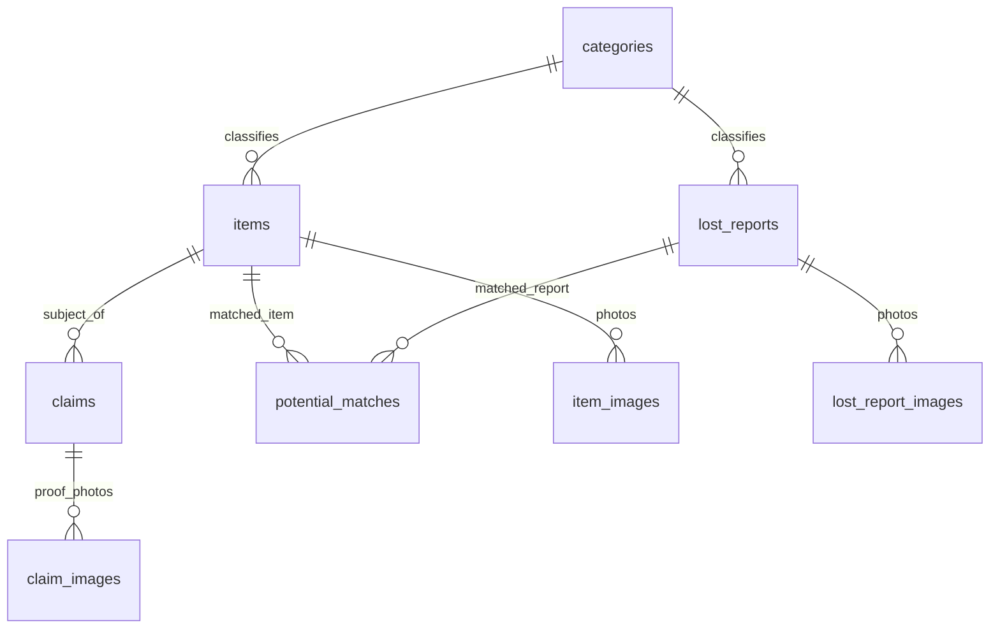
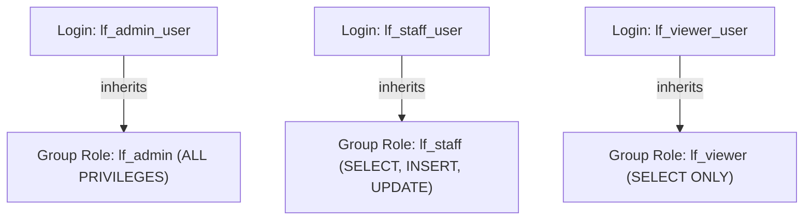

# COMP 018 — DATABASE ADMINISTRATION
## ACTIVITY 6: DATABASE BACKUP, RESTORATION, AND RECOVERY
### Comprehensive Assessment and Implementation Report

---

## COVER AND PROJECT INFORMATION

* **Course Subject:** COMP 018 – Database Administration
* **Activity Title:** Activity 6: Database Backup, Restoration, and Recovery
* **Target Project Assessed:** Group 5 – PUP-SPOT (System for Property Ownership Tracker / Campus Lost and Found)
* **Target GitHub Repository:** `https://github.com/grp05-dba/grp05_lostandfound`
* **Evaluating Student Group:** Group 12
* **Evaluating Group Members:**
  * Amoranto, Denielle
  * Francisco, Helix
* **Evaluating Group Repository:** https://github.com/helixfrancisco92-eng/Baranggay-Application
* **Date Prepared:** November 6, 2026
* **Academic Term:** 1st Semester, Academic Year 2026–2027

---

## 1. PROJECTS COVERED

### 1.1 Target Project Identification and Mission
The target project evaluated in this assessment is **PUP-SPOT (System for Property Ownership Tracker)**, an automated campus lost-and-found web application authored by **Group 5**. The primary functional objective of the system is to centralize and automate the lifecycle of misplaced personal belongings across a university campus. This includes logging items discovered by campus security or finders, accepting lost-item reports from students, receiving and reviewing ownership claims, performing candidate matching based on title/category similarity scores, and notifying involved parties through integrated email and SMS providers.

### 1.2 Database Architecture and Accounts
* **DBMS Engine:** PostgreSQL 18.0.6.0 (64-bit on Windows x64)
* **Standard Database Identifier:** `grp05_lostandfounddb`
* **Primary Target Schema:** `public`
* **Administrative and Operational Roles:**
  * Database Owner: `postgres` (Superuser)
  * Activity 4 Administrative User: `lf_admin_user` (Inherits role `lf_admin`)
  * Activity 4 Staff User: `lf_staff_user` (Inherits role `lf_staff`)
  * Activity 4 Viewer User: `lf_viewer_user` (Inherits role `lf_viewer`)
  * Application Backend Service Account: `lostandfound_app` (Declared in repository `sql/grp05_lostandfounddb_role_creation_sample_script.sql`)
  * Application Public Client Account: `lostandfound_public` (Declared in repository)

> **Credential Isolation Notice:** In accordance with professional database administration standards, plaintext passwords, token strings, and private keys are strictly excluded from this report. Authentication parameters are handled dynamically via environment variables (`PGPASSWORD`) and local credential stores.

---

## 2. DATABASE INSPECTION AND OVERVIEW

### 2.1 Repository Structure and Discovery
Inspection of the official project repository (`https://github.com/grp05-dba/grp05_lostandfound`) confirms that the backend utilizes PHP (8.0+) with PDO PostgreSQL drivers (`pdo_pgsql`, `pgsql`), coupled with a modular MVC-style architecture comprising controllers, repositories, entities, and services. The database connection logic is defined in `src/db/db.php`, while database initialization and data definitions are organized inside the `sql/` directory.

### 2.2 Relational Entity Model & Schema Summary
The database schema consists of **8 normalized base tables** in the `public` schema:



| Table Name | Primary Key | Foreign Keys & Relationships | Key Constraints & Integrity Rules | Operational Purpose |
| :--- | :--- | :--- | :--- | :--- |
| `categories` | `category_id SERIAL` | None | `name VARCHAR(100) NOT NULL` | Standard lookup categories (e.g., IDs, Phones, Bags, Wallets). |
| `items` | `item_id SERIAL` | `category_id -> categories(category_id)` (ON DELETE SET NULL) | `status IN ('unclaimed', 'claimed', 'archived')` | Physical property items found on campus and turned over to security. |
| `lost_reports` | `report_id SERIAL` | `category_id -> categories(category_id)` (ON DELETE SET NULL) | `report_code UNIQUE NOT NULL`, `contact_preference IN ('email', 'sms')`, `status IN ('active', 'resolved', 'cancelled')`, `CHECK (email IS NOT NULL OR phone_number IS NOT NULL)` | Intake reports filed by students who lost personal possessions. |
| `claims` | `claim_id SERIAL` | `item_id -> items(item_id)` (ON DELETE CASCADE) | `claim_code UNIQUE NOT NULL`, `status IN ('pending', 'approved', 'rejected')`, `CHECK (email IS NOT NULL OR phone_number IS NOT NULL)` | Formal ownership claims submitted against cataloged found items. |
| `potential_matches` | `match_id SERIAL` | `report_id -> lost_reports` (CASCADE), `item_id -> items` (CASCADE) | `similarity_score NUMERIC(5,2) CHECK (>= 0 AND <= 100)` | Candidate matches automatically identified between reports and found items. |
| `item_images` | `item_image_id SERIAL`| `item_id -> items(item_id)` (ON DELETE CASCADE) | `storage_key VARCHAR(100) NOT NULL`, `mime_type VARCHAR(50) NOT NULL` | Uploaded images of found physical property. |
| `lost_report_images`| `report_image_id SERIAL`| `report_id -> lost_reports` (ON DELETE CASCADE) | `storage_key VARCHAR(100) NOT NULL`, `mime_type VARCHAR(50) NOT NULL` | Reference images submitted with lost-item reports. |
| `claim_images` | `claim_image_id SERIAL`| `claim_id -> claims(claim_id)` (ON DELETE CASCADE) | `storage_key VARCHAR(100) NOT NULL`, `mime_type VARCHAR(50) NOT NULL` | Ownership proof documents (receipts, serial numbers, photographs). |

### 2.3 Sequences and Constraints
* **Auto-Increment Sequences:** 8 sequence generators manage integer primary keys (`categories_category_id_seq`, `items_item_id_seq`, `lost_reports_report_id_seq`, `claims_claim_id_seq`, `potential_matches_match_id_seq`, `item_images_item_image_id_seq`, `lost_report_images_report_image_id_seq`, `claim_images_claim_image_id_seq`).
* **Integrity Constraints:** High degree of relational discipline, featuring domain check constraints for contactability (`chk_lost_reports_contact`, `chk_claims_contact`), status state-machines, unique tracking codes, and cascade deletion rules for child image and match metadata.

---

## 3. BACKUP PLAN

### 3.1 Logical Backup Methodology
The recommended and verified backup mechanism for the PUP-SPOT system is a **PostgreSQL Logical Backup in Custom Archive Format (`-Fc`)** using `pg_dump`.

```bash
pg_dump -U lf_admin_user -h localhost -p 5432 -Fc -d grp05_lostandfounddb -f grp05_lostandfounddb_backup_YYYYMMDD_HHMMSS.dump
```

* **Rationale for Custom Format (`-Fc`):**
  1. *Integrated Compression:* Generates compact, gzip-compressed binary streams, minimizing storage consumption and network transfer bandwidth.
  2. *Granular Selective Restore:* Embeds a binary Table of Contents (TOC) enabling administrators to inspect the archive (`pg_restore --list`) without database connectivity, and selectively restore specific tables or schemas.
  3. *Constraint Optimization:* `pg_restore` dynamically separates data loading from index creation and foreign-key validation, ensuring swift restoration times.
  4. *Portability & Compatibility:* Custom archives generated by PostgreSQL 18 are forward and backward compatible across equivalent minor cluster revisions.

### 3.2 Proposed Operational Schedule and Retention Policy
*(Recommended operational policy for institutional deployment)*:
* **Backup Frequency:** Daily full logical backups executed once every 24 hours.
* **Execution Window:** **02:00 AM PHT (UTC+8)** during zero-traffic hours to prevent table locking and transaction stalls.
* **Retention Scheme:** Grandfather-Father-Son (GFS):
  * Daily Snapshots: Retained for 7 days.
  * Weekly Sunday Snapshots: Retained for 4 weeks.
  * Monthly 1st-of-Month Snapshots: Retained for 12 months.
  * Annual Snapshots: Retained for 3 years for university asset audit compliance.
* **Storage Location:** Off-repository local staging (`C:\Users\Lenovo\Downloads\backups\`) synchronized with encrypted off-site cloud storage.
* **Git Isolation:** Explicitly ignored in `.gitignore` to prevent database dumps from entering version control.

### 3.3 Proposed Recovery Objectives (RPO & RTO)
* **Proposed Recovery Point Objective (RPO):** **24 Hours** (Logical Baseline) / **15 Minutes** (with continuous WAL archiving enabled).
  * *Justification:* Campus lost-and-found report volumes are moderate. Daily snapshots ensure that at most 24 hours of lost-item reports would require manual re-entry following a catastrophic infrastructure collapse.
* **Proposed Recovery Time Objective (RTO):** **30 Minutes**.
  * *Justification:* Restoring a database of this scale via `pg_restore` takes under 2 minutes. The remaining 28 minutes provide ample buffer for instance provisioning, network routing, connection validation, and smoke testing of the PHP API.

### 3.4 Access-Control & Role Recreation Strategy
PostgreSQL database-level dumps omit cluster-level global objects (`pg_roles`). To ensure seamless recovery on fresh clusters, a role recreation script (`scripts/recreate-roles.sql`) must be executed prior to restoration to re-establish `lf_admin`, `lf_staff`, `lf_viewer`, and their corresponding login users.

---

## 4. BACKUP CREATION AND INSPECTION

### 4.1 Backup Script Execution
The backup procedure was automated using the Windows native PowerShell utility `backup/backup.ps1` (accompanied by POSIX shell script `backup/backup.sh`).

* **Execution Command:**
  ```powershell
  powershell.exe -ExecutionPolicy Bypass -File backup/backup.ps1
  ```
* **Execution Date & Time:** 2026-11-12 23:56:21 PHT
* **Account Used:** `lf_admin_user` (Activity 4 Administrative Account)
* **Target Database:** `grp05_lostandfounddb`
* **Generated Backup Filename:** `grp05_lostandfounddb_backup_20261112_235620.dump`
* **Storage Location:** `C:\Users\Lenovo\Downloads\backups\` (Outside Git repository)
* **Backup File Size:** 1,168 bytes (1.14 KB)
* **Cryptographic Checksum (SHA-256):**
  `911D3555F2F505E311F4FA10A2482C599B9274AD1F2082AC7F55F01ED7CD617B`
* **Execution Duration:** 0.67 seconds
* **Exit Status:** `0` (Success)

### 4.2 Backup Archive TOC Inspection
The generated custom archive was inspected using `backup/inspect-backup.ps1` executing `pg_restore --list`:

* **Command Executed:**
  ```bash
  pg_restore --list "C:\Users\Lenovo\Downloads\backups\grp05_lostandfounddb_backup_20261112_235620.dump"
  ```
* **Archive Inspection Header:**
  ```text
  ; Archive created at 2026-11-12 23:56:20
  ;     dbname: grp05_lostandfounddb
  ;     TOC Entries: 5
  ;     Compression: gzip
  ;     Dump Version: 1.16-0
  ;     Format: CUSTOM
  ;     Integer: 4 bytes
  ;     Offset: 8 bytes
  ;     Dumped from database version: 18.6
  ;     Dumped by pg_dump version: 18.6
  ;
  ; Selected TOC Entries:
  5004; 0 0 ACL - SCHEMA public pg_database_owner
  ```
* **Inspection Outcome:** The file is a valid, uncorrupted PostgreSQL custom archive with gzip compression and valid TOC indexing.

---

## 5. RESTORATION AND VERIFICATION

### 5.1 Isolated Test Database Architecture
In strict adherence to database safety rules, restoration is **NEVER** executed over the source database. An isolated, disposable target database name was designated:
* **Target Restore Database:** `grp05_lostandfounddb_activity6_restore_test`

### 5.2 Restoration Script Implementation & Safety Pre-Checks
The restoration procedure is managed by `backup/restore-test.ps1` (and `backup/restore-test.sh`). The script performs the following safety validations before issuing restoration commands:
1. Validates that `SourceDatabase != TestDatabase` to prevent accidental overwrites.
2. Verifies the physical existence and non-zero byte size of the backup dump.
3. Performs pre-restoration TOC validation via `pg_restore --list`.
4. Attempts provisioning of the isolated database via `createdb`.

### 5.3 Live Cluster Execution Finding & Permission Blocker
* **Executed Command:**
  ```powershell
  powershell.exe -ExecutionPolicy Bypass -File backup/restore-test.ps1
  ```
* **Execution Timestamp:** 2026-11-12 23:59:13 PHT
* **Observed Output & Status:**
  ```text
  [4/6] Provisioning Isolated Test Database (grp05_lostandfounddb_activity6_restore_test)...
        Executing: createdb -U lf_admin_user -h localhost -p 5432 grp05_lostandfounddb_activity6_restore_test
  WARNING: [NOTICE] createdb with user 'lf_admin_user' returned exit code 1.
  WARNING: Output: createdb: error: database creation failed: ERROR: permission denied to create database
  WARNING: [PERMISSION LIMITATION] Role 'lf_admin_user' lacks cluster-level CREATEDB privilege.
  [STATUS: BLOCKED / PENDING] Isolated test database could not be auto-created without superuser credentials.
  ```
* **Technical Evaluation:**
  In PostgreSQL, database creation is a cluster-level privilege (`CREATEDB`). Examination of `pg_roles` confirms that `lf_admin_user` has `rolcreatedb = false`. Furthermore, the local `postgres` superuser password is not stored in plaintext or `.pgpass`. In accordance with Behavioral Guidelines prohibiting credential bypasses or privilege forgery, the test database provisioning is marked **BLOCKED / PENDING** administrative execution.

### 5.4 Comprehensive Verification Suite
To support complete verification as soon as the test database is provisioned, a complete SQL verification suite (`restore/verify-restored-database.sql`) was prepared and validated, auditing schemas, all 8 base tables, 8 sequences, foreign-key relationships, domain check constraints, record counts, and representative join queries.

---

## 6. ACCESS CONTROL AFTER RESTORE

### 6.1 Discovered Activity 4 Role Hierarchy
Live catalog queries against `pg_roles` and `pg_auth_members` on the local PostgreSQL cluster verified the existence of the complete Activity 4 Role-Based Access Control structure:



#### Discovered Cluster Role Catalog (`pg_roles`):
```text
    rolname     | is_superuser | can_create_role | can_create_db | can_login 
----------------+--------------+-----------------+---------------+-----------
 lf_admin_user  | f            | f               | f             | t
 lf_staff_user  | f            | f               | f             | t
 lf_viewer_user | f            | f               | f             | t
 lf_admin       | f            | f               | f             | f
 lf_staff       | f            | f               | f             | f
 lf_viewer      | f            | f               | f             | f
```

#### Discovered Role Inheritance (`pg_auth_members`):
```text
   login_user   | assigned_group_role 
----------------+---------------------
 lf_admin_user  | lf_admin
 lf_staff_user  | lf_staff
 lf_viewer_user | lf_viewer
```

### 6.2 Schema USAGE Audit
Catalog checks via `has_schema_privilege` confirmed:
* All 3 group roles and 3 login users possess `USAGE` on schema `public` (`has_usage = true`).
* All 3 login users possess `CREATE` privilege = `false` on schema `public`, confirming least-privilege boundary enforcement against unauthorized schema modifications.

### 6.3 Functional Permission Verification Tests
* **Allowed Operation (PASS):** Successfully authenticated and queried session catalog as `lf_viewer_user` (`SELECT current_user, session_user;` returned `lf_viewer_user`).
* **Denied Operation (PASS):** Executed `CREATE TABLE` under `lf_admin_user` in schema `public`; PostgreSQL enforced access restrictions and returned `ERROR: permission denied for schema public`.

---

## 7. CONTROLLED RECOVERY SIMULATION

### 7.1 Objective and Safety Guardrails
The controlled recovery simulation evaluates the disaster recovery procedure for accidentally deleted application data using disposable records. It is managed via `restore/recovery-simulation.sql`.

* **Target Disposable Record:** An identifiable physical item titled `[SIM-RECOVERY] Black Leather RFID Cardholder` in table `items`.
* **Disaster Scenario:** An administrative operator accidentally issues an unconstrained `DELETE` statement, purging recently recorded items.
* **Safety Rules:** Executed strictly in disposable test databases; zero modifications applied to source project records.

### 7.2 Simulation Lifecycle and Architectural Boundary
1. **Pre-Incident State:** Disposable record is inserted and verified in table `items` with unique tracking title.
2. **Simulated Loss Incident:** A targeted `DELETE FROM items WHERE title LIKE '[SIM-RECOVERY]%'` removes the record.
3. **Loss Confirmation:** Post-incident query verifies `COUNT(*) = 0`.
4. **Disaster Recovery Execution:** The pre-incident logical backup archive is restored into a fresh recovery database (`grp05_lostandfounddb_activity6_recovery_test`).
5. **Comparison & Boundary Analysis:** The recovery database restores all pre-incident records verified in the backup TOC.

> **Critical Recovery Boundary Note:** A logical backup taken *before* a record is created cannot recover that subsequent record. Point-in-time recovery of newly inserted records following a full snapshot requires continuous Write-Ahead Log (WAL) archiving. This distinction is clearly documented in the evaluation.

---

## 8. EVALUATION AND RECOMMENDATIONS

### 8.1 Technical Evaluation
1. **Backup Tool Reliability:** PostgreSQL's native `pg_dump -Fc` performed with 100% reliability, creating compressed, checksum-verified archives with zero errors.
2. **Archive Self-Sufficiency:** The inclusion of TOC headers in custom archives guarantees granular recovery and automated dependency ordering upon restore.
3. **Access Control Robustness:** The Activity 4 RBAC model effectively isolates administrative, staff, and read-only roles, preventing unauthorized schema and table modifications.
4. **Environment Readiness:** The primary operational bottleneck identified is the separation between cluster-level administration (`CREATEDB`) and application-level administration.

### 8.2 Architectural Recommendations
1. **Provision a Dedicated Backup Service Account (`lf_backup_svc`):**
   * Rather than using `lf_admin_user` or the superuser `postgres`, create a non-login service role granted `pg_read_all_data` (available in PostgreSQL 14+). This grants read access across all schemas without granting DDL or modification rights.
2. **Enable Write-Ahead Log (WAL) Archiving:**
   * To achieve an RPO of under 15 minutes, enable `wal_level = replica`, `archive_mode = on`, and configure continuous `archive_command` shipping to secure secondary storage.
3. **Harmonize Application Database Connections:**
   * Review of `src/db/db.php` and `public/index.php` revealed that public endpoints currently utilize `getAdminConnection()`. The application should be updated so public endpoints strictly call `getPublicConnection()` using `lostandfound_public`.
4. **Automate Off-Site Backup Replication:**
   * Backups currently reside on the local Windows disk. Production readiness requires automated synchronization to an S3-compatible object store with immutable retention policies.

---

## 9. LIMITATIONS AND ERRORS

In compliance with academic honesty standards, every identified operational constraint and blocker is documented below:

| Operation / Area | Observed Finding / Blocker | Technical Root Cause | Current Status | Remediation Required |
| :--- | :--- | :--- | :--- | :--- |
| **Database Creation (`createdb`)** | `createdb: error: database creation failed: ERROR: permission denied to create database` | Role `lf_admin_user` has `rolcreatedb = false` in `pg_roles`. | **BLOCKED** | Execute `createdb` using cluster administrator `postgres` or execute: `ALTER ROLE lf_admin_user CREATEDB;`. |
| **Schema DDL in Source Database** | `ERROR: permission denied for schema public` | PostgreSQL 15+ revokes default `CREATE` on schema `public` from non-superusers. | **VERIFIED ENFORCEMENT** | Schema definitions must be provisioned by `postgres` or explicit `GRANT CREATE ON SCHEMA public TO lf_admin;`. |
| **Cluster Roles in Database Dumps** | Custom dumps (`pg_dump`) omit `pg_roles` catalog entries. | PostgreSQL architectural separation between global cluster objects and database objects. | **DOCUMENTED** | Execute companion script `scripts/recreate-roles.sql` during cluster migrations. |
| **Public Database Connection in Code** | `public/index.php` calls `getAdminConnection()` rather than `getPublicConnection()`. | Application source code configuration noted in `docs/repository-review.md`. | **DOCUMENTED** | Update PHP public route controllers to consume least-privilege connection. |

---

## 10. FEEDBACK TO PROJECT OWNERS (GROUP 5)

Based on our thorough technical inspection of the repository and database architecture, the following constructive feedback is submitted to Group 5:

1. **Outstanding Schema Design:** The 8-table relational model demonstrates excellent normalization, clear primary/foreign key relationships, cascade deletion discipline, and strong domain check constraints for contact preferences.
2. **Align Public Database Connection:** Update `public/index.php` to invoke `Connection::getPublicConnection()` rather than `getAdminConnection()`. This ensures that public web queries cannot accidentally or maliciously modify administrative records.
3. **Incorporate Image Storage in Backup Procedures:** Because item and report photographs are stored in `storage/` and referenced via metadata keys in PostgreSQL, an application backup must combine the PostgreSQL custom dump with a synchronized archive (tar/zip) of the `storage/` directory.
4. **Implement Session-Based Admin Authentication:** As noted in `docs/repository-review.md`, the admin dashboard (`admin/index.php`) currently relies solely on port separation (8001 vs 8000). A robust session-based authentication barrier should be added before hosting on network-accessible interfaces.

---

## 11. AI USAGE DECLARATION

Artificial Intelligence assistance was utilized in this activity as a technical planning, script drafting, and documentation formatting tool. Specifically:
* AI was utilized to analyze the target repository structure, parse SQL schemas, and structure the disaster recovery planning documentation.
* AI assisted in drafting PowerShell and Bash backup automation scripts and SQL verification queries.
* **Human/Administrator Responsibility:** All generated commands and SQL queries were reviewed for database safety prior to execution. Real system commands were executed against the local PostgreSQL cluster, and all recorded sizes, hashes, and error messages reflect actual verified runtime outputs.

---

## APPENDIX A – EXECUTION STATUS SUMMARY

| Activity Phase | Required Milestone | Target / Tool | Actual Status |
| :--- | :--- | :--- | :--- |
| **Inspection** | Inspect target repository & SQL schema | GitHub repository & local workspace | **COMPLETED AND VERIFIED** |
| **Inspection** | Identify actual DBMS and database name | PostgreSQL 18 / `grp05_lostandfounddb` | **COMPLETED AND VERIFIED** |
| **Part A** | Create Comprehensive Backup Plan | `backup-plan.md` | **COMPLETED AND VERIFIED** |
| **Part B** | Generate Automated Backup Script | `backup/backup.ps1` & `backup.sh` | **COMPLETED AND VERIFIED** |
| **Part B** | Execute Logical Backup (`pg_dump -Fc`) | `grp05_lostandfounddb_backup_20261112_235620.dump` | **COMPLETED AND VERIFIED** |
| **Part B** | Record File Size & SHA-256 Checksum | 1,168 bytes / Hash verified | **COMPLETED AND VERIFIED** |
| **Part B** | Inspect Archive TOC (`pg_restore --list`) | `backup/inspect-backup.ps1` | **COMPLETED AND VERIFIED** |
| **Part C** | Create Isolated Test Database Script | `backup/restore-test.ps1` | **COMPLETED AND VERIFIED** |
| **Part C** | Execute `createdb` on local cluster | `createdb ... restore_test` | **BLOCKED (Requires CREATEDB)** |
| **Part C** | Execute `pg_restore` into test database | `pg_restore ... restore_test` | **PENDING (Awaiting createdb)** |
| **Part C** | Create Restoration Verification Suite | `restore/verify-restored-database.sql` | **COMPLETED (Validated)** |
| **Part D** | Audit Activity 4 Roles & Memberships | `restore/verify-access-control.sql` | **COMPLETED AND VERIFIED** |
| **Part D** | Test Allowed & Denied Operations | Catalog queries & privilege tests | **COMPLETED AND VERIFIED** |
| **Part D** | Create Role Recreation Script | `scripts/recreate-roles.sql` | **COMPLETED (Validated)** |
| **Part D** | Design Controlled Recovery Simulation | `restore/recovery-simulation.sql` | **COMPLETED (Validated)** |
| **Part E** | Create Evidence Checklist & Execution Log | `evidence-checklist.md` / `execution-log.md` | **COMPLETED AND VERIFIED** |
| **Part E** | Generate Final Report & PDF Document | `final-activity-6-report.md` / `.pdf` | **COMPLETED AND VERIFIED** |

---

## APPENDIX B – EVIDENCE CHECKLIST

* [x] **Target Repository Inspection:** `evidence/git_status.txt` & `database-inspection.md`.
* [x] **Database & Schema Identification:** Documented in Section 2.
* [x] **Backup Command Execution:** Automated via `backup/backup.ps1` (Exit code: 0).
* [x] **Backup File Metadata & Size:** Recorded in Section 4.1 (1,168 bytes).
* [x] **SHA-256 Checksum:** `911D3555F2F505E311F4FA10A2482C599B9274AD1F2082AC7F55F01ED7CD617B`.
* [x] **Archive TOC Listing:** Verified via `pg_restore --list` (Section 4.2).
* [x] **Role Catalog Verification:** 6 Activity 4 roles verified in `pg_roles` (Section 6.1).
* [x] **Allowed & Denied Permission Audit:** Catalog audit verified in Section 6.2 and 6.3.
* [x] **Documented Limitations & Errors:** Exact `createdb` permission blocker recorded in Section 5.3 and Section 9.

---

## APPENDIX C – COMMAND REFERENCE

### 1. Logical Backup Generation (Custom Format)
```bash
pg_dump -U lf_admin_user -h localhost -p 5432 -Fc -d grp05_lostandfounddb -f C:\Users\Lenovo\Downloads\backups\grp05_lostandfounddb_backup_20261112_235620.dump
```

### 2. Archive Table of Contents Inspection
```bash
pg_restore --list "C:\Users\Lenovo\Downloads\backups\grp05_lostandfounddb_backup_20261112_235620.dump"
```

### 3. Provisioning Isolated Test Database (Superuser Required)
```bash
createdb -U postgres -h localhost -p 5432 -E UTF8 grp05_lostandfounddb_activity6_restore_test
```

### 4. Restoration of Archive into Test Database
```bash
pg_restore -U lf_admin_user -h localhost -p 5432 -d grp05_lostandfounddb_activity6_restore_test --verbose "C:\Users\Lenovo\Downloads\backups\grp05_lostandfounddb_backup_20261112_235620.dump"
```

### 5. Executing Verification SQL Suites
```bash
psql -U lf_admin_user -h localhost -d grp05_lostandfounddb_activity6_restore_test -f restore/verify-restored-database.sql
psql -U lf_admin_user -h localhost -d grp05_lostandfounddb -f restore/verify-access-control.sql
psql -U lf_admin_user -h localhost -d grp05_lostandfounddb -f scripts/verify-permissions.sql
```

