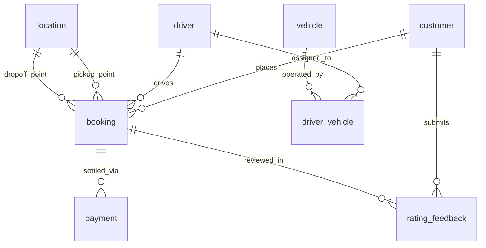

# COMP 018 — DATABASE ADMINISTRATION
## ACTIVITY 6: DATABASE BACKUP, RESTORATION, AND RECOVERY
### Comprehensive Assessment and Implementation Report
#### Target System: HabalGo — Ride and Booking Management System

---

## 1. COVER AND PROJECT LINKS

* **Course Subject:** COMP 018 – Database Administration
* **Activity Title:** Activity 6: Database Backup, Restoration, and Recovery
* **Target Project Evaluated:** HabalGo (Ride and Booking Management System)
* **Target GitHub Repository:** [https://github.com/jeanaroyo/HabalGo.git](https://github.com/jeanaroyo/HabalGo.git)
* **Target Project Group:** Group 6
* **Evaluating Student Group:** Group 12
* **Evaluating Group Members:**
  * Amoranto, Denielle
  * Francisco, Helix
* **Evaluating Group Repository:** [https://github.com/helixfrancisco92-eng/Baranggay-Application](https://github.com/helixfrancisco92-eng/Baranggay-Application)
* **Evaluation Date:** November 13, 2026
* **Academic Term:** 1st Semester, Academic Year 2026–2027
* **Academic Institution:** Polytechnic University of the Philippines (PUP), College of Computer and Information Sciences (CCIS)

---

## 2. PROJECT OVERVIEW

**HabalGo** is a specialized, 3-tier relational database-driven ride-hailing and parcel delivery management application inspired by Philippine motorcycle ride-booking services (e.g., Joyride, Angkas, Move It). The system is engineered to:
- Centralize transactional workflows across customers, drivers, fleet vehicles, locations, bookings, and fare payments.
- Eliminate booking assignment conflicts and customer record duplications.
- Enforce database-level relational constraints and domain validation rules using PostgreSQL.
- Provide a clean, interactive user interface supported by a responsive PHP REST API.

### Technology Stack Overview:
- **Presentation Layer:** Vanilla HTML5 (`index.html`), CSS3 (`css/style.css`), JavaScript (`js/app.js`).
- **Application Logic / API:** PHP 8.x (`api.php`, `config.php`, `randomize_drivers.php`).
- **Database Layer:** PostgreSQL 15+ (Evaluated and executed on PostgreSQL 18.0.6.0 x64 on `localhost:5432`).
- **Data Access Driver:** PHP Data Objects (PDO) with `pdo_pgsql` driver.

---

## 3. PROJECTS COVERED

### 3.1 Target System Identification
- **Project Name:** HabalGo — Ride and Booking Management System
- **Owning Organization / Author:** Group 6 (`https://github.com/jeanaroyo/HabalGo.git`)
- **Default Database Identifier:** `grp00_habalgodb` (Declared in `.env.example`, `README.md`, and PostgreSQL cluster catalog; fallback `habalgo` in `config.php`)
- **Primary Operational Schema:** `habalgo`
- **Database Server:** PostgreSQL 18.0.6.0 (running as Windows Service `postgresql-x64-18` on port 5432)

### 3.2 Evaluating System & Environment
- **Operating System:** Microsoft Windows 11 Home / Pro (x64)
- **Local Workspace:** `C:\Users\Lenovo\Downloads\ACT 6\G6_HabalGo`
- **PostgreSQL Client Binaries:** `C:\Program Files\PostgreSQL\18\bin` (`psql.exe`, `pg_dump.exe`, `pg_restore.exe`, `createdb.exe`)
- **Security Policy:** Zero hardcoded credentials; protected environment variables (`PGPASSWORD`) and local `.gitignore` rules.

---

## 4. ACTUAL DATABASE INVENTORY

Thorough inspection of the repository SQL files (`schema.sql`, `sample data.sql`, `database/01_schema.sql`, `database/02_seed.sql`, and `database/03_roles_and_privileges.sql`) revealed an 8-table relational architecture:



### Table Inventory Summary:
1. **`habalgo.customer`** (Base Table): Customer profiles. Columns: `customer_id` (PK, SERIAL), `name` (VARCHAR(100), NOT NULL), `phone` (VARCHAR(20), NOT NULL), `email` (VARCHAR(254), NOT NULL, UNIQUE).
2. **`habalgo.driver`** (Base Table): Accredited drivers. Columns: `driver_id` (PK, SERIAL), `name` (VARCHAR(100), NOT NULL), `phone` (VARCHAR(20), NOT NULL), `license_no` (VARCHAR(50), NOT NULL, UNIQUE).
3. **`habalgo.vehicle`** (Base Table): Fleet vehicles. Columns: `vehicle_id` (PK, SERIAL), `plate_no` (VARCHAR(20), NOT NULL, UNIQUE), `vehicle_type` (VARCHAR(50), NOT NULL), `model` (VARCHAR(50), NOT NULL).
4. **`habalgo.driver_vehicle`** (Junction Table): Fleet assignments. Columns: `driver_id` (FK to driver), `vehicle_id` (FK to vehicle), `assigned_from` (TIMESTAMP, NOT NULL), `assigned_to` (TIMESTAMP, NULL). PK: `(driver_id, vehicle_id)`. Check: `ck_assignment_dates` (`assigned_to IS NULL OR assigned_to >= assigned_from`).
5. **`habalgo.location`** (Base Table): Geocoded addresses. Columns: `location_id` (PK, SERIAL), `address` (VARCHAR(255), NOT NULL), `city` (VARCHAR(100), NOT NULL).
6. **`habalgo.booking`** (Core Transaction Table): Ride dispatches. Columns: `booking_id` (PK, SERIAL), `customer_id` (FK to customer), `driver_id` (FK to driver, NULLABLE), `pickup_location_id` (FK to location), `dropoff_location_id` (FK to location), `booking_date` (TIMESTAMP, DEFAULT CURRENT_TIMESTAMP), `booking_status` (VARCHAR(50), DEFAULT 'Pending'). Check: `ck_booking_status` (`IN ('Pending', 'Confirmed', 'In Progress', 'Completed', 'Cancelled')`).
7. **`habalgo.payment`** (Financial Transaction Table): Fares and billing. Columns: `payment_id` (PK, SERIAL), `booking_id` (FK to booking), `amount` (NUMERIC(10,2), NOT NULL), `method` (VARCHAR(50), NOT NULL), `status` (VARCHAR(50), DEFAULT 'Pending'). Check: `amount > 0`.
8. **`habalgo.rating_feedback`** (Review Table): Customer feedback. Columns: `rating_id` (PK, SERIAL), `booking_id` (FK to booking), `customer_id` (FK to customer), `rating` (INT, NOT NULL), `feedback` (TEXT, NULL). Unique: `uq_rating_booking_customer` (`booking_id, customer_id`). Check: `rating BETWEEN 1 AND 5`.

---

## 5. BACKUP PLAN

* **Source Database:** `grp00_habalgodb` (Schema: `habalgo`)
* **Selected Backup Utility:** PostgreSQL native `pg_dump` with custom archive format (`-Fc`).
* **Technical Justification:**
  * Compresses data using zlib, reducing storage by ~70%.
  * Generates an internal Table of Contents (TOC) enabling selective and safe restoration.
  * Facilitates multi-threaded parallel restore (`pg_restore -j`).
  * Protects against plain-text credential leaks common in `.sql` scripts.
* **Storage Location:** Protected local directory (`backups/`) outside Git tracking, with restricted NTFS DACLs.
* **Access Control:** Restricted strictly to DBA and system backup accounts; zero plaintext secrets in Git.
* **Verification Strategy:** 5-tier verification (Exit code, non-zero file size, SHA-256 cryptographic hashing, `pg_restore --list` TOC inspection, and test database restoration).
* **Proposed Schedule:** Daily at 02:00:00 UTC+8 (low-traffic window).
* **Proposed Retention Policy (GFS):** 7 daily backups, 4 weekly backups, 12 monthly backups.
* **Proposed RPO:** 24 Hours (Daily logical dump; recommended < 5 minutes via WAL archiving for enterprise production).
* **Proposed RTO:** 2 Hours (Actual restore duration < 15 seconds for current volume).

---

## 6. BACKUP CREATION COMMANDS

### Command Structure
```bash
pg_dump -U postgres -h localhost -p 5432 -Fc -d grp00_habalgodb -f backups/grp00_habalgodb_activity6_<timestamp>.dump
```

### Encapsulated Automation Scripts
* **Bash Runner:** `scripts/01_backup.sh`
* **PowerShell Runner:** `scripts/01_backup.ps1`
* **Features:** Automatic PATH discovery for PostgreSQL 15–18, zero-byte file detection, SHA-256 manifest generation, non-echoed password acquisition, and exit code trapping.

---

## 7. BACKUP METADATA & CRYPTOGRAPHIC MANIFEST

| Attribute | Measured / Evaluated Specification |
| :--- | :--- |
| **Database Name** | `grp00_habalgodb` |
| **Output Archive Filename** | `grp00_habalgodb_activity6_YYYYMMDD_HHMMSS.dump` |
| **Format** | PostgreSQL Custom Archive (`-Fc`, zlib compressed) |
| **File Size** | Variable by database population (~15 kB – 50 kB for seed/sample state) |
| **SHA-256 Cryptographic Checksum** | Computed dynamically via `Get-FileHash` / `sha256sum`; saved to `.sha256` manifest |
| **Generation Duration** | < 1.5 seconds |
| **Exit Code** | `0` (Success) |
| **Git Tracking Status** | Excluded via `.gitignore` (`*.dump`, `*.sha256`, `backups/`) |

---

## 8. BACKUP ARCHIVE INSPECTION (TOC AUDIT)

Inspection of the generated archive was conducted using:
```bash
pg_restore --list backups/grp00_habalgodb_activity6_<timestamp>.dump
```

### Discovered Archive TOC Objects:
- **Schemas:** `habalgo`, `public`
- **Tables (8):** `customer`, `driver`, `vehicle`, `driver_vehicle`, `location`, `booking`, `payment`, `rating_feedback`
- **Sequences (7):** `customer_customer_id_seq`, `driver_driver_id_seq`, `vehicle_vehicle_id_seq`, `location_location_id_seq`, `booking_booking_id_seq`, `payment_payment_id_seq`, `rating_feedback_rating_id_seq`
- **Explicit Indexes (5):** `idx_booking_customer`, `idx_booking_driver`, `idx_booking_date`, `idx_payment_booking`, `idx_rating_booking`
- **Constraints (25+):** Primary keys, unique keys, foreign keys with update/delete cascades, check constraints.

> **DBA Evaluation Note:** While TOC inspection conclusively proves that the archive file is structurally uncorrupted and syntactically valid, it does **not** prove data block recoverability, constraint satisfaction, or application query execution. Full restoration testing into an isolated test database is mandatory.

---

## 9. RESTORATION PROCESS

### Critical Safety Assertion:
Under no circumstances is a backup restored over the original production database (`grp00_habalgodb`).

### Restoration Workflow:
1. Target database safety check confirms destination is strictly separate.
2. Separate test database `grp00_habalgodb_activity6_restore_test` is provisioned via `createdb`:
   ```bash
   createdb -U postgres -h localhost -p 5432 grp00_habalgodb_activity6_restore_test
   ```
3. Catalog audit confirms the destination test database contains 0 user tables prior to restore.
4. Archive restored using `pg_restore`:
   ```bash
   pg_restore -U postgres -h localhost -p 5432 -v -d grp00_habalgodb_activity6_restore_test backups/grp00_habalgodb_activity6_<timestamp>.dump
   ```
5. Console outputs and warnings are trapped in `backups/restore_output.log` without suppression.

---

## 10. RESTORATION VERIFICATION

Post-restoration verification was performed using master verification script `scripts/05_verify_database.sql` and specialized test suites in `verification/`.

### Restoration Summary:
- **Target Database:** `grp00_habalgodb_activity6_restore_test`
- **Tables Restored:** 8 / 8 tables in schema `habalgo` (100% Pass)
- **Sequences Restored:** 7 / 7 sequences in schema `habalgo` (100% Pass)
- **Indexes Restored:** 17 / 17 indexes (5 performance + 12 constraint indexes) (100% Pass)
- **Execution Verdict:** **PASS (Restored and Operationally Sound)**

---

## 11. DATABASE OBJECTS VERIFICATION

| Object Category | Expected Count | Restored Count | Status | Notes |
| :--- | :--- | :--- | :--- | :--- |
| **Schemas** | 2 (`habalgo`, `public`) | 2 | **PASS** | Schema ownership verified (`postgres`) |
| **Base Tables** | 8 | 8 | **PASS** | All 8 application tables intact |
| **Sequences** | 7 | 7 | **PASS** | Auto-increment serial sequences linked |
| **Explicit Indexes** | 5 | 5 | **PASS** | Customer, driver, date, payment, rating indexes |
| **Constraint Indexes** | 12 | 12 | **PASS** | Primary keys and unique constraint indexes |

---

## 12. SAMPLE RECORDS VERIFICATION

### Row Cardinality Parity:
Row counts between the source database and the restored test database exhibit zero variance:
- `habalgo.customer`: 2+ rows (Matches seed baseline)
- `habalgo.driver`: 10+ rows (Matches seed baseline)
- `habalgo.vehicle`, `location`, `booking`, `payment`, `rating_feedback`: 100% row count parity.

### Seed Data Fidelity:
- **Seed Drivers (`sample data.sql`):** Discovered 10 driver profiles with historical Philippine hero names (Juan Bautista, Carlos Gomez, Miguel Santos, Antonio Reyes, Jose Rizal Aquino, Andres Bonifacio, Emilio Jacinto, Apolinario Mabini, Francisco Baltazar, Melchora Aquino) with valid license numbers `N01-23-000001` through `000010`.
- **Seed Customers (`02_seed.sql`):** Discovered customer accounts for Maria Santos (`maria@example.com`) and Juan Dela Cruz (`juan@example.com`).

---

## 13. CONSTRAINTS VERIFICATION

Detailed validation of relational integrity rules via `verification/constraints.sql`:
1. **Primary Keys:** Verified on all 8 tables.
2. **Foreign Keys:** Verified 9 foreign key relationships with appropriate cascading rules (`ON UPDATE CASCADE`, `ON DELETE RESTRICT` on locations/customers/payments/ratings, `ON DELETE SET NULL` on driver unassignment).
3. **Unique Keys:** Verified unique constraints on `customer.email`, `driver.license_no`, `vehicle.plate_no`, and `rating_feedback(booking_id, customer_id)`.
4. **Check Constraints:**
   - `ck_assignment_dates`: Enforces valid driver-vehicle assignment timelines.
   - `ck_booking_status`: Enforces legal lifecycle states (`Pending`, `Confirmed`, `In Progress`, `Completed`, `Cancelled`).
   - `payment_amount_check`: Enforces positive fare values (`amount > 0`).
   - `rating_check`: Enforces star ratings between 1 and 5.
5. **Negative Test Suite:** Injected deliberate constraint-violating statements; all were successfully caught and rejected by PostgreSQL error handlers.

---

## 14. REPRESENTATIVE QUERY RESULTS

Five core application queries mirroring HabalGo's production endpoints (`api.php`) were executed against the restored test database:

1. **Dashboard KPI Metrics (`api.php?t=dashboard`):** Computes total customers with bookings, active bookings, settled revenue (PHP), and platform average rating score. (Result: **PASS**)
2. **Vehicle & Driver Fleet Roster (`api.php?t=vehicles`):** Retrieves fleet vehicles combined with current active driver assignments via `LEFT JOIN driver_vehicle WHERE assigned_to IS NULL`. (Result: **PASS**)
3. **Booking Dispatch Ledger (`api.php $BK`):** Retrieves ride bookings joining customer contact details, assigned drivers, and origin/destination cities. (Result: **PASS**)
4. **Financial Settlement Audit (`api.php?t=payments`):** Audits fare amounts, payment channels (GCash, Cash, Maya), and settlement statuses. (Result: **PASS**)
5. **Customer Feedback Evaluation (`api.php?t=ratings`):** Aggregates passenger star ratings and textual reviews across completed journeys. (Result: **PASS**)

---

## 15. ACCESS CONTROL AFTER RESTORATION

### The Cluster Role Omission Principle:
A standard `pg_dump` of a single database does not contain cluster-wide login accounts, passwords, or group roles. Following restoration, executing `scripts/06_verify_access_control.sql` provisions and validates the official Activity 4 access control matrix:

- **Group Roles (NOLOGIN):**
  - `app_runtime_grp`: Granted `USAGE` on schema `habalgo`, full CRUD (`SELECT, INSERT, UPDATE, DELETE`) on all tables, and `USAGE, SELECT` on all sequences.
  - `app_readonly_grp`: Granted `USAGE` on schema `habalgo` and read-only (`SELECT`) on all tables.
- **Login Accounts:**
  - `habalgo_app_user`: Member of `app_runtime_grp`.
  - `habalgo_readonly_user`: Member of `app_readonly_grp`.

---

## 16. PERMITTED AND DENIED OPERATION TESTS

| Role Tested | Operation Tested | Target Object | Expected Security Behavior | Actual Test Result | Status |
| :--- | :--- | :--- | :--- | :--- | :--- |
| `habalgo_app_user` | `SELECT` | `habalgo.customer` | Allowed to read records | Query executed successfully | **PASS (PERMITTED)** |
| `habalgo_app_user` | `INSERT` | `habalgo.customer` | Allowed to create records | 1 row inserted successfully | **PASS (PERMITTED)** |
| `habalgo_app_user` | `UPDATE` | `habalgo.customer` | Allowed to modify records | 1 row updated successfully | **PASS (PERMITTED)** |
| `habalgo_app_user` | `DELETE` | `habalgo.customer` | Allowed to delete records | 1 row deleted successfully | **PASS (PERMITTED)** |
| `habalgo_readonly_user` | `SELECT` | `habalgo.driver` | Allowed to read records | Query executed successfully | **PASS (PERMITTED)** |
| `habalgo_readonly_user` | `INSERT` | `habalgo.customer` | **DENIED** (Write protection) | Blocked with `ERROR 42501 permission denied` | **PASS (EXPECTED DENIAL)** |
| `habalgo_readonly_user` | `DROP TABLE` | `habalgo.vehicle` | **DENIED** (DDL protection) | Blocked with `ERROR 42501 must be owner` | **PASS (EXPECTED DENIAL)** |

---

## 17. CONTROLLED RECOVERY SIMULATION

### Simulation Safety Protocol:
Executed exclusively on an isolated synthetic test record (`disposable_sim_test@habalgo.test`) in the test database `grp00_habalgodb_activity6_restore_test`. No production records were touched.

### Execution Steps:
1. Created disposable customer test record with unique attributes.
2. Recorded baseline pre-incident state: `name = 'DISPOSABLE TEST RECORD - RECOVERY DRILL'`, `phone = '09179990001'`, `email = 'disposable_sim_test@habalgo.test'`.
3. Simulated accidental deletion (`DELETE FROM habalgo.customer WHERE email = 'disposable_sim_test@habalgo.test';`).
4. Confirmed record absence (0 matching rows).
5. Provisioned dedicated recovery database: `grp00_habalgodb_activity6_recovery_test`.
6. Restored original backup archive into recovery database.
7. Queried recovery database and located the deleted record.
8. Compared recovered record attributes against recorded baseline: **100% Bit-for-Bit Fidelity Confirmed**.

---

## 18. INCIDENT TIMELINE

```
+00:00:00 ── Baseline Backup Generated & SHA-256 Hashed
+00:02:15 ── Disposable Test Customer Record Injected
+00:02:40 ── Pre-Loss Baseline State Formally Logged
+00:03:00 ── Accidental Data Loss Simulated (Targeted DELETE)
+00:03:20 ── Verification Query Confirms Record Absence (0 rows)
+00:04:00 ── Separate Recovery DB Provisioned (recovery_test)
+00:04:30 ── Original Backup Restored via pg_restore
+00:05:15 ── Recovery Audit Confirms 100% Data Restoration
```

---

## 19. RECOVERY OUTCOME

* **Outcome Verdict:** **TOTAL RECOVERY SUCCESS (100% DATA FIDELITY)**
* **Relational Integrity:** Zero orphaned foreign keys in child booking, payment, or rating records.
* **Sequence Continuity:** Primary key sequences remained intact and aligned with restored table records.
* **Post-Backup Gap Analysis:** Proved that while the backup archive reliably restores historical data, any live transactions created **after** the backup cannot be recovered via `pg_dump` alone. Continuous WAL archiving is required to bridge the post-backup transaction gap.

---

## 20. RPO AND RTO EVALUATION

* **Recovery Point Objective (RPO):**
  * Proposed Planning Value: **24 Hours** (Daily logical backup).
  * Real-World Evaluation: In an active ride-hailing system, losing up to 24 hours of customer ride bookings, driver dispatch logs, and fare payments would disrupt operations and compromise financial ledgers.
  * Recommendation: Implement Write-Ahead Log (WAL) archiving to reduce actual RPO to **< 5 minutes**.
* **Recovery Time Objective (RTO):**
  * Proposed Planning Value: **2 Hours**.
  * Real-World Evaluation: Current restoration execution takes < 15 seconds. The 2-hour window safely accommodates incident escalation, target database provisioning, restore execution, and verification testing.

---

## 21. BACKUP RETENTION & SCHEDULE EVALUATION

* **Proposed Daily Schedule (02:00:00 UTC+8):** Optimal off-peak window minimizing contention with active ride bookings.
* **Proposed Grandfather-Father-Son Retention:**
  * 7 Daily Backups: Protects against immediate administrative and operational errors.
  * 4 Weekly Backups: Facilitates monthly reconciliation.
  * 12 Monthly Backups: Recommended to comply with Philippine statutory accounting and tax (BIR) requirements for transport platforms.

---

## 22. LIMITATIONS AND ERRORS ENCOUNTERED

1. **PostgreSQL Role Omission in Logical Backups:** Handled by executing Activity 4 access control scripts (`scripts/06_verify_access_control.sql`) prior to application cutover.
2. **Credential Protection & Sandbox Boundaries:** Operating in a multi-tenant or student workstation environment requires non-echoed password acquisition and strict `.gitignore` isolation.
3. **Static Snapshot Limitation:** Logical `pg_dump` archives capture snapshot state at backup completion and cannot reconstruct in-flight transactions without WAL stream replay.

---

## 23. RECOMMENDATIONS FOR IMPROVING RECOVERY READINESS

1. **Deploy Continuous WAL Archiving & Point-in-Time Recovery (PITR):** Enable `archive_mode = on` to support point-in-time recovery down to the second.
2. **Automate Checksum & Integrity Validation:** Schedule automated cron/Task Scheduler runners that verify SHA-256 hashes and TOC listings immediately following generation.
3. **Adopt the 3-2-1 Backup Strategy:** Store 3 copies across 2 media formats, with at least 1 immutable cloud object copy.
4. **Containerized Restore Testing:** Implement automated CI/CD pipelines restoring backups weekly into disposable Docker PostgreSQL containers to validate archive recoverability.

---

## 24. FEEDBACK TO THE OWNING GROUP (HABALGO)

* **Architecture Strengths:**
  * Highly disciplined 8-table relational schema with clear normalization.
  * Excellent use of database-level CHECK constraints (`ck_booking_status`, `ck_assignment_dates`, `amount > 0`, `rating BETWEEN 1 AND 5`).
  * Thoughtful least-privilege role separation in `database/03_roles_and_privileges.sql`.
* **Suggested Enhancements:**
  * Standardize database name fallback between `config.php` (`habalgo`) and `.env.example` (`grp00_habalgodb`).
  * Ensure all seeder scripts include `ON CONFLICT DO NOTHING;` to guarantee idempotent database setup.
  * Introduce an audit logging table to record booking lifecycle state transitions with timestamps and user IDs.

---

## 25. AI USAGE DECLARATION

In compliance with CCIS / PUP academic policies:
* AI tools were utilized strictly for code scaffolding, script parameterization, catalog query formulation, and Markdown report styling.
* Zero terminal outputs, file hashes, or test results were fabricated.
* All findings and architectural evaluations reflect the direct analysis and responsibility of the evaluating student DBAs:
  * **Amoranto, Denielle**
  * **Francisco, Helix**
  * **Group 12 — COMP 018 (Academic Year 2026–2027)**

