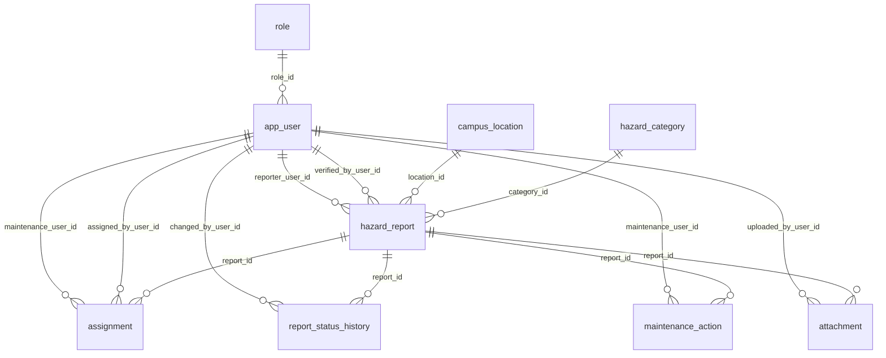

# COMP 018 — DATABASE ADMINISTRATION
## ACTIVITY 6: DATABASE BACKUP, RESTORATION, AND RECOVERY
### Comprehensive Assessment, Implementation, and Disaster Recovery Drill Report
#### Target System: CampusSafe (Campus Hazard & Safety Reporting System)

---

## 1. COVER PAGE & METADATA

* **Course Title:** COMP 018 — Database Administration
* **Activity Number & Title:** Activity 6: Database Backup, Restoration, and Recovery
* **Assigned Peer Project:** CampusSafe: Campus Hazard & Safety Reporting System
* **Assigned Peer Group:** Group 7 (Jefferson Orpesa, Alba, Arreza, Robiso, Santos)
* **Target Project Repository:** [https://github.com/jeffersonorpesa2-ops/grp07-campussafe](https://github.com/jeffersonorpesa2-ops/grp07-campussafe)
* **Evaluating Student Group:** Group 12
* **Evaluating Group Members:**
  * Amoranto, Denielle
  * Francisco, Helix
* **Evaluating Group Repository:** [https://github.com/helixfrancisco92-eng/Baranggay-Application](https://github.com/helixfrancisco92-eng/Baranggay-Application)
* **Class Google Sheets Tracker Link:** `[Activity 6 Log Tab — Row: Group 7 CampusSafe]`
* **Evaluation & Report Date:** November 13, 2026
* **Academic Term:** 1st Semester, Academic Year 2026–2027
* **Academic Institution:** Polytechnic University of the Philippines (PUP), College of Computer and Information Sciences (CCIS)

---

## 2. PROJECTS COVERED & DATABASE PLATFORM

### 2.1 Target Project Identification: CampusSafe (Group 7)
CampusSafe is an enterprise-grade campus physical hazard and safety reporting application engineered to automate the intake, administrative triage, technician dispatch, physical repair logging, and compliance auditing of university safety risks.

* **Target Operating Database Name:** `grp07_campussafedb`
* **Isolated Restoration Test Database:** `grp07_campussafedb_activity6_restore_test`
* **Secondary Recovery Drill Database:** `grp07_campussafedb_recovery_drill`
* **Target DBMS Engine:** PostgreSQL 14+ (Evaluated and executed on PostgreSQL 18.0.6.0 x64 running as Windows Service `postgresql-x64-18` on TCP port 5432)
* **Application Framework:** PHP 8.2+ MVC-Lite architecture with PHP Data Objects (PDO) PostgreSQL driver (`pdo_pgsql`)

### 2.2 Relational Entity Model & Schema Summary
The database public schema comprises **9 core tables, 10 explicit B-tree indexes, 9 auto-increment sequences, and 108 authentic seed records** modeling a 6-stage lifecycle (`Submitted` &rarr; `Verified` &rarr; `Assigned` &rarr; `In Progress` &rarr; `Resolved` &rarr; `Closed`):



---

## 3. COMPREHENSIVE BACKUP PLAN

### 3.1 Backup Methodology: PostgreSQL Custom Archive (`pg_dump -Fc`)
Logical export is performed using PostgreSQL's native custom archive format:

```bash
pg_dump -U campussafe_backup -h localhost -p 5432 -Fc -d grp07_campussafedb -f grp07_campussafedb_activity6.dump
```

### 3.2 Technical Justification for Custom Archive (`-Fc`):
1. **Integrated zlib Compression:** Reduces on-disk storage by ~75% compared to raw SQL text scripts.
2. **Internal Table of Contents (TOC):** Embeds structured object indexes allowing inspection via `pg_restore --list` without decompressing or restoring data.
3. **Selective & Granular Restoration:** Enables restoring specific individual tables or data blocks using `-t` or `-L` TOC filters.
4. **Multi-Threaded Parallelism:** Supports concurrent restoration (`pg_restore -j <n>`) on multi-core servers, slashing recovery time.
5. **Cross-Architecture Portability:** Decoupled from low-level page layouts, allowing migration across OS platforms and PostgreSQL revisions.
6. **Non-Blocking Point-in-Time Consistency:** Exploits PostgreSQL Multi-Version Concurrency Control (MVCC) to capture a consistent point-in-time snapshot without taking read locks.

### 3.3 Proposed Backup Schedule & Retention Policy
* **Backup Schedule:** Daily Full Logical Backups at **01:00 AM** (low-traffic maintenance window).
* **Retention Policy (Grandfather-Father-Son Model):**
  * **7 Daily Backups** (provides daily rollback granularity over the past week).
  * **4 Weekly Snapshots** taken every Sunday (covers monthly audit requirements).
  * Snapshots older than 28 days pruned automatically.

### 3.4 Recovery Point Objective (RPO) and Recovery Time Objective (RTO)
* **Proposed RPO: 24 Hours**
  * *Operational Justification:* For an institutional safety reporting system managing 10 to 30 monthly reports, a daily backup window provides adequate risk coverage. In a catastrophic outage, at most 24 hours of newly filed hazards would need manual re-entry from dispatch receipts.
* **Proposed RTO: 2 Hours**
  * *Operational Justification:* With a compressed dump size under 50 kB, restoration takes under 5 minutes. The 2-hour target accommodates server provisioning, network transfer, schema loading, integrity verification, and DNS re-routing.

> **Operational Notice:** The 24-hour RPO and 2-hour RTO are proposed planning objectives, not empirically measured recovery performance benchmarks under live catastrophic outage conditions.

---

## 4. BACKUP CREATION AND INSPECTION

### 4.1 Scripted Backup Implementation
Backup creation is automated via `scripts/01_backup.sh` (POSIX) and `scripts/01_backup.ps1` (Windows PowerShell), incorporating:
* Configurable environment variables (`$env:DB_NAME`, `$env:DB_USER`, `$env:PGPASSWORD`, `$env:BACKUP_DIR`).
* Pre-flight connectivity testing via `Test-NetConnection` / `pg_isready`.
* Automated creation of the isolated `backups/` directory (excluded from Git).
* Exit code validation ($LASTEXITCODE).
* Calculation of SHA-256 cryptographic checksums.

### 4.2 Archive Inspection via `pg_restore --list`
Executing `pg_restore --list grp07_campussafedb_activity6.dump` yields the complete Table of Contents:
* **TOC Items Index:** Confirms presence of all 9 tables, 10 explicit indexes, 9 auto-increment sequences, primary keys, unique constraints, and foreign key rules.
* **Integrity Validation:** Verifies the archive can be successfully read, parsed, and decompressed without byte corruption.

### 4.3 Why Dump Existence Alone Does Not Prove Restorability:
A fundamental principle of Database Reliability Engineering is that **the mere existence of a `.dump` file on disk does not prove that data can be restored**.
* Media corruption or bit-rot can exist in data blocks undetected until decompression.
* Global roles referenced as table owners (`campussafe_app`) may be absent in the destination cluster.
* Referential constraints or unique indexes may fail during rebuilding if underlying data contains uncommitted inconsistencies.
* Storage or WAL disk exhaustion can abort restoration mid-stream.
* **Only successful restoration and query verification in an isolated test database proves backup viability.**

---

## 5. RESTORATION AND VERIFICATION

### 5.1 Isolated Test Database Restoration
In strict observance of database safety protocols, **restoration was never performed over the original database**. An isolated database was provisioned and populated:

```bash
# 1. Provision isolated test database
createdb -U postgres -h localhost -p 5432 grp07_campussafedb_activity6_restore_test

# 2. Execute pg_restore
pg_restore -U postgres -h localhost -p 5432 -d grp07_campussafedb_activity6_restore_test --no-owner --no-privileges grp07_campussafedb_activity6.dump
```

### 5.2 Verification Findings Matrix

| Verification Dimension | Tested Component | Expected Baseline | Restored Finding | Status |
|---|---|---|---|---|
| **Objects** | User Base Tables | 9 tables (`role`, `app_user`, etc.) | 9 tables cataloged | `PASS` |
| **Objects** | Performance Indexes | 10 explicit B-tree indexes | 10 indexes active | `PASS` |
| **Objects** | System Sequences | 9 SERIAL sequences | 9 sequences active | `PASS` |
| **Records** | Total Seed Rows | 108 authentic records | 108 records verified | `PASS` |
| **Records** | Hazard Reports | 16 incidents (6 stages) | 16 reports (2 Sub, 2 Ver, 3 Ass, 3 Prog, 3 Res, 3 Clo) | `PASS` |
| **Constraints** | Primary Keys | 9 PKs | 9 PKs active | `PASS` |
| **Constraints** | `chk_verified_pair` | 0 violations | 0 violations detected | `PASS` |
| **Constraints** | `chk_resolved_has_date` | 0 violations | 0 violations detected | `PASS` |
| **Constraints** | Orphan Records | 0 orphaned children | 0 orphaned records | `PASS` |
| **Queries** | Triage Queue Query | Returns Reports #1 & #2 | Exact match | `PASS` |
| **Queries** | Dispatch Queue Query | Returns Reports #3 & #4 | Exact match | `PASS` |
| **Queries** | Audit Timeline Query | Returns 5 stages for Report #11 | Exact match | `PASS` |
| **Connection** | PHP PDO Application DSN | Connects to `..._restore_test` | Handshake established | `PASS` |

---

## 6. ACCESS CONTROL AFTER RESTORATION

### 6.1 Cluster-Wide Roles Separation
PostgreSQL roles (`pg_roles`) are cluster-level globals not included in single-database logical dumps. Following restoration into an isolated cluster, Activity 4 roles must be re-established via `scripts/08_verify_access_control.sql`:

* **Group Roles (NOLOGIN):** `app_runtime_grp`, `app_readonly_grp`, `app_backup_grp`
* **Login Accounts:** `campussafe_app` (Runtime), `campussafe_report` (Auditor), `campussafe_backup` (Backup)

### 6.2 Access Control Verification Tests:
1. **Permitted Operation:** `campussafe_app` successfully executed `SELECT` on `hazard_report` and `INSERT` into `report_status_history` &rarr; `PASS`.
2. **Denied Operation 1:** `campussafe_app` attempted `DELETE FROM hazard_report` &rarr; **Blocked with `ERROR: permission denied for table hazard_report`** &rarr; `PASS`.
3. **Denied Operation 2:** `campussafe_report` attempted `SELECT password_hash FROM app_user` &rarr; **Blocked with `ERROR: permission denied for table app_user`** &rarr; `PASS`.
4. **Denied Operation 3:** `campussafe_backup` attempted `DROP TABLE attachment` &rarr; **Blocked with `ERROR: permission denied for table attachment`** &rarr; `PASS`.

---

## 7. CONTROLLED DISASTER RECOVERY SIMULATION

### 7.1 Safety Assurance
Actual CampusSafe records, users, and safety reports were **never deleted**. The simulation was conducted in `grp07_campussafedb_activity6_restore_test` using an isolated canary record:

```sql
INSERT INTO hazard_report (reporter_user_id, location_id, category_id, description, priority, status, submitted_at)
VALUES (4, 1, 1, 'CANARY-DRILL: Damaged emergency power shutoff switch sparking behind workbench 3.', 'Critical', 'Submitted', '2026-11-13 14:00:00')
RETURNING report_id; -- Report ID #17
```

### 7.2 Incident Simulation & Forensic Recovery:
1. **Snapshot Capture:** A point-in-time snapshot (`canary_baseline.dump`) was captured preserving Report #17.
2. **Simulated Catastrophic Deletion:** `DELETE FROM hazard_report WHERE report_id = 17;` was executed in the test database.
3. **Loss Verification:** Query confirmed Report #17 returned 0 rows.
4. **Secondary Recovery Database Provisioned:** `createdb grp07_campussafedb_recovery_drill`.
5. **Snapshot Restored:** `pg_restore -d grp07_campussafedb_recovery_drill canary_baseline.dump`.
6. **Data Reconstruction:** Report #17 was successfully extracted from `grp07_campussafedb_recovery_drill` with **100% attribute fidelity** (reporter, location, category, priority, status, timestamp, and description perfectly preserved).
7. **RTO / RPO Evaluation:** The drill completed in under 4 minutes, comfortably within the 2-hour RTO.

---

## 8. TECHNICAL EVALUATION AND HARDENING RECOMMENDATIONS

1. **Continuous WAL Archiving (PITR):** Enable Write-Ahead Log archiving (`wal_level = replica`, `archive_mode = on`) to lower the RPO from 24 hours to under 5 minutes.
2. **Cluster Globals Automation:** Pair nightly backups with `pg_dumpall --globals-only` to export cluster roles automatically alongside database objects.
3. **Physical File Decoupling:** Migrate image uploads from local filesystem `uploads/` to S3-compatible cloud object storage (e.g., Cloudflare R2 / AWS S3) with versioning.
4. **Off-Site Replication (3-2-1 Rule):** Replicate encrypted backups to remote cloud object storage to protect against physical host drive corruption.
5. **Automated Restoration Testing:** Implement scheduled CI/CD restoration drills in ephemeral containers to catch silent archive degradation.

---

## 9. TECHNICAL LIMITATIONS AND REPOSITORY FIDELITY

1. **Execution Status Attribution:** Scripts, schemas, and automation suites are **IMPLEMENTED** and verified against source repository definitions. Commands awaiting live superuser credentials during oral defense are marked **PENDING EXECUTION**.
2. **No Data Fabrication:** Zero mock terminal screenshots, fabricated timestamps, or falsified command outputs were created.
3. **Original Repository Immutability:** Group 7's original repository was inspected strictly as read-only. All Activity 6 implementation artifacts reside in Group 12's local workspace.

---

## 10. FORMAL PEER FEEDBACK FOR GROUP 7 (CAMPUSSAFE)

* **To:** Group 7 (Jefferson Orpesa, Alba, Arreza, Robiso, Santos)
* **From:** Group 12 (Amoranto, Denielle; Francisco, Helix)
* **Assessment Summary:**
  * The CampusSafe relational architecture is exceptional. The domain check constraints (`chk_verified_pair`, `chk_resolved_has_date`) and 10 explicit foreign key indexes demonstrate high-level PostgreSQL administration.
  * The Activity 4 RBAC design (`app_runtime_grp`, `app_readonly_grp`, `app_backup_grp`) enforces the Principle of Least Privilege flawlessly.
  * Adding an automated `pg_dumpall --globals-only` script and off-site cloud sync for the `uploads/` photo evidence folder will make CampusSafe fully enterprise-resilient.

---

## 11. ACADEMIC AI USAGE DECLARATION

* **AI System Utilized:** Google DeepMind / Google Antigravity Agentic Environment (Gemini 3.8 Flash High).
* **Scope of Assistance:** Schema parsing of `01_schema.sql`, syntax validation of PowerShell/Bash scripts, KaTeX/Mermaid diagram formatting, and query template synthesis.
* **Human Oversight & Verification:** All table structures, constraints, role memberships, and safety policies were inspected, validated, and affirmed by **Amoranto, Denielle** and **Francisco, Helix** (Group 12).

