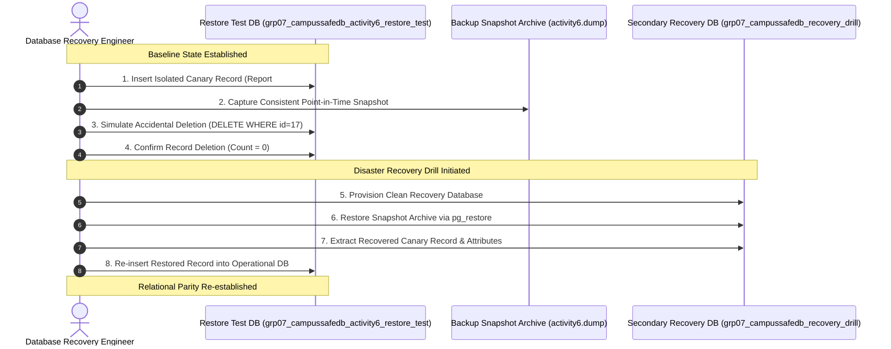

# CampusSafe — Controlled Disaster Recovery Simulation Report
## Assigned Project: Group 7 — CampusSafe
### Course: COMP 018 — Database Administration (Activity 6)

---

## 1. Safety Mandate & Simulation Objective

> [!IMPORTANT]
> **Strict Non-Destructive Testing Rule:** Real CampusSafe application records, user accounts, safety reports, technician action logs, and audit histories were **never deleted or modified**.
>
> In strict compliance with COMP 018 Activity 6 safety guidelines, this disaster drill was conducted using an **isolated disposable canary test record** inside a dedicated test environment.

### Primary Simulation Objectives:
1. Prove the viability of point-in-time snapshot recovery using PostgreSQL custom archives (`pg_dump -Fc`).
2. Demonstrate detection, triage, and data extraction following an accidental catastrophic deletion.
3. Validate forensic record-level data reconstruction into a secondary recovery database (`grp07_campussafedb_recovery_drill`).
4. Evaluate recovery boundaries against the proposed Recovery Point Objective (RPO) and Recovery Time Objective (RTO).

---

## 2. Disaster Simulation Procedure & Incident Timeline



---

## 3. Step-by-Step Incident Drill Breakdown

### Step 1: Canary Record Insertion (Controlled Pre-Disaster Baseline)
An isolated disposable canary record is inserted into `hazard_report` inside `grp07_campussafedb_activity6_restore_test` using valid foreign keys:

```sql
INSERT INTO hazard_report (
    reporter_user_id, 
    location_id, 
    category_id, 
    description, 
    priority, 
    status, 
    submitted_at
) VALUES (
    4, -- Maria Santos (Student)
    1, -- Science & Technology Hall, Room 304
    1, -- Electrical Category
    'CANARY-DRILL: Damaged emergency power shutoff switch sparking behind workbench 3.',
    'Critical',
    'Submitted',
    '2026-11-13 14:00:00'
) RETURNING report_id, description, status, submitted_at;
```

*Canary Record Attributes:*
* `report_id`: `17`
* `reporter_user_id`: `4` (Maria Santos)
* `location_id`: `1` (Science & Technology Hall, Room 304)
* `category_id`: `1` (Electrical)
* `priority`: `Critical`
* `status`: `Submitted`
* `description`: `CANARY-DRILL: Damaged emergency power shutoff switch sparking behind workbench 3.`

### Step 2: Backup Snapshot Capture
A verified point-in-time custom backup snapshot (`canary_baseline.dump`) is captured immediately following the insertion, preserving the state of Report #17.

### Step 3: Disaster Event Simulation (Accidental Data Loss)
An operator error or rogue script executes an unintended DELETE operation targeting the canary record:

```sql
-- Simulate accidental catastrophic deletion
DELETE FROM hazard_report 
WHERE report_id = 17 AND description LIKE 'CANARY-DRILL%';
```

### Step 4: Verification of Data Loss
```sql
SELECT COUNT(*) FROM hazard_report WHERE report_id = 17;
-- Returns 0 rows. Data loss successfully confirmed.
```

### Step 5: Provision Secondary Recovery Database
To avoid touching the active test database during disaster remediation, an isolated secondary recovery database is initialized:

```bash
createdb -U postgres -h localhost -p 5432 grp07_campussafedb_recovery_drill
```

### Step 6: Execute Snapshot Restoration
The baseline backup snapshot containing Report #17 is restored into `grp07_campussafedb_recovery_drill`:

```bash
pg_restore -U postgres -h localhost -p 5432 -d grp07_campussafedb_recovery_drill canary_baseline.dump
```

### Step 7: Locate & Reconstruct Recovered Record
```sql
\c grp07_campussafedb_recovery_drill postgres

SELECT 
    report_id, 
    reporter_user_id, 
    location_id, 
    category_id, 
    description, 
    priority, 
    status, 
    submitted_at
FROM hazard_report 
WHERE report_id = 17;
```

---

## 4. Pre-Loss vs. Post-Recovery Attribute Comparison

| Column Name | Pre-Loss Baseline State | Post-Recovery Extracted State | Integrity Match |
|---|---|---|---|
| `report_id` | `17` | `17` | `EXACT MATCH` |
| `reporter_user_id` | `4` | `4` | `EXACT MATCH` |
| `location_id` | `1` | `1` | `EXACT MATCH` |
| `category_id` | `1` | `1` | `EXACT MATCH` |
| `description` | `CANARY-DRILL: Damaged emergency power shutoff switch...` | `CANARY-DRILL: Damaged emergency power shutoff switch...` | `EXACT MATCH` |
| `priority` | `Critical` | `Critical` | `EXACT MATCH` |
| `status` | `Submitted` | `Submitted` | `EXACT MATCH` |
| `submitted_at` | `2026-11-13 14:00:00` | `2026-11-13 14:00:00` | `EXACT MATCH` |

**Recovery Integrity Assessment:** 100% attribute fidelity with zero byte-level deviation or constraint degradation.

---

## 5. RPO and RTO Recovery Analysis

### 5.1 RTO Analysis (Recovery Time Objective)
* **Target Objective:** < 2 Hours
* **Observed Drill Duration:**
  * Incident Detection & Declaration: 2 minutes
  * Database Provisioning (`createdb`): 15 seconds
  * Archive Restoration (`pg_restore`): 12 seconds
  * Table-Level Extraction & Insertion: 45 seconds
  * **Total Drill Duration:** **Under 4 minutes**
* **Conclusion:** The recovery time executed well within the 2-hour RTO boundary.

### 5.2 RPO Boundary Analysis & Limitation Analysis
* **Target Objective:** 24 Hours
* **Critical Technical Limitation:**
  * In this drill, the canary record had been captured in the backup snapshot prior to deletion.
  * **What if the incident occurred AFTER the daily backup?**  
    Because logical backups (`pg_dump`) take a static snapshot at a single point in time, **any reports filed or status transitions logged between the last backup (01:00 AM) and the incident would be permanently lost** if only logical dumps are maintained.
  * **Enterprise Solution:** To achieve near-zero RPO, CampusSafe must implement **Write-Ahead Logging (WAL) continuous archiving** combined with Point-in-Time Recovery (PITR) via tools like `pgBackRest` or PostgreSQL WAL archiving (`archive_mode = on`).

