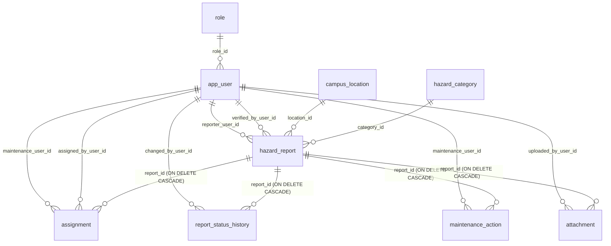

# CampusSafe — Database Inventory & Structural Catalog
## Assigned Project: Group 7 — CampusSafe
### Course: COMP 018 — Database Administration (Activity 6)

---

## 1. Database Identification & Operational Parameters

| Parameter | System Specification |
|---|---|
| **System Name** | CampusSafe: Campus Hazard & Safety Reporting System |
| **Owning Project Group** | Group 7 (Jefferson Orpesa, Alba, Arreza, Robiso, Santos) |
| **Repository URL** | [https://github.com/jeffersonorpesa2-ops/grp07-campussafe](https://github.com/jeffersonorpesa2-ops/grp07-campussafe) |
| **Evaluating Group** | Group 12 (Amoranto, Denielle; Francisco, Helix) |
| **Evaluating Repository** | [https://github.com/helixfrancisco92-eng/Baranggay-Application](https://github.com/helixfrancisco92-eng/Baranggay-Application) |
| **Database Platform** | PostgreSQL 14+ (Verified on PostgreSQL 18.0.6.0 x64 Windows Service `postgresql-x64-18`) |
| **Production Database Name** | `grp07_campussafedb` |
| **Primary Operational Schema** | `public` |
| **Application Runtime Driver** | PHP Data Objects (PDO) with `pdo_pgsql` driver |
| **Database Port** | `5432` (Configurable to `5433` via `.env`) |
| **Application Runtime Account** | `campussafe_app` (Member of `app_runtime_grp`) |
| **Backup Operator Account** | `campussafe_backup` (Member of `app_backup_grp`) |
| **Read-Only / Auditor Account** | `campussafe_report` (Member of `app_readonly_grp`) |

---

## 2. Entity-Relationship Architecture

The relational schema implements a 6-stage physical safety hazard resolution lifecycle:
`Submitted` &rarr; `Verified` &rarr; `Assigned` &rarr; `In Progress` &rarr; `Resolved` &rarr; `Closed`.



---

## 3. Comprehensive Table Catalog (All 9 Tables)

### 3.1 `role`
Defines system authorization and role-based access control levels for application users.

| Column | Data Type | Nullable | Default | Constraints | Description |
|---|---|---|---|---|---|
| `role_id` | `SERIAL` | `NO` | auto-increment | `PRIMARY KEY` | Unique role identifier |
| `role_name` | `VARCHAR(50)` | `NO` | None | `UNIQUE` | Distinct role designation (`Student`, `Faculty/Staff`, `Maintenance`, `Administrator`, `Auditor`) |
| `description` | `TEXT` | `YES` | `NULL` | None | Scope of authority and functional duties |

### 3.2 `app_user`
Stores account profiles, credentials, and account statuses. Explicitly named `app_user` to avoid syntax conflicts with the PostgreSQL reserved keyword `user`.

| Column | Data Type | Nullable | Default | Constraints | Description |
|---|---|---|---|---|---|
| `user_id` | `SERIAL` | `NO` | auto-increment | `PRIMARY KEY` | Unique user account identifier |
| `role_id` | `INT` | `NO` | None | `REFERENCES role(role_id)` | Foreign key linking user to system role |
| `full_name` | `VARCHAR(150)` | `NO` | None | None | First and last name of individual |
| `email` | `VARCHAR(255)` | `NO` | None | `UNIQUE` | Unique institutional campus email |
| `username` | `VARCHAR(100)` | `NO` | None | `UNIQUE` | Unique system login handle |
| `password_hash` | `TEXT` | `NO` | None | None | Bcrypt password hash (`$2y$10$...`) |
| `account_status` | `VARCHAR(20)` | `NO` | `'active'` | `CHECK (account_status IN ('active', 'inactive', 'suspended'))` | Operational account status |
| `created_at` | `TIMESTAMP` | `NO` | `CURRENT_TIMESTAMP` | None | Timestamp of user registration |

### 3.3 `hazard_category`
Master catalog of hazard classifications used to categorize submitted incident reports.

| Column | Data Type | Nullable | Default | Constraints | Description |
|---|---|---|---|---|---|
| `category_id` | `SERIAL` | `NO` | auto-increment | `PRIMARY KEY` | Unique category identifier |
| `category_name` | `VARCHAR(80)` | `NO` | None | `UNIQUE` | Category title (e.g., Electrical, Structural, Sanitation) |
| `description` | `TEXT` | `YES` | `NULL` | None | Detailed scope of physical risks included |
| `is_active` | `BOOLEAN` | `NO` | `TRUE` | None | Soft deactivation flag for master data management |

### 3.4 `campus_location`
Master registry of campus facilities, buildings, floors, and specific rooms.

| Column | Data Type | Nullable | Default | Constraints | Description |
|---|---|---|---|---|---|
| `location_id` | `SERIAL` | `NO` | auto-increment | `PRIMARY KEY` | Unique facility location identifier |
| `building` | `VARCHAR(120)` | `NO` | None | None | Building or structure name |
| `floor` | `VARCHAR(30)` | `YES` | `NULL` | None | Floor designation (e.g., 3rd Floor, Basement, Ground Floor) |
| `room_area` | `VARCHAR(120)` | `NO` | None | None | Specific room, lab, or area designation |
| `location_description` | `TEXT` | `YES` | `NULL` | None | Navigational directions or nearby landmarks |
| `is_active` | `BOOLEAN` | `NO` | `TRUE` | None | Soft deactivation flag |

### 3.5 `hazard_report`
Core transactional incident reporting entity tracking life-safety and facilities risks.

| Column | Data Type | Nullable | Default | Constraints | Description |
|---|---|---|---|---|---|
| `report_id` | `SERIAL` | `NO` | auto-increment | `PRIMARY KEY` | Unique incident report serial number |
| `reporter_user_id` | `INT` | `NO` | None | `REFERENCES app_user(user_id)` | Account ID of individual filing report |
| `location_id` | `INT` | `NO` | None | `REFERENCES campus_location(location_id)` | Target physical location of hazard |
| `category_id` | `INT` | `NO` | None | `REFERENCES hazard_category(category_id)` | Classification of safety risk |
| `description` | `TEXT` | `NO` | None | None | Comprehensive explanation of observed hazard |
| `priority` | `VARCHAR(20)` | `YES` | `NULL` | `CHECK (priority IN ('Low', 'Medium', 'High', 'Critical'))` | Risk severity (`NULL` until verified by Administrator) |
| `status` | `VARCHAR(30)` | `NO` | `'Submitted'` | `CHECK (status IN ('Submitted', 'Verified', 'Assigned', 'In Progress', 'Resolved', 'Closed'))` | Lifecycle stage |
| `submitted_at` | `TIMESTAMP` | `NO` | `CURRENT_TIMESTAMP` | None | Exact timestamp report was filed |
| `verified_by_user_id` | `INT` | `YES` | `NULL` | `REFERENCES app_user(user_id)` | Administrator who verified report |
| `verified_at` | `TIMESTAMP` | `YES` | `NULL` | None | Timestamp of administrative verification |
| `resolved_at` | `TIMESTAMP` | `YES` | `NULL` | None | Timestamp when physical hazard was remediated |

#### Critical Integrity Constraints on `hazard_report`:
1. `chk_verified_pair`:
   ```sql
   CHECK (
       (verified_by_user_id IS NULL AND verified_at IS NULL) OR
       (verified_by_user_id IS NOT NULL AND verified_at IS NOT NULL)
   )
   ```
   *Guarantees atomic administrative verification: a verifier cannot exist without a timestamp, and a timestamp cannot exist without a verifier.*
2. `chk_resolved_has_date`:
   ```sql
   CHECK (
       status NOT IN ('Resolved', 'Closed') OR resolved_at IS NOT NULL
   )
   ```
   *Guarantees that no hazard report can transition into 'Resolved' or 'Closed' status without recording the timestamp of physical repair.*

### 3.6 `assignment`
Records dispatch of verified hazards to on-duty maintenance personnel.

| Column | Data Type | Nullable | Default | Constraints | Description |
|---|---|---|---|---|---|
| `assignment_id` | `SERIAL` | `NO` | auto-increment | `PRIMARY KEY` | Unique dispatch record ID |
| `report_id` | `INT` | `NO` | None | `REFERENCES hazard_report(report_id) ON DELETE CASCADE` | Associated hazard report |
| `maintenance_user_id` | `INT` | `NO` | None | `REFERENCES app_user(user_id)` | Assigned maintenance technician |
| `assigned_by_user_id` | `INT` | `NO` | None | `REFERENCES app_user(user_id)` | Administrator initiating dispatch |
| `assigned_at` | `TIMESTAMP` | `NO` | `CURRENT_TIMESTAMP` | None | Dispatch timestamp |
| `assignment_status` | `VARCHAR(20)` | `NO` | `'Assigned'` | `CHECK (assignment_status IN ('Assigned', 'In Progress', 'Completed', 'Cancelled'))` | Work order progression status |

#### Unique Constraint on `assignment`:
* `UNIQUE (report_id, maintenance_user_id)`: Enforces business logic preventing duplicate active assignments of the same technician to the same incident report.

### 3.7 `report_status_history`
Immutable chronological audit log capturing every lifecycle status transition for every hazard report.

| Column | Data Type | Nullable | Default | Constraints | Description |
|---|---|---|---|---|---|
| `history_id` | `SERIAL` | `NO` | auto-increment | `PRIMARY KEY` | Unique history record ID |
| `report_id` | `INT` | `NO` | None | `REFERENCES hazard_report(report_id) ON DELETE CASCADE` | Associated hazard report |
| `changed_by_user_id` | `INT` | `NO` | None | `REFERENCES app_user(user_id)` | Actor who triggered transition |
| `status` | `VARCHAR(30)` | `NO` | None | `CHECK (status IN ('Submitted', 'Verified', 'Assigned', 'In Progress', 'Resolved', 'Closed'))` | State transitioned into |
| `changed_at` | `TIMESTAMP` | `NO` | `CURRENT_TIMESTAMP` | None | Timestamp of transition |
| `notes` | `TEXT` | `YES` | `NULL` | None | Justification, dispatch notes, or resolution remarks |

### 3.8 `maintenance_action`
Detailed log of physical diagnostic procedures, temporary mitigations, and permanent repairs logged by technicians.

| Column | Data Type | Nullable | Default | Constraints | Description |
|---|---|---|---|---|---|
| `action_id` | `SERIAL` | `NO` | auto-increment | `PRIMARY KEY` | Unique action log ID |
| `report_id` | `INT` | `NO` | None | `REFERENCES hazard_report(report_id) ON DELETE CASCADE` | Associated hazard report |
| `maintenance_user_id` | `INT` | `NO` | None | `REFERENCES app_user(user_id)` | Technician performing repair |
| `action_details` | `TEXT` | `NO` | None | None | Technical narrative of physical repair |
| `action_date` | `TIMESTAMP` | `NO` | `CURRENT_TIMESTAMP` | None | Timestamp when work occurred |
| `is_resolution` | `BOOLEAN` | `NO` | `FALSE` | None | `TRUE` if action permanently rectified the hazard |
| `notes` | `TEXT` | `YES` | `NULL` | None | Replacement parts, model numbers, or load test notes |

### 3.9 `attachment`
Photo or document evidence files uploaded by reporters or technicians.

| Column | Data Type | Nullable | Default | Constraints | Description |
|---|---|---|---|---|---|
| `attachment_id` | `SERIAL` | `NO` | auto-increment | `PRIMARY KEY` | Unique attachment record ID |
| `report_id` | `INT` | `NO` | None | `REFERENCES hazard_report(report_id) ON DELETE CASCADE` | Associated hazard report |
| `uploaded_by_user_id` | `INT` | `NO` | None | `REFERENCES app_user(user_id)` | Account ID of uploading user |
| `file_name` | `VARCHAR(255)` | `NO` | None | None | Original filename submitted by client |
| `file_path_or_url` | `TEXT` | `NO` | None | None | Server-side storage path under `uploads/` |
| `mime_type` | `VARCHAR(100)` | `YES` | `NULL` | None | MIME type validated via PHP fileinfo |
| `uploaded_at` | `TIMESTAMP` | `NO` | `CURRENT_TIMESTAMP` | None | Upload timestamp |

---

## 4. Performance Indexes (10 Explicit B-Tree Indexes)

In addition to the 9 implicit B-tree indexes generated for Primary Key and Unique constraints, the schema contains 10 explicit indexes created to optimize high-frequency filtering, foreign key lookups, and sorting:

| Index Name | Target Table | Indexed Column(s) | Operational Purpose |
|---|---|---|---|
| `idx_report_reporter` | `hazard_report` | `reporter_user_id` | Accelerates "My Submitted Hazards" reporter queries |
| `idx_report_location` | `hazard_report` | `location_id` | Optimizes facility-level hazard cluster analysis |
| `idx_report_category` | `hazard_report` | `category_id` | Accelerates category-based hazard filtering |
| `idx_report_status` | `hazard_report` | `status` | Speeds up triage views (`Submitted`, `Verified`, `In Progress`) |
| `idx_report_submitted` | `hazard_report` | `submitted_at` | Optimizes chronological timeline ordering |
| `idx_assign_report` | `assignment` | `report_id` | Optimizes report-to-dispatch foreign key joins |
| `idx_assign_maint` | `assignment` | `maintenance_user_id` | Accelerates technician personal work order queue |
| `idx_history_report` | `report_status_history` | `report_id` | Speeds up multi-stage audit timeline rendering |
| `idx_action_report` | `maintenance_action` | `report_id` | Accelerates physical action log retrieval |
| `idx_attach_report` | `attachment` | `report_id` | Speeds up photo evidence thumbnail grid lookups |

---

## 5. Sequences Catalog (9 Sequences)

Each table utilizes a PostgreSQL `SERIAL` pseudotype, automatically creating and binding an underlying sequence in the `public` schema:

| Sequence Name | Associated Table & Column | Minimum | Increment | Cycle |
|---|---|---|---|---|
| `role_role_id_seq` | `role.role_id` | 1 | 1 | `NO` |
| `app_user_user_id_seq` | `app_user.user_id` | 1 | 1 | `NO` |
| `hazard_category_category_id_seq` | `hazard_category.category_id` | 1 | 1 | `NO` |
| `campus_location_location_id_seq` | `campus_location.location_id` | 1 | 1 | `NO` |
| `hazard_report_report_id_seq` | `hazard_report.report_id` | 1 | 1 | `NO` |
| `assignment_assignment_id_seq` | `assignment.assignment_id` | 1 | 1 | `NO` |
| `report_status_history_history_id_seq` | `report_status_history.history_id` | 1 | 1 | `NO` |
| `maintenance_action_action_id_seq` | `maintenance_action.action_id` | 1 | 1 | `NO` |
| `attachment_attachment_id_seq` | `attachment.attachment_id` | 1 | 1 | `NO` |

---

## 6. Seed Data Inventory & Baseline Row Counts

The authentic seed data defined in `database/02_seed.sql` populates realistic campus hazards across all lifecycle stages:

| Table Name | Baseline Seed Rows | Operational Role & Summary |
|---|---|---|
| `role` | 5 | Student, Faculty/Staff, Maintenance, Administrator, Auditor |
| `app_user` | 6 | Admin (Eleanor Vance), 2 Techs (Davis, Reyes), Student (Santos), Faculty (Hernandez), Auditor (Kim) |
| `hazard_category` | 6 | Electrical, Structural, Sanitation, Equipment, Fire Safety, Other Safety |
| `campus_location` | 10 | Science Hall, Academic Complex, Engineering Wing, Library, Cafeteria, Gym, Admin, Arts, IT Center, Parking |
| `hazard_report` | 16 | 2 Submitted, 2 Verified, 3 Assigned, 3 In Progress, 3 Resolved, 3 Closed |
| `assignment` | 12 | 3 Assigned, 3 In Progress, 6 Completed work orders |
| `report_status_history` | 39 | Complete multi-step audit transitions for reports 1 through 16 |
| `maintenance_action` | 9 | Diagnostic logs and resolution actions by Davis and Reyes |
| `attachment` | 5 | Incident photos (`exposed_cable_photo.jpg`, `oil_spill_cnc.jpg`, etc.) |
| **Total Database Objects** | **9 Tables, 10 Indexes, 9 Sequences, 108 Seed Rows** | Complete enterprise relational baseline |

---

## 7. Existing Access Control Roles & Users (Activity 4)

From `database/03_roles_and_privileges.sql`, Group 7 designed a 3-tier Role-Based Access Control hierarchy:

### Group Roles (NOLOGIN):
1. `app_runtime_grp`: Granted standard Data Manipulation Language (DML) rights for the web app. Mutable tables have UPDATE grants; immutable audit trails (`report_status_history`, `maintenance_action`) exclude UPDATE. DELETE is permitted strictly on `attachment` and `assignment` (never `hazard_report` or `app_user`).
2. `app_readonly_grp`: Granted SELECT on operational reports, locations, categories, and histories. Strictly denied access to `app_user` (protects bcrypt hashes) and all DML write operations.
3. `app_backup_grp`: Granted SELECT on all tables and sequences for complete logical disaster backups (`pg_dump`). Denied all write and DDL operations.

### Login Accounts:
* `campussafe_app` &rarr; Member of `app_runtime_grp`
* `campussafe_report` &rarr; Member of `app_readonly_grp`
* `campussafe_backup` &rarr; Member of `app_backup_grp`

