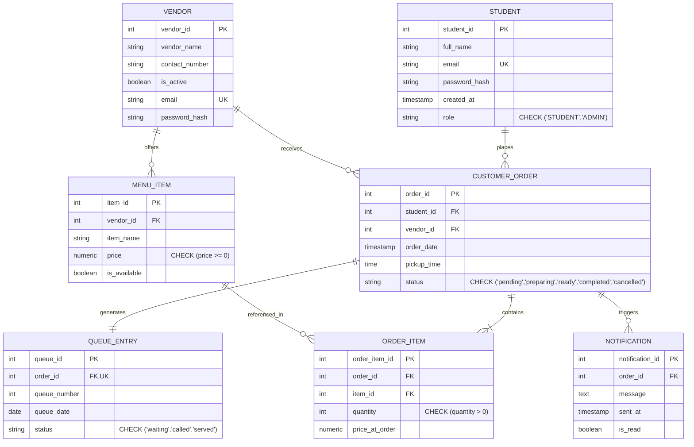
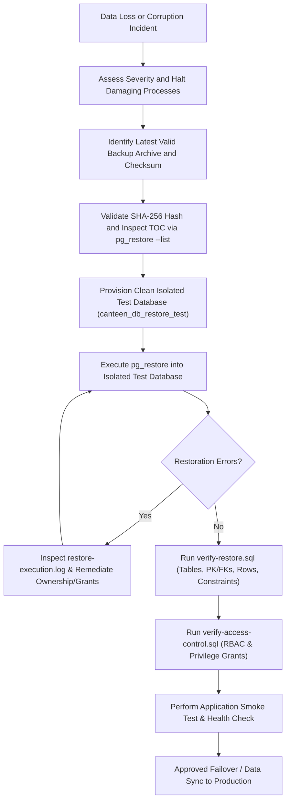

# Database Backup and Disaster Recovery Plan
## COMP 018 — Database Administration | Activity 6
### Assigned Project: Campus Canteen Pre-Order and Queue Management System (Group 8 – bwisIT Solutions)

---

## 1. Executive Summary and System Context

This document establishes the formal **Database Backup, Restoration, and Recovery Plan** for the **Campus Canteen Pre-Order and Queue Management System (canteen_db)**. The system is designed to streamline meal ordering, queue tracking, and sales analytics for university food stalls. 

As a transactional database servicing daily campus dining operations, data loss or corruption could disrupt meal pickups, stall revenue accounting, and order status notifications. This plan details the technical backup strategy, storage security architecture, verification gates, operational schedules, and disaster recovery runbooks adhering to senior database administration best practices.

---

## 2. Target Database Architecture Inventory

### A. Identification and Environment
- **Project Name:** Campus Canteen Pre-Order and Queue Management System
- **Assigned Group:** Group 8 (bwisIT Solutions)
- **Repository URL:** `https://github.com/EclipseChan/bwisIT-Solutions---Campus-Canteen-Pre-Order-and-Queue-Management-System.git`
- **Database Engine:** PostgreSQL 18 (Client binary suite located at `C:\Program Files\PostgreSQL\18\bin`)
- **Primary Database Name:** `canteen_db`
- **Isolated Restoration Test DB:** `canteen_db_activity6_restore_test`
- **Database Schema:** `public`
- **Backend Application Stack:** Java 21, Spring Boot 3.4.1, Spring Data JPA, Spring Security, JWT, Maven

### B. Core Relational Schema and Objects
The database contains seven core relational tables structured in strict dependency order:



### C. Relational Integrity and Constraints
1. **Primary Keys:** `student_id`, `vendor_id`, `item_id`, `order_id`, `order_item_id`, `queue_id`, `notification_id`.
2. **Foreign Keys:**
   - `menu_item.vendor_id` → `vendor.vendor_id` (RESTRICT)
   - `customer_order.student_id` → `student.student_id` (RESTRICT)
   - `customer_order.vendor_id` → `vendor.vendor_id` (RESTRICT)
   - `order_item.order_id` → `customer_order.order_id` (CASCADE / RESTRICT)
   - `order_item.item_id` → `menu_item.item_id` (RESTRICT)
   - `queue_entry.order_id` → `customer_order.order_id` (RESTRICT, 1-to-1)
   - `notification.order_id` → `customer_order.order_id` (RESTRICT)
3. **Unique Constraints:**
   - `student.email`
   - `vendor.email`
   - `menu_item(vendor_id, item_name)` (`uq_menu_item_vendor_name`)
   - `queue_entry.order_id`
   - `queue_entry(queue_number, queue_date)`
4. **Check Constraints:**
   - `student.role IN ('STUDENT','ADMIN')`
   - `menu_item.price >= 0`
   - `customer_order.status IN ('pending','preparing','ready','completed','cancelled')`
   - `order_item.quantity > 0`
   - `queue_entry.status IN ('waiting','called','served')`
5. **Performance Indexes:**
   - `idx_customer_order_vendor_date` on `customer_order(vendor_id, order_date)`
   - `idx_customer_order_student_date` on `customer_order(student_id, order_date DESC)`
   - `idx_customer_order_completed` on `customer_order(order_date)` WHERE `status = 'completed'`
   - `idx_order_item_order` on `order_item(order_id)`
   - `idx_order_item_item` on `order_item(item_id)`
   - `idx_menu_item_vendor` on `menu_item(vendor_id)`
   - `idx_notification_order` on `notification(order_id)`

---

## 3. Backup Methodology and Engineering Rationale

### A. Selected Tool and Format
- **Utility:** PostgreSQL `pg_dump`
- **Archive Format:** Custom Archive Format (`-Fc` / `--format=custom`)
- **Syntax Specification:**
  ```bash
  pg_dump -h <host> -p <port> -U canteen_admin -Fc -b -v -d canteen_db -f <destination_file>.dump
  ```

### B. Engineering Justification
1. **High-Ratio zlib Compression:** The `-Fc` format applies stream compression natively, reducing storage footprint by 70–85% compared to plain SQL text files.
2. **Binary Table of Contents (TOC):** Embeds structural metadata that can be pre-inspected via `pg_restore --list` without restoring data or executing DDL.
3. **Intelligent Restoration Reordering:** Plain SQL files can fail during restore if foreign key constraints are evaluated before child tables are populated. `pg_restore` dynamically interprets TOC dependency trees to recreate tables, restore rows, and apply foreign key constraints in correct topological order.
4. **Selective and Parallel Restoration:** Allows restoring specific schemas, individual tables, or schema-only/data-only slices, and supports multi-threaded restoration (`-j` flag).
5. **Cross-Platform Portability:** Binary custom dumps can be restored across heterogeneous environments (Linux, Windows, macOS) provided PostgreSQL engine compatibility is maintained.

### C. What Is Included in the Backup
- Complete DDL statements for schemas, tables, columns, data types, and sequences.
- All primary key, foreign key, unique, and check constraints.
- All performance, relational, and partial indexes.
- Table-level data blocks and sequence state values (`last_value`).
- Object ownership designations (tagging `canteen_admin`).
- Database-level and object-level privilege grants explicitly recorded on tables.

### D. What Is NOT Included (Cluster-Wide Scope)
- **PostgreSQL Cluster Roles and Passwords:** PostgreSQL roles (`canteen_admin`, `canteen_app`, `canteen_readonly`, etc.) are cluster-wide global entities stored in `pg_authid`. Single-database `pg_dump` archives do not contain cluster roles.
- **Tablespaces and Cluster Configuration Parameters:** Global server settings located in `postgresql.conf` or `pg_hba.conf`.
- **Role Recreation Strategy:** Roles and memberships must be preserved and recreated separately using `pg_dumpall --globals-only` or by applying Group 8's Activity 4 scripts:
  - `db-access-control/01-create-roles.sql`
  - `db-access-control/02-role-memberships.sql`
  - `db-access-control/03-database-privileges.sql`
  - `db-access-control/04-schema-and-table-privileges.sql`
  - `db-access-control/05-sequence-privileges.sql`
  - `db-access-control/06-default-privileges.sql`

---

## 4. Backup Storage Architecture and Operational Security

### A. Storage Segregation Boundary
Backup files must never reside within the application code repository, web server directories, or public cloud storage.
- **Designated Backup Location:** `db-backup-recovery/backups/` or external secure volume (`D:\canteen-backups\`).
- **File System Permissions:** Restricted to the operating system administrative user and PostgreSQL service account. World-read and group-write permissions are strictly revoked (`chmod 700` / Windows ACL restriction).

### B. Version Control Security and Data Protection
Committing raw database dumps to Git repositories is a critical security vulnerability:
1. **Confidentiality Breach:** Backups contain student personal identifiable information (full names, institutional emails), vendor contact numbers, and bcrypt password hashes.
2. **Repository Bloat:** Binary dump files cause Git repository size inflation that cannot be easily purged due to Git commit history immutability.
3. **Exclusion Enforcement:** A robust `.gitignore` is enforced at the repository root:
   ```gitignore
   *.dump
   *.tar
   *.sql.gz
   backups/
   /db-backup-recovery/group-08-campus-canteen/backups/
   .env
   *.pgpass
   ```

### C. Credential Management Policy
- **Authorized Backup Account:** `canteen_admin` (database owner) or cluster administrator `postgres`.
- **Prohibited Account:** The application runtime user `canteen_app` and reporting user `canteen_readonly` must never be used for administrative backup/restore tasks.
- **Zero-Hardcoding Policy:** Scripts prompt interactively (`Read-Host -AsSecureString` / `read -s`) or utilize local PostgreSQL password mechanisms (`%APPDATA%\postgresql\pgpass.conf` or `~/.pgpass`) configured with `0600` permissions.

### D. Multi-Tier Verification Gates
Every backup must pass five strict verification gates:
1. **Gate 1 - Execution Exit Code:** `pg_dump` terminates with exit code 0.
2. **Gate 2 - File Size Validation:** Archive file exists and has non-zero byte size (`-s` / `Length -gt 0`).
3. **Gate 3 - Cryptographic Checksum:** SHA-256 hash generated and recorded in companion `.sha256` file.
4. **Gate 4 - TOC Extraction Audit:** `pg_restore --list` reads archive without corruption and verifies all 7 tables.
5. **Gate 5 - Sandbox Restoration Test:** Periodic restore to an isolated test database (`canteen_db_activity6_restore_test`).

---

## 5. Proposed Backup Schedule, Retention, RPO, and RTO

> [!NOTE]
> The schedule and metrics below represent a formal professional DBA operational recommendation for the production deployment of the Campus Canteen System.

### A. Proposed Schedule (Grandfather-Father-Son Policy)
- **Daily Backups (Son):** Automated full logical dump executed daily at 02:00 AM Philippine Standard Time (off-peak hours when canteen ordering is inactive).
- **Weekly Backups (Father):** Captured every Sunday at 03:00 AM, retained for 4 weeks.
- **Monthly Backups (Grandfather):** Captured on the 1st day of each month, retained for 12 months for academic term and financial audit compliance.
- **Retention Rule:** Maintain 7 daily backups and 4 weekly backups. Archives older than retention thresholds are automatically purged by scheduled rotation tasks.

### B. Recovery Point Objective (RPO)
- **Proposed Target:** **24 Hours** (for daily logical backups)
- **Operational Definition:** RPO specifies the maximum acceptable data loss measured in time between the last successful backup and a disaster event.
- **Justification for Canteen System:** The primary daily meal ordering occurs during operational daytime hours (07:00 to 19:00). Daily overnight backups at 02:00 AM ensure that all settled orders and daily sales totals from the preceding business day are permanently preserved. In production, augmenting this with PostgreSQL Write-Ahead Log (WAL) archiving reduces RPO to **15 minutes**.

### C. Recovery Time Objective (RTO)
- **Proposed Target:** **2 Hours**
- **Operational Definition:** RTO specifies the maximum acceptable duration of system downtime from incident notification to complete database restoration and service verification.
- **Justification for Canteen System:** The compact schema (7 tables, under 50 MB initial volume) can be restored via `pg_restore` in under 3 minutes. The remaining 117 minutes provide ample buffer for hardware diagnosis, isolated sandbox restoration, constraint validation, application smoke testing, and DNS/connection string redirection.

---

## 6. Comprehensive Restoration and Incident Runbook



### Restoration Runbook Steps:
1. **Safety Boundary Enforcement:** Never restore directly over the live database `canteen_db`. Always create a fresh, isolated restoration database: `canteen_db_activity6_restore_test`.
2. **Execute Restoration Script:**
   ```powershell
   .\scripts\create-restore-db.ps1 -RestoreDb "canteen_db_activity6_restore_test"
   .\scripts\restore.ps1 -RestoreDb "canteen_db_activity6_restore_test" -BackupFile "backups/canteen_db_YYYYMMDD_HHMMSS.dump"
   ```
3. **Execute Verification Suites:**
   ```powershell
   psql -U canteen_admin -d canteen_db_activity6_restore_test -f .\scripts\verify-restore.sql
   psql -U postgres -d canteen_db_activity6_restore_test -f .\scripts\verify-access-control.sql
   ```
4. **Remediation of Restoration Warnings:** If role ownership warnings occur (e.g., `role "canteen_admin" does not exist`), re-apply `db-access-control/01-create-roles.sql` and `02-role-memberships.sql` under superuser before re-running restore.

