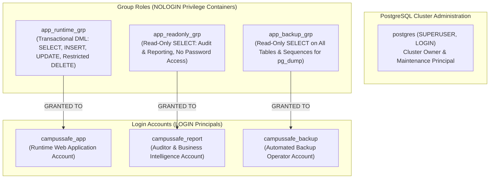

# Activity 5: Database Access Control & Security Review
## CampusSafe: Campus Hazard & Safety Reporting System

**Course:** COMP 018 — Database Administration  
**Group:** Group 7  
**Database Name:** `grp07_campussafedb`  
**Schema:** `public`  
**Evaluation Date:** November 17, 2026  
**Documented DBMS:** PostgreSQL 14+ (Verified Environment: PostgreSQL 14.24)  
**Host Runtime DBMS:** PostgreSQL 18.6 on x86_64-windows, compiled by msvc-19.44.35228, 64-bit  
**Evaluator:** Senior Database Security Specialist & RBAC Auditor (Group 7 DBA Team)  

---

## 1. Executive Summary & Purpose

This document provides a thorough audit of the **Activity 4 Access Control Architecture** implemented in CampusSafe (`database/03_roles_and_privileges.sql`). The review assesses whether the database enforces the **Principle of Least Privilege (PoLP)**, verifies the separation between database-level accounts and application-level human roles, checks table and sequence grants, inspects password protection boundaries, and documents the vital security boundary governing PostgreSQL maintenance commands (`VACUUM` and `ANALYZE`).

---

## 2. PostgreSQL Role Architecture & Membership Hierarchy

CampusSafe implements a two-tier Role-Based Access Control (RBAC) architecture separating **non-login group roles** (privilege containers) from **login accounts** (principals):



### 2.1 Cluster Roles Verification (`pg_roles`)

```text
     role_name     | can_login | is_superuser | inherits_privileges | can_create_roles | can_create_db | max_connections 
-------------------+-----------+--------------+---------------------+------------------+---------------+-----------------
 app_backup_grp    | f         | f            | t                   | f                | f             |              -1
 app_readonly_grp  | f         | f            | t                   | f                | f             |              -1
 app_runtime_grp   | f         | f            | t                   | f                | f             |              -1
 campussafe_app    | t         | f            | t                   | f                | f             |              -1
 campussafe_backup | t         | f            | t                   | f                | f             |              -1
 campussafe_report | t         | f            | t                   | f                | f             |              -1
 postgres          | t         | t            | t                   | t                | t             |              -1
(7 rows)
```

### 2.2 Role Inheritance & Group Membership (`pg_auth_members`)

```text
   member_account   | inherited_group_role | admin_option 
-------------------+----------------------+--------------
 campussafe_app    | app_runtime_grp      | f
 campussafe_backup | app_backup_grp       | f
 campussafe_report | app_readonly_grp     | f
(3 rows)
```

- **Inheritance (`INHERIT = TRUE`):** Login accounts automatically inherit the bundled privileges of their respective group role without requiring explicit `SET ROLE` switching.
- **Admin Option (`ADMIN OPTION = FALSE`):** Login accounts cannot grant their inherited group roles to third-party accounts, preventing privilege escalation.

---

## 3. Application Human Roles vs. PostgreSQL Database Accounts

A fundamental database administration principle is maintaining a clear distinction between **database login accounts** and **application-level human users**:

| Architectural Layer | Role Name | Managing Authority | Authentication Mechanism | Responsibility & Scope |
|---|---|---|---|---|
| **Database Engine Layer** | `campussafe_app` | PostgreSQL DBMS (`pg_authid`) | SCRAM-SHA-256 via PHP PDO (`Database.php`) | Connects the PHP backend to `grp07_campussafedb`; executes prepared SQL statements. |
| **Database Engine Layer** | `campussafe_report`| PostgreSQL DBMS (`pg_authid`) | SCRAM-SHA-256 via analytical tools / psql | External auditor connection for read-only reporting and data inspection. |
| **Database Engine Layer** | `campussafe_backup`| PostgreSQL DBMS (`pg_authid`) | SCRAM-SHA-256 via `pg_dump` automation | Dumps full database schema and data into custom format archive (`.dump`). |
| **Application Layer** | `Student` (1) | CampusSafe PHP Session (`Auth.php`)| Bcrypt password verification in `app_user` | Files hazard reports; views personal report history. |
| **Application Layer** | `Faculty/Staff` (2)| CampusSafe PHP Session (`Auth.php`)| Bcrypt password verification in `app_user` | Files hazard reports; views personal report history. |
| **Application Layer** | `Maintenance` (3) | CampusSafe PHP Session (`Auth.php`)| Bcrypt password verification in `app_user` | Views assigned work orders; logs repairs; marks incidents resolved. |
| **Application Layer** | `Administrator` (4)| CampusSafe PHP Session (`Auth.php`)| Bcrypt password verification in `app_user` | Verifies reports; sets priority; assigns technicians; manages master catalogs. |
| **Application Layer** | `Auditor` (5) | CampusSafe PHP Session (`Auth.php`)| Bcrypt password verification in `app_user` | Read-only access to compliance reports, metrics, and incident history. |

*DBA Insight:* Human users do **not** possess individual PostgreSQL login accounts. All 5 application roles interact with the database through a single pooled connection authenticated as `campussafe_app`. Application logic enforces fine-grained authorization rules based on `$_SESSION['user']['role_id']`.

---

## 4. Table Privilege Matrix & Least-Privilege Verification

The table privilege matrix recorded from `information_schema.role_table_grants` demonstrates rigorous adherence to least privilege:

| Target Table | `app_runtime_grp` (`campussafe_app`) | `app_readonly_grp` (`campussafe_report`) | `app_backup_grp` (`campussafe_backup`) | Security & Least-Privilege Safeguard |
|---|---|---|---|---|
| **`role`** | `SELECT` | **NONE (REVOKED)** | `SELECT` | Auditor cannot read role catalog or correlate internal role mappings. |
| **`app_user`** | `SELECT`, `INSERT`, `UPDATE` | **NONE (REVOKED)** | `SELECT` | **Critical Security Boundary:** Auditor is strictly blocked from `app_user`, preventing exposure of Bcrypt `password_hash` values. |
| **`hazard_category`** | `SELECT`, `INSERT`, `UPDATE` | `SELECT` | `SELECT` | Read-only for reporting; runtime allows admin CRUD. |
| **`campus_location`** | `SELECT`, `INSERT`, `UPDATE` | `SELECT` | `SELECT` | Read-only for reporting; runtime allows admin CRUD. |
| **`hazard_report`** | `SELECT`, `INSERT`, `UPDATE` | `SELECT` | `SELECT` | **`DELETE` is strictly revoked** from runtime account to prevent deletion of incident records. |
| **`assignment`** | `SELECT`, `INSERT`, `UPDATE`, **`DELETE`** | `SELECT` | `SELECT` | Runtime allows `DELETE` exclusively for reassignment workflows. |
| **`report_status_history`** | `SELECT`, `INSERT` | `SELECT` | `SELECT` | **Immutable Audit Log:** `UPDATE` and `DELETE` are completely revoked from all accounts. |
| **`maintenance_action`** | `SELECT`, `INSERT` | `SELECT` | `SELECT` | **Immutable Work Log:** `UPDATE` and `DELETE` are revoked; technician repairs cannot be altered. |
| **`attachment`** | `SELECT`, `INSERT`, **`DELETE`** | `SELECT` | `SELECT` | Runtime allows `DELETE` for removing invalid uploaded files. |

### 4.1 Key Security Safeguards Confirmed

1. **Deletion Immutability on Core Incidents:** `DELETE` is completely revoked on `hazard_report`, `report_status_history`, `maintenance_action`, and `app_user`. An attacker compromising `campussafe_app` cannot wipe incident history or erase audit logs.
2. **Credential Shielding:** `app_readonly_grp` holds zero table privileges on `app_user`. Auditors and external reporting processes cannot read user records, safeguarding institutional emails and password hashes.
3. **Public Lockdown:** Privileges on database `grp07_campussafedb` and schema `public` were explicitly revoked from role `PUBLIC`:
   ```sql
   REVOKE ALL ON DATABASE grp07_campussafedb FROM PUBLIC;
   REVOKE CREATE ON SCHEMA public FROM PUBLIC;
   ```
   This ensures unauthenticated or newly created PostgreSQL roles cannot access CampusSafe objects.

---

## 5. Serial Sequence Permissions

Surrogate key sequences in `public` require explicit usage permissions for transactional insert operations:

```text
            sequence_name             | app_usage | app_select | report_usage | backup_select 
--------------------------------------+-----------+------------+--------------+---------------
 app_user_user_id_seq                 | t         | t          | f            | t
 assignment_assignment_id_seq         | t         | t          | f            | t
 attachment_attachment_id_seq         | t         | t          | f            | t
 campus_location_location_id_seq      | t         | t          | f            | t
 hazard_category_category_id_seq      | t         | t          | f            | t
 hazard_report_report_id_seq          | t         | t          | f            | t
 maintenance_action_action_id_seq     | t         | t          | f            | t
 report_status_history_history_id_seq | t         | t          | f            | t
 role_role_id_seq                     | t         | t          | f            | t
(9 rows)
```

- `app_runtime_grp` holds `USAGE` and `SELECT` across all 9 sequences, allowing `nextval()` calls during `INSERT ... RETURNING` statements.
- `app_readonly_grp` holds zero sequence privileges (`USAGE = FALSE`), preventing auditors from advancing sequence counters.
- `app_backup_grp` holds `SELECT` on all sequences, enabling `pg_dump` to record the sequence state for accurate database restoration.

---

## 6. Maintenance Privilege Boundary & Operational Security

### 6.1 The PostgreSQL Maintenance Permission Requirement

Under PostgreSQL 14+, routine database maintenance commands (`VACUUM` and `ANALYZE`) have strict authorization requirements:
- To run `VACUUM` or `ANALYZE` on a table, the executing session must:
  1. Be the **table owner** (`relowner`), OR
  2. Be a PostgreSQL **superuser** (`postgres`), OR
  3. Be granted the pre-defined PostgreSQL administrative role `pg_maintain` (introduced in PostgreSQL 16+).

### 6.2 Ownership Audit

```sql
SELECT 
    c.relname AS table_name,
    r.rolname AS table_owner,
    pg_has_role('campussafe_app', c.relowner, 'USAGE') AS app_is_owner
FROM pg_class c
JOIN pg_roles r ON r.oid = c.relowner
WHERE nspname = 'public' AND c.relkind = 'r';
```

- **Actual Table Owner:** `postgres` owns all 9 tables.
- **Application Role Status:** `campussafe_app` is **not** the table owner (`app_is_owner = FALSE`).

### 6.3 Security Implications & DBA Recommendation

1. **Why `campussafe_app` Must NOT Own Tables:**
   - Table ownership in PostgreSQL carries full DDL authority, including `ALTER TABLE`, `DROP TABLE`, `TRUNCATE TABLE`, and `GRANT/REVOKE`.
   - If `campussafe_app` were granted table ownership solely to run `VACUUM`, a SQL injection vulnerability in the PHP application would give an attacker full capability to drop tables or disable foreign key constraints.
2. **Proper Maintenance Operating Procedure:**
   - Routine maintenance must **never** be delegated to application runtime accounts.
   - Maintenance must be handled through two authorized channels:
     - **Automated Autovacuum:** PostgreSQL internal autovacuum daemon runs with superuser privileges and automatically vacuums tables when dead tuple thresholds are reached.
     - **Scheduled Administrative Maintenance:** Periodic DBA maintenance jobs executed via `postgres` or an authorized DBA account during scheduled off-peak maintenance windows.

---

## 7. Conclusion

The access control review confirms that CampusSafe exhibits exemplary database security:
- Strong group/login role separation
- Explicit least-privilege DML restrictions
- Password hash shielding
- Appropriate isolation of maintenance permissions from application runtime credentials
