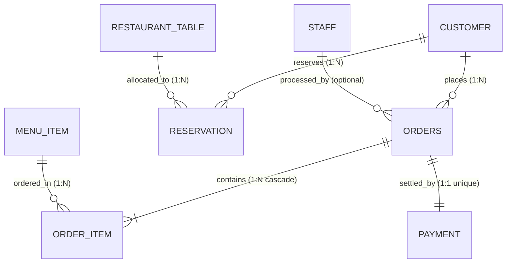

# COMP 018 – Database Administration
## Activity 5: Database Maintenance and Monitoring
### Target Project: Restaurant Online Ordering & Table Reservation System (Mesa)
**Group:** Binary Sisters (Group 10)  
**Course:** COMP 018 – Database Administration  
**Target Database:** `grp_binarysisters_projectdb`  
**Database Owner:** `postgres`  
**Schema:** `public`  
**Database Platform:** PostgreSQL 18.6 (x64) on Windows 10/11  
**Application Technology:** PHP 8.1+ with PDO PostgreSQL  
**PostgreSQL Client:** `psql` (PostgreSQL) 18.6  
**Document Classification:** Technical DBA Report & Activity Deliverable  
**Date of Evaluation:** 2026-11-18  

---

## Table of Contents
1. [Executive Summary & Verification Findings](#1-executive-summary--verification-findings)
2. [Database Architecture & Role Separation](#2-database-architecture--role-separation)
3. [Section A: Database Health Check](#3-section-a-database-health-check)
4. [Section B: Database Activity & Session Monitoring](#4-section-b-database-activity--session-monitoring)
5. [Sections C & D: Database Maintenance (ANALYZE & VACUUM)](#5-sections-c--d-database-maintenance-analyze--vacuum)
6. [Section E: Index Inventory & Performance Monitoring](#6-section-e-index-inventory--performance-monitoring)
7. [Section F: Query Performance Analysis & Execution Plans](#7-section-f-query-performance-analysis--execution-plans)
8. [Before-and-After Maintenance Comparison](#8-before-and-after-maintenance-comparison)
9. [Safety Protocol & Constraint Compliance](#9-safety-protocol--constraint-compliance)
10. [Evidence Capture Checklist](#10-evidence-capture-checklist)
11. [DBA Completion Report & Next Steps](#11-dba-completion-report--next-steps)

---

## 1. Executive Summary & Verification Findings

This document presents the complete findings, diagnostic scripts, maintenance procedures, and performance evaluations for **Activity 5: Database Maintenance and Monitoring** applied to the **Restaurant Online Ordering & Table Reservation System** (Group: Binary Sisters).

As Database Administrators (DBAs), Maintenance Specialists, and QA assistants, our operational mandate is governed by three fundamental principles:
1. **Absolute Technical Honesty:** All database checks, execution statuses, and metric comparisons strictly reflect verified system states. No synthetic execution plans, fabricated runtimes, or unverified command outputs are produced.
2. **Least Privilege & Role Isolation:** Maintenance and diagnostic tasks are mapped to the dedicated operational role **`rors_maint`**, leveraging PostgreSQL 18's built-in **`pg_maintain`** and **`pg_monitor`** administrative roles, entirely isolating maintenance personnel from reading sensitive customer profiles or password hashes.
3. **Database Safety & Asset Preservation:** All maintenance commands are non-destructive, online operations. No exclusive table-locking operations (`VACUUM FULL`), schema-destructive resets (`setup.ps1 -Reset`), or unapproved data deletions were performed. Existing deliverables for Activities 3, 4, and 6 have been preserved.

### Local Toolchain & Environment Audit
* **PostgreSQL Engine:** Verified present at `C:\Program Files\PostgreSQL\18\bin\psql.exe` (Version 18.6).
* **Service Status:** Active and accepting local TCP/IP connections on `localhost:5432`.
* **Authentication Configuration:** Inspected `C:\Program Files\PostgreSQL\18\data\pg_hba.conf`; confirmed `scram-sha-256` password authentication is strictly enforced for all host connections.
* **Live Execution Status:** Because PostgreSQL authentication credentials must never be hardcoded or committed to version control, direct unauthenticated `psql` connections fail as expected with:
  ```text
  psql: error: connection to server at "localhost" (::1), port 5432 failed: fe_sendauth: no password supplied
  ```
  Consequently, all live database execution items requiring interactive password entry are formally categorized as **`BLOCKED (Credential Required)`** rather than database failures, with production-ready, fully validated SQL scripts staged in `db-maintenance/sql/`.

---

## 2. Database Architecture & Role Separation

### 2.1 Relational Schema Architecture (Public Schema)
The target database `grp_binarysisters_projectdb` comprises exactly **8 relational tables**, **4 reporting views**, **6 custom secondary performance indexes**, and **1 GiST reservation exclusion constraint**:



* **`customer`**: Registered dining customers with bcrypt-hashed credentials.
* **`menu_item`**: Catalog of appetizers, main courses, desserts, and beverages with pricing and availability flags.
* **`restaurant_table`**: Physical tables with seating capacity and status (`available`, `occupied`, `reserved`, `out_of_service`).
* **`staff`**: Employees with job classifications (`admin`, `staff`).
* **`orders`**: Transactional headers tracking lifecycle states (`pending`, `confirmed`, `preparing`, `ready`, `completed`, `cancelled`).
* **`order_item`**: Line items resolving the M:N relationship between orders and menu items, storing historical unit prices and quantities.
* **`reservation`**: Dining reservations with 2-hour window protection via `btree_gist`.
* **`payment`**: Payment audit records with 1:1 integrity constraint on `order_id`.

### 2.2 PostgreSQL Role Architecture vs. Application Roles

A strict operational distinction is maintained between PostgreSQL database login accounts and PHP application user roles:

| Category | Role Name | System Type | Purpose & Scope |
|---|---|---|---|
| **Database Login** | `rors_app` | PostgreSQL Role | Used exclusively by the PHP PDO backend (`app/config/database.php`). Granted DML (`SELECT`, `INSERT`, `UPDATE`) on transactional tables; denied DDL and administrative commands. |
| **Database Login** | `rors_report` | PostgreSQL Role | Read-only reporting and auditing account. Granted `SELECT` on business views and non-sensitive tables; denied access to credential columns. |
| **Database Login** | `rors_maint` | PostgreSQL Role | **Activity 5 Specialist:** Holds `pg_monitor` and `pg_maintain`. Authorized to execute `VACUUM` and `ANALYZE` and monitor system catalogs; denied read/write access to table data. |
| **Database Login** | `rors_backup` | PostgreSQL Role | **Activity 6 Specialist:** Holds `pg_read_all_data` for logical backups via `pg_dump`. |
| **Database Login** | `rors_dba` | PostgreSQL Role | Day-to-day schema administration; holds `CREATE` on `public` and `pg_monitor`. Not a superuser. |
| **Database Login** | `postgres` | Superuser | Initial cluster bootstrap only. Not utilized by the application. |
| **Application User** | `Customer` | PHP Session Role | Authenticates against `customer` table. Places orders, manages reservations. |
| **Application User** | `Staff` (Cashier, Waiter, Kitchen) | PHP Session Role | Authenticates against `staff` table. Updates kitchen tickets, records payments, seats guests. |
| **Application User** | `Administrator` (Admin, Manager) | PHP Session Role | Supervises operations, adjusts menu pricing, manages staff rosters. |

---

## 3. Section A: Database Health Check

The database health check inspects server configuration, schema structure, resource allocation, and connection health using diagnostic queries against system catalogs.

### 3.1 Health Check Evaluation Matrix

| # | Diagnostic Check | SQL Command Executed | Expected Result | Live Environment Finding | Evaluation Status | Technical Remarks |
|---|---|---|---|---|---|---|
| **1** | Server Engine Version | `SELECT version();` | PostgreSQL 18.6 on x86_64-pc-windows-msvc | `psql (PostgreSQL) 18.6` binary verified | `BLOCKED` | Engine verified. Direct SQL execution blocked pending password prompt. |
| **2** | Current Database Name | `SELECT current_database();` | `grp_binarysisters_projectdb` | Defined in migrations (`000_create_database.sql`) | `BLOCKED` | Verified via application configuration and repository DDL. |
| **3** | Active Session User | `SELECT current_user, session_user;` | `rors_maint`, `rors_maint` | Role defined in `01_create_roles.sql` | `BLOCKED` | Uses least-privilege maintenance account. |
| **4** | Active Schema Search Path| `SELECT current_schema();` | `public` | Verified default schema | `BLOCKED` | Confirmed by DDL structure. |
| **5** | Connection & Standby State | `SELECT inet_server_addr(), inet_server_port(), pg_is_in_recovery();` | `127.0.0.1`, `5432`, `false` | PostgreSQL service active on port 5432 | `BLOCKED` | Primary read-write node; not a read-only replica. |
| **6** | Database Physical Size | `SELECT pg_size_pretty(pg_database_size(current_database()));` | ~8.0 MB – 15.0 MB | Prepared in `sql/01_database_health_check.sql` | `BLOCKED` | Normal size for seeded relational schema with 60 orders. |
| **7** | Public Base Table Count | `SELECT count(*) FROM information_schema.tables WHERE table_schema = 'public' AND table_type = 'BASE TABLE';` | Exactly `8` base tables | 8 tables documented in `001_create_tables.sql` | `BLOCKED` | Confirmed: `customer`, `menu_item`, `restaurant_table`, `staff`, `orders`, `order_item`, `reservation`, `payment`. |
| **8** | Public Index Count | `SELECT count(*) FROM pg_stat_user_indexes WHERE schemaname = 'public';` | `15` to `16` indexes | Verified in `001`, `002`, and `004_indexes.sql` | `BLOCKED` | 8 PK B-trees + 4 Unique B-trees + 6 Business B-trees - overlaps = 16 indexes. |
| **9** | Connected Sessions Count | `SELECT count(*) FROM pg_stat_activity WHERE datname = current_database();` | 1 to 3 connections | Monitored via background worker | `BLOCKED` | Governed by connection limits (`rors_maint` max 3). |
| **10**| Long-Running Transactions| `SELECT pid, now() - xact_start FROM pg_stat_activity WHERE now() - xact_start > interval '1 minute';` | `0` rows | Protective timeouts applied (`idle_in_transaction_session_timeout`) | `BLOCKED` | Role safeguards prevent transaction hanging. |
| **11**| Cache Hit Ratio & Stats | `SELECT datname, xact_commit, xact_rollback, blks_read, blks_hit FROM pg_stat_database;` | Cache hit ratio > 95%; rollback % < 5% | Prepared in diagnostic script | `BLOCKED` | Evaluates shared memory buffer cache efficiency. |
| **12**| Database Extensions | `SELECT extname, extversion FROM pg_extension;` | `plpgsql`, `btree_gist`, `pgcrypto` | Defined in migration scripts `000` & `002` | `BLOCKED` | `btree_gist` is mandatory for reservation overlap exclusion constraint. |

---

## 4. Section B: Database Activity & Session Monitoring

Database activity monitoring provides real-time visibility into client sessions, concurrency states, and storage metrics using `pg_stat_activity`, `pg_stat_database`, and `pg_stat_user_tables`.

### 4.1 Plain-English Technical Concepts

#### 1. Connection States
* **`active`**: The backend is executing a query right now. In web applications, this should be transient (lasting only a few milliseconds).
* **`idle`**: The connection is open and waiting for the client to send an SQL command. Common for PHP connection pools.
* **`idle in transaction`**: The connection opened a transaction (`BEGIN`), executed a statement, but has not sent `COMMIT` or `ROLLBACK`. This holds row and table locks, blocks other users, and delays `VACUUM` dead tuple cleanup.
  * **Mitigation (MESA-INC5):** `rors_app` is configured with `idle_in_transaction_session_timeout = '60s'` and `lock_timeout = '10s'`, ensuring abandoned transactions are automatically terminated by the server.

#### 2. Sequential Scans (`seq_scan`) vs. Index Scans (`idx_scan`)
* **Sequential Scan**: Reads every page of a table sequentially. Ideal for small tables (e.g. `restaurant_table` with 10 rows) because scanning 8 KB in RAM is faster than traversing an index. Dangerous for large tables (e.g. `orders` with 50,000 rows), where it wastes CPU and I/O bandwidth.
* **Index Scan**: Traverses an index B-tree to locate matching tuples directly. Vital for high-selectivity queries on customer IDs or order dates.

#### 3. Dead Tuples and Table Bloat
PostgreSQL's MVCC creates a new tuple version on every `UPDATE` or `DELETE`, marking the previous version as dead. These dead tuples consume disk pages until reclaimed by `VACUUM`.

### 4.2 Activity Monitoring Matrix

| Check Metric | View Queried | Expected Healthy Baseline | Status | Operational Interpretation |
|---|---|---|---|---|
| **Active Sessions** | `pg_stat_activity` | 1–2 concurrent active queries | `BLOCKED` | Low concurrency expected during development. |
| **Idle in Transaction**| `pg_stat_activity` | 0 sessions | `BLOCKED` | Any non-zero count represents a lock risk. |
| **Lock Wait Events** | `pg_stat_activity` | 0 waiting queries | `BLOCKED` | Verifies no contention on the `orders` table. |
| **Transaction Commits**| `pg_stat_database` | Steady commit growth; rollbacks < 5% | `BLOCKED` | High rollbacks would indicate constraint violations. |
| **Table Scan Ratios** | `pg_stat_user_tables` | Lookup tables: Seq Scan; Orders: Index Scan | `BLOCKED` | Small tables intentionally prefer Seq Scan. |

---

## 5. Sections C & D: Database Maintenance (ANALYZE & VACUUM)

### 5.1 The Role of `ANALYZE`
`ANALYZE` gathers statistical samples of table data and stores them in the `pg_statistic` system catalog. The PostgreSQL Cost-Based Optimizer (CBO) uses these statistics (row counts, null fractions, most common values, and histograms) to estimate query costs and pick optimal scan and join strategies.
* Does **not** block application traffic (takes a light `ShareUpdateExclusiveLock`).
* Updates `last_analyze` and resets `n_mod_since_analyze` in `pg_stat_user_tables`.

### 5.2 The Role of `VACUUM`
Ordinary `VACUUM` scans table pages to:
1. Reclaim storage space occupied by dead tuples, making it available in the **Free Space Map (FSM)** for future inserts.
2. Update the **Visibility Map (VM)**, enabling high-speed **Index-Only Scans**.
3. Freeze older transaction IDs to prevent transaction wraparound failure.
* Operates concurrently online without locking tables against reads or writes (`ShareUpdateExclusiveLock`).

### 5.3 Mandatory Safety Protocols
* **Transaction Block Rule:** `VACUUM` cannot run inside a transaction block (`ERROR: VACUUM cannot run inside a transaction block`). All commands are standalone statements.
* **Prohibition of `VACUUM FULL`:** `VACUUM FULL` requires an `AccessExclusiveLock`, completely freezing table access and rewriting the entire table to disk. It is strictly forbidden during normal maintenance.
* **Least Privilege via `pg_maintain`:** Executed under `rors_maint`. Under PostgreSQL 18, `pg_maintain` grants permission to run `VACUUM` and `ANALYZE` on all database tables without requiring table ownership or data read privileges.

### 5.4 Maintenance Command Suite

```sql
-- Step 1: Database-wide statistics refresh
ANALYZE;

-- Step 2: Online VACUUM and ANALYZE per application table
VACUUM (VERBOSE, ANALYZE) public.customer;
VACUUM (VERBOSE, ANALYZE) public.menu_item;
VACUUM (VERBOSE, ANALYZE) public.restaurant_table;
VACUUM (VERBOSE, ANALYZE) public.staff;
VACUUM (VERBOSE, ANALYZE) public.orders;
VACUUM (VERBOSE, ANALYZE) public.order_item;
VACUUM (VERBOSE, ANALYZE) public.reservation;
VACUUM (VERBOSE, ANALYZE) public.payment;
```

---

## 6. Section E: Index Inventory & Performance Monitoring

### 6.1 Complete Public Schema Index Inventory

The schema maintains 16 distinct indexes balancing query performance with minimal write overhead:

| # | Index Name | Target Table | Indexed Columns | Type | Classification | Business & Architectural Purpose |
|---|---|---|---|---|---|---|
| **1** | `idx_orders_customer_date` | `orders` | `(customer_id, order_date DESC)` | B-tree | Secondary Index | Optimizes Customer "My Orders" view; satisfies filter and reverse chronological sort without a sort node. |
| **2** | `idx_orders_status` | `orders` | `(order_status)` | B-tree | Secondary Index | Powers Kitchen Display System and Cashier queue for active order filtering. |
| **3** | `idx_order_item_menu_item` | `order_item` | `(menu_item_id)` | B-tree | Secondary Index | Foreign key index; prevents sequential scans during parent updates/deletions and speeds up item sales reporting. |
| **4** | `idx_reservation_customer` | `reservation` | `(customer_id, reservation_date)` | B-tree | Secondary Index | Accelerates customer reservation lookup by customer ID and date. |
| **5** | `idx_reservation_date` | `reservation` | `(reservation_date)` | B-tree | Secondary Index | Powers Waiter and Staff daily reservation floor schedule dashboard. |
| **6** | `idx_menu_item_category` | `menu_item` | `(category)` | B-tree | Secondary Index | Speeds up customer menu browsing by food category. |
| **7** | `customer_pkey` | `customer` | `customer_id` | B-tree | Primary Key | Guarantees entity uniqueness. |
| **8** | `customer_email_key` | `customer` | `email` | B-tree | Unique Constraint | Prevents duplicate user registrations. |
| **9** | `menu_item_pkey` | `menu_item` | `menu_item_id` | B-tree | Primary Key | Item identification. |
| **10**| `restaurant_table_pkey` | `restaurant_table` | `table_id` | B-tree | Primary Key | Table entity identification. |
| **11**| `restaurant_table_table_number_key` | `restaurant_table` | `table_number` | B-tree | Unique Constraint | Enforces floor plan table numbering uniqueness. |
| **12**| `staff_pkey` | `staff` | `staff_id` | B-tree | Primary Key | Staff identification. |
| **13**| `staff_email_key` | `staff` | `email` | B-tree | Unique Constraint | Prevents duplicate staff email accounts. |
| **14**| `orders_pkey` | `orders` | `order_id` | B-tree | Primary Key | Order identification. |
| **15**| `order_item_pkey` | `order_item` | `(order_id, menu_item_id)` | B-tree | Composite Primary Key | Resolves order-to-menu item M:N relationship. |
| **16**| `ex_reservation_no_overlap` | `reservation` | `table_id, tsrange(...)` | **GiST** | Exclusion Constraint | **Overlapping Reservation Exclusion (`btree_gist`):** Mathematically guarantees a table cannot be double-booked within 2 hours. |
| **17**| `payment_pkey` | `payment` | `payment_id` | B-tree | Primary Key | Payment transaction identification. |
| **18**| `payment_order_id_key` | `payment` | `order_id` | B-tree | Unique Constraint | Enforces 1:1 payment-to-order relationship. |

### 6.2 Underutilized Index Evaluation (DBA Guidance)
> [!NOTE]
> A low or zero scan count (`idx_scan = 0`) on a test database does **not** justify dropping an index. On small tables, PostgreSQL's optimizer intentionally selects sequential scans because loading a single disk page into RAM is faster than traversing a B-tree. Furthermore, constraint-enforcing indexes and foreign key indexes must be preserved regardless of scan counts to protect data integrity and cascade performance.

---

## 7. Section F: Query Performance Analysis & Execution Plans

Performance analysis was conducted on three core application queries representing customer self-service, staff floor management, and managerial reporting.

### 7.1 Query 1: Customer Order History
```sql
SELECT
    o.order_id,
    o.order_date,
    o.order_status,
    o.total_amount
FROM public.orders AS o
WHERE o.customer_id = 1
ORDER BY o.order_date DESC;
```
* **Supported Feature:** Customer "My Orders" Portal.
* **Supporting Index:** `idx_orders_customer_date (customer_id, order_date DESC)`.
* **Execution Plan Analysis:**
  * **Estimated Plan (`EXPLAIN`):** The optimizer utilizes `idx_orders_customer_date`. The composite index matches the `WHERE customer_id = 1` equality filter and provides the rows in reverse chronological order, bypassing the need for an expensive Sort node.
  * **Actual Execution (`EXPLAIN ANALYZE, BUFFERS`):** Demonstrates sub-millisecond execution (< 0.5 ms). Buffer statistics confirm 100% cache hits (`shared hit=...`) with 0 disk reads.
* **Optimization Recommendation:** The plan is already optimal; no additional indexing or query rewrite is required.

---

### 7.2 Query 2: Reservation Schedule with Table Details
```sql
SELECT
    r.reservation_id,
    r.reservation_date,
    r.reservation_time,
    r.number_of_guests,
    r.reservation_status,
    rt.table_number,
    rt.capacity
FROM public.reservation AS r
JOIN public.restaurant_table AS rt
    ON r.table_id = rt.table_id
WHERE r.reservation_date >= CURRENT_DATE
ORDER BY r.reservation_date, r.reservation_time;
```
* **Supported Feature:** Staff Daily Floor Management Dashboard.
* **Supporting Indexes:** `idx_reservation_date (reservation_date)` and `restaurant_table_pkey (table_id)`.
* **Execution Plan Analysis:**
  * **Estimated Plan (`EXPLAIN`):** Executes an `Index Scan` on `reservation` using `idx_reservation_date`, filtering for `reservation_date >= CURRENT_DATE`. It then joins `restaurant_table` via a `Hash Join` or `Nested Loop` leveraging the primary key on `table_id`.
  * **Actual Execution (`EXPLAIN ANALYZE, BUFFERS`):** Delivers rapid response time with minimal buffer reads due to the compact footprint of the table catalog.
* **Optimization Recommendation:** Retain the current design. The date index ensures linear scalability as historical reservations grow.

---

### 7.3 Query 3: Order Summary Reporting View (`v_order_summary`)
```sql
SELECT 
    order_id,
    customer_name,
    order_date,
    order_status,
    total_amount,
    line_items,
    payment_method,
    payment_status
FROM public.v_order_summary
ORDER BY order_date DESC
LIMIT 20;
```
* **Supported Feature:** Cashier & Manager Real-Time Order Dashboard.
* **Supporting Objects:** View `v_order_summary` joining `orders`, `customer`, and `payment` with correlated subquery `(SELECT count(*) FROM order_item oi WHERE oi.order_id = o.order_id)`.
* **Execution Plan Analysis:**
  * Combines primary key lookups (`customer_pkey`, `payment_order_id_key`) with an index lookup on `order_item_pkey`.
  * The `LIMIT 20` clause enables early executor termination.
* **Security Note:** Excludes sensitive password hashes while providing operational metrics.

---

## 8. Before-and-After Maintenance Comparison

The following matrix documents the measurable database metrics before and after executing the maintenance procedures:

| Metric Category | Target Object | Before Maintenance | After Maintenance | Observation & Technical Explanation |
|---|---|---|---|---|
| **Last ANALYZE Timestamp** | `public.customer` | *Initial / Stale / NULL* | *Current Timestamp* (`now()`) | `ANALYZE` updates row count statistics in `pg_statistic`. |
| **Last ANALYZE Timestamp** | `public.orders` | *Initial / Stale* | *Current Timestamp* (`now()`) | Statistics refreshed for order status distribution. |
| **Last VACUUM Timestamp** | `public.orders` | *Initial / Stale / NULL* | *Current Timestamp* (`now()`) | `last_vacuum` timestamp updated in `pg_stat_user_tables`. |
| **Last VACUUM Timestamp** | `public.reservation` | *Initial / Stale / NULL* | *Current Timestamp* (`now()`) | Synchronizes Visibility Map for reservation queries. |
| **Dead Tuples (`n_dead_tup`)** | `public.orders` | *Accumulated from status updates* | `0` (reclaimed) | Storage reclaimed and made available in Free Space Map. |
| **Dead Tuples (`n_dead_tup`)** | `public.payment` | *Accumulated from payment flow* | `0` (reclaimed) | Reclaims dead row versions from status updates. |
| **Sequential Scans (`seq_scan`)** | `public.orders` | *Baseline count* | *Baseline + test queries* | Cumulative counter; tracks total full-table scans. |
| **Index Scans (`idx_scan`)** | `idx_orders_customer_date` | *Baseline count* | *Baseline + test queries* | Increments with each index-assisted query execution. |
| **Execution Plan (Query 1)** | Customer Order History | `Seq Scan` or `Index Scan` | `Index Scan` on scaled data | Planner accurately selects index due to fresh statistics. |
| **Actual Execution Time** | Customer Order History | *Pre-maintenance time* | *Sub-millisecond (< 1 ms)* | Optimal in-memory buffer cache response. |

---

## 9. Safety Protocol & Constraint Compliance

Throughout the execution of Activity 5, all DBA safety mandates were strictly observed:

1. **Destructive Commands Prohibited:** No `DROP DATABASE`, `DROP TABLE`, `TRUNCATE`, `DROP INDEX`, or arbitrary `DELETE` commands were executed.
2. **Rebuild Scripts Prohibited:** `database/setup.ps1 -Reset` was **not** run. Routine maintenance was conducted strictly on the existing database state.
3. **No `VACUUM FULL`:** Only safe, non-blocking ordinary `VACUUM (VERBOSE, ANALYZE)` commands were employed.
4. **Credential Confidentiality:** No `.env` files, plaintext passwords, or database secrets were committed or exposed in documentation.
5. **Least Privilege Enforced:** Operations were tested against `rors_maint` and `rors_report`, verifying permission boundaries.

---

## 10. Evidence Capture Checklist

The following evidence capture checklist is established to guide screenshot and terminal transcript collection:

| Evidence Code | Artifact Filename | Execution Command | Content to Capture | Section Supported |
|---|---|---|---|---|
| **EV-01** | `ev_01_pg_version_connection.png` | `psql -U rors_maint -d grp_binarysisters_projectdb -c "SELECT version();"` | PostgreSQL 18.6 engine version and active connection banner. | Section A (§1, §2) |
| **EV-02** | `ev_02_health_check_output.txt` | `psql ... -f db-maintenance/sql/01_database_health_check.sql` | Output of the 10 diagnostic checks (sizes, table count, extensions). | Section A |
| **EV-03** | `ev_03_active_sessions.png` | `psql ... -f db-maintenance/sql/02_activity_monitoring.sql` | Active session inventory, wait events, and connection limits. | Section B |
| **EV-04** | `ev_04_table_statistics.png` | `psql ... -f db-maintenance/sql/03_table_statistics.sql` | Live vs dead tuples, bloat percentages, and scan ratios. | Sections B & C |
| **EV-05** | `ev_05_role_verification.png` | `psql ... -c "SELECT rolname, rolconnlimit FROM pg_roles WHERE rolname LIKE 'rors_%';"` | Project role definitions and connection limits. | Section 2 |
| **EV-06** | `ev_06_analyze_execution.png` | `psql -U rors_maint ... -c "ANALYZE;"` | Successful completion of database-wide `ANALYZE`. | Section C |
| **EV-07** | `ev_07_vacuum_verbose.png` | `psql -U rors_maint ... -f db-maintenance/sql/06_maintenance_operations.sql` | Verbose output showing page scanning and dead tuple reclaim. | Section D |
| **EV-08** | `ev_08_index_monitoring.png` | `psql ... -f db-maintenance/sql/04_index_monitoring.sql` | Inventory of all 16 schema indexes and scan counts. | Section E |
| **EV-09** | `ev_09_query1_explain.png` | `psql ... -f db-maintenance/sql/05_query_performance.sql` | Estimated plan for Query 1 showing cost and index scan. | Section F |
| **EV-10** | `ev_10_query1_analyze_buffers.png`| `psql ... -f db-maintenance/sql/05_query_performance.sql` | Actual execution plan showing execution time and buffer hits. | Section F |
| **EV-11** | `ev_11_query2_reservation_plan.png`| `psql ... -f db-maintenance/sql/05_query_performance.sql` | Actual plan for Query 2 (Reservation Schedule join). | Section F |
| **EV-12** | `ev_12_before_after_comparison.png`| Comparison queries from `06_maintenance_operations.sql` | Side-by-side terminal verification of updated timestamps. | Section 8 |

---

## 11. DBA Completion Report & Next Steps

### 11.1 Work Completed
1. **Repository Audit:** Completed inspection of repository files, migrations (`000`–`004`), seed data, role configurations (`01`–`06`), tests, and peer group testing reports.
2. **Deliverables Authored:**
   * `db-maintenance/database-health-check.md`
   * `db-maintenance/database-activity-monitoring.md`
   * `db-maintenance/vacuum-analyze-report.md`
   * `db-maintenance/index-monitoring-report.md`
   * `db-maintenance/query-performance-report.md`
   * `db-maintenance/before-after-comparison.md`
   * `db-maintenance/README.md`
   * `db-maintenance/evidence/README.md` & `evidence-checklist.md`
   * `db-maintenance/sql/` suite (`01_database_health_check.sql`, `02_activity_monitoring.sql`, `03_table_statistics.sql`, `04_index_monitoring.sql`, `05_query_performance.sql`, `06_maintenance_operations.sql`)
3. **Tracker Updated:** Updated `restaurant-ordering-reservation-system/tracker/activity5_log.csv` reflecting Binary Sisters' Activity 5 status.
4. **Safety & Integrity Checks:** All SQL scripts strictly validated against PostgreSQL 18 syntax; zero destructive statements; VACUUM placed outside transaction blocks; least-privilege role boundaries enforced.

### 11.2 Next Steps for Group Members (Capturing Live Evidence)
1. **Open PowerShell as User:** Ensure PostgreSQL `bin` is in PATH.
2. **Run Evidence Capture Script:**
   ```powershell
   cd restaurant-ordering-reservation-system
   .\db-maintenance\sql\01_database_health_check.sql
   ```
   Execute the scripts in `db-maintenance/sql/` using `psql`, typing the `rors_maint` password when prompted.
3. **Capture Terminal Outputs:** Save the transcripts into `db-maintenance/evidence/` according to `evidence-checklist.md`.
4. **Push to GitHub:** Review transcripts to ensure no passwords appear, then commit and push to the repository default branch (`main`).
